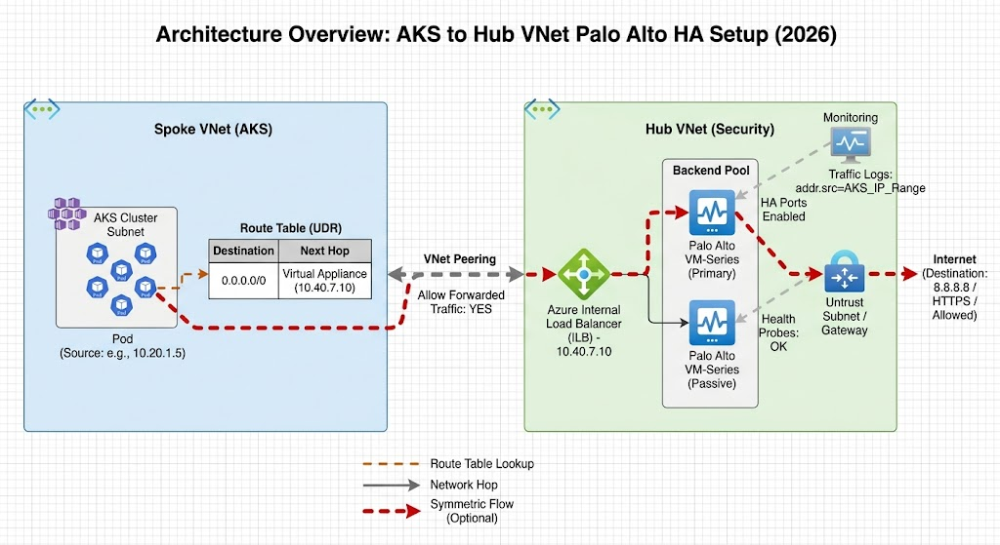
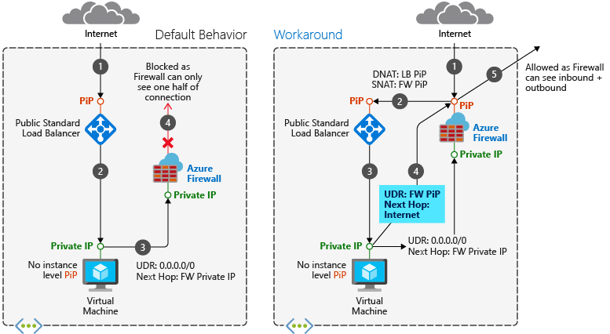
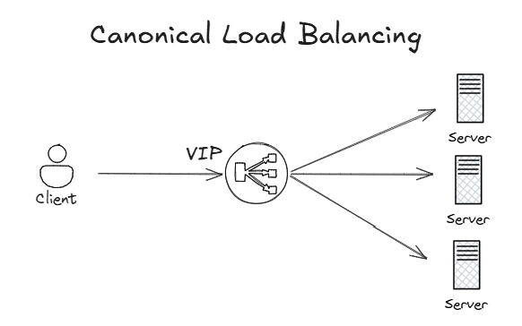
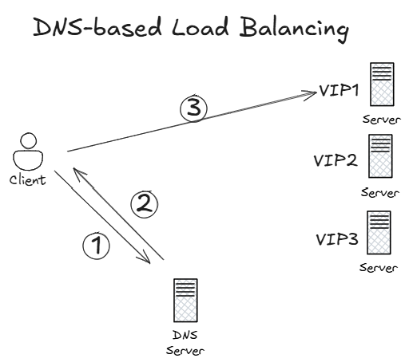
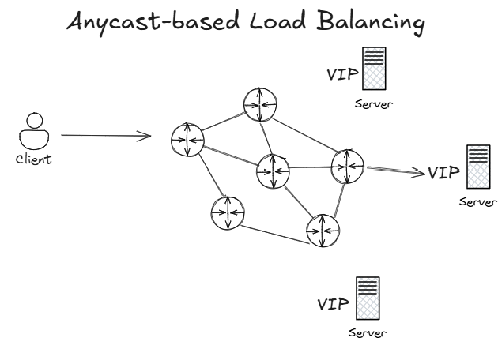
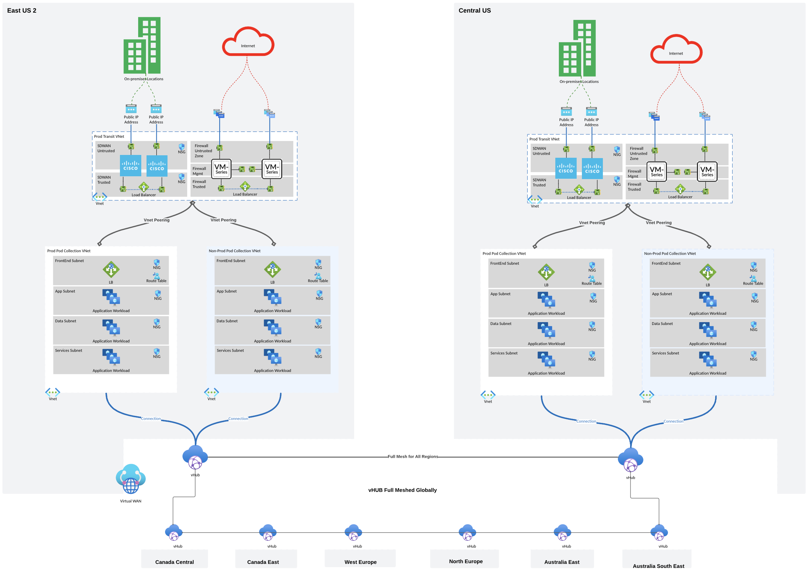
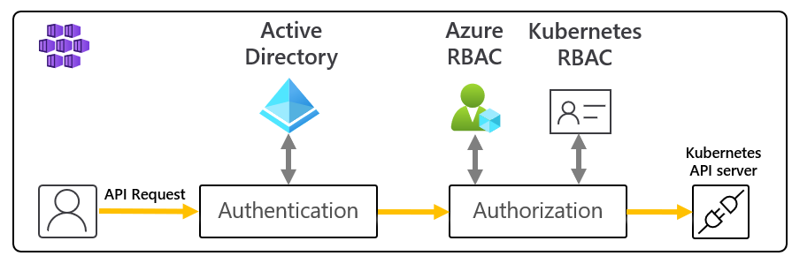
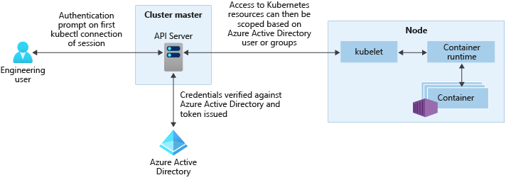
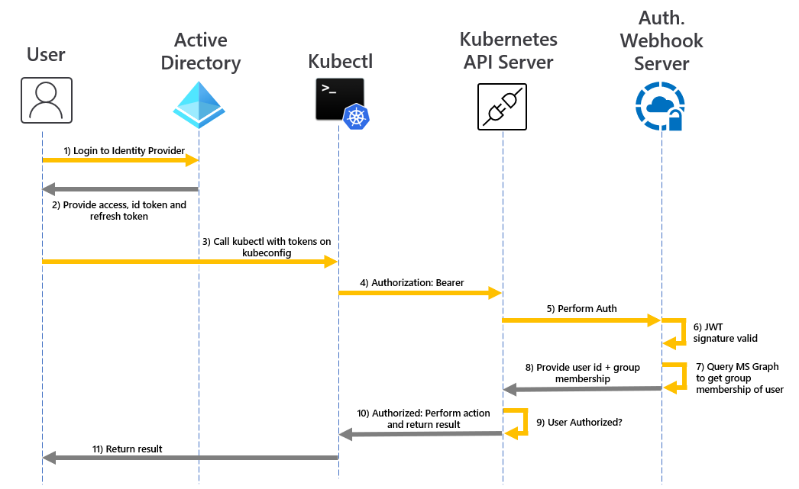

# Azure

Notes on Azure resource organisation, networking (VNets, peering, hub and spoke, load balancers, Private Link), App Service, workload identity and AKS.

---

## 1. Resource hierarchy

```sh
Microsoft Entra ID (Azure AD) Tenant
  └── Management Groups (optional, nestable up to 6 levels)
        └── Subscriptions
              └── Resource Groups
                    └── Resources (VMs, Storage, DBs, etc.)
```

### Subscriptions

- The billing boundary and a trust boundary for Azure AD.
- Each subscription is linked to exactly one tenant.
- Resource limits (quotas) are scoped per subscription.
- Common pattern: separate subscriptions for Dev, Staging, Prod.

### Resource Groups

- A logical container for resources that share the same lifecycle.
- Every resource must live in exactly one resource group.
- Deleting a resource group deletes everything inside it.
- Resource groups have a location (where metadata is stored), but resources inside can be in different regions

### Resources

- The actual services: VMs, VNets, Storage Accounts, Databases, etc.
- Each resource has a unique Resource ID:
`/subscriptions/{sub-id}/resourceGroups/{rg-name}/providers/{provider}/{type}/{name}`

#### Parent-Child (Containment)

Some resources are sub-resources of others. They can't exist independently:

| Parent | Child |
|---|---|
| Virtual Network (VNet) | Subnet |
| Storage Account | Blob Container, File Share, Queue |
| SQL Server | SQL Database |
| Key Vault | Secret, Key, Certificate |

An App Service Plan and its web apps are **not** parent and child. A web app (`Microsoft.Web/sites`) is a top-level resource that points at its plan through `serverFarmId`, so it's a reference link (below).

#### Reference Links (Cross-Resource Dependencies)

Resources reference each other by ID:
- A NIC references a Subnet (which references a VNet)
- A VM references a NIC, a Disk, and optionally an Availability Set
- A Private Endpoint references a target resource (e.g., Storage Account)

```sh
VM ──→ NIC ──→ Subnet ──→ VNet
 └──→ OS Disk
 └──→ Availability Set
```

A NIC must be connected to a Subnet so the VM gets an IP address and can communicate on the network. The Subnet must be part of a VNet, which provides the overall network infrastructure. The VM also needs an OS Disk to boot.

### Resource providers

Every resource type belongs to a provider namespace:
- Microsoft.Compute → VMs, Disks, Scale Sets
- Microsoft.Network → VNets, NICs, Load Balancers
- Microsoft.Storage → Storage Accounts

Providers must be registered on a subscription before use.

The full list of providers is in §6.

---

## 2. Networking

### Building blocks

| Concept | Purpose |
|---|---|
| VNet Peering | Connects two VNets (even cross-subscription/region) |
| Private Endpoint | Private IP for a PaaS service inside your VNet |
| Service Endpoint | Optimized route from Subnet → PaaS over Azure backbone |
| NSG (Network Security Group) | Firewall rules, attached to Subnet or NIC |
| Route Table (UDR) | Custom routing, attached to a Subnet |
| VNet Gateway | Connects VNet to on-premises (VPN/ExpressRoute) |

A typical three-tier VNet:

```sh
VNet: 10.0.0.0/16
  ├── Subnet-Web:  10.0.1.0/24  (NSG: allow HTTP/HTTPS only)
  ├── Subnet-App:  10.0.2.0/24  (NSG: allow traffic from Web only)
  └── Subnet-DB:   10.0.3.0/24  (NSG: allow traffic from App only)
```

### NSG and UDR compared with Linux

| Azure | Linux | Purpose |
|---|---|---|
| NSG | iptables (filter table) / nftables | Allow/deny traffic |
| UDR | route table (ip route) | Where to send traffic |

```sh
$ ip route
default via 192.168.1.1 dev eth0          # internet → go to gateway
10.244.0.0/24 via 10.0.1.5 dev eth0       # pod CIDR → go to node-1
10.244.1.0/24 via 10.0.1.6 dev eth0       # pod CIDR → go to node-2
172.17.0.0/16 dev docker0                  # docker → go to bridge
```

```sh
Packet arrives at eth0
    │
    ▼
1. iptables PREROUTING (nat table — DNAT)
    │
    ▼
2. ROUTING DECISION (ip route)          ← "where does it go?" (= UDR)
    │           │
    │       Is it for me?
    │      /          \
    │   Yes            No (forwarding)
    │    │              │
    ▼    ▼              ▼
3. iptables INPUT    iptables FORWARD   ← "is it allowed?" (= NSG)
    │                   │
    ▼                   ▼
4. Local process     iptables POSTROUTING (nat table — SNAT)
                        │
                        ▼
                     Out via eth0
```

### VNet peering

- Connects two VNets, allowing resources in both to communicate privately.
- Can be within the same subscription or across subscriptions/regions.
- Peering is non-transitive: if VNet A is peered with B, and B is peered with C, A cannot communicate with C through B.

VNet Peering is the mechanism that connects two virtual networks (VNets) in Azure so they can communicate with each other. It allows VNets to communicate privately (without traversing the public internet) over Azure's backbone.

#### Regional VNet Peering

Same Azure region, two VNets connected directly:

```sh
Region: East US
  VNet-A (10.0.0.0/16) ←──── peering ────→ VNet-B (10.1.0.0/16)
```

- Low latency (same region, Microsoft backbone)
- Traffic stays within the region
- Most common type

#### Global VNet Peering

Different Azure regions:

```sh
East US                          West Europe
  VNet-A (10.0.0.0/16) ←──── peering ────→ VNet-B (10.2.0.0/16)
```

- Traffic travels over Microsoft's global backbone (not public internet)
- Higher latency than regional (cross-region by definition)
- Higher cost (cross-region data transfer fees)

A common mistake — peering is not transitive:

```sh
VNet-A ←── peered ──→ VNet-B ←── peered ──→ VNet-C
```

VNet-A cannot reach VNet-C through VNet-B. Peering is point-to-point, not chained.

### Hub and spoke

It's called hub and spoke — named after a wheel. The hub is the central VNet that contains shared services (firewall, VPN gateway, bastion). The spokes are separate VNets for Prod, Staging, and Dev. Each spoke is peered to the hub, allowing them to use the shared services while keeping their workloads isolated from each other.

```text
    ┌── spoke-vnet-1 (app team A)
    │
hub─┼── spoke-vnet-2 (app team B)
    │
    └── spoke-vnet-3 (app team C)
```

Look at a bicycle wheel:

```sh
         [spoke-vnet-1]
              │
              │  ← spoke
              │
[spoke-vnet-2]──── [HUB] ────[spoke-vnet-3]
              │
              │  ← spoke
              │
         [spoke-vnet-4]
```

- The hub is the center — shared services (firewall, DNS, VPN, bastion)
- The spokes are the arms radiating out — workload VNets for each team/app
- Spokes connect to the hub, not to each other directly
- The hub acts as the central transit VNet: if Spoke1 wants to talk to Spoke2, the traffic can be routed via the hub.

```sh
HUB VNet (10.0.0.0/16):
  ├── Azure Firewall          ← all traffic inspected here
  ├── VPN Gateway             ← on-premises connectivity
  ├── ExpressRoute Gateway    ← dedicated circuit to on-prem
  ├── Azure Bastion           ← secure SSH/RDP to VMs
  ├── DNS servers             ← private DNS resolution
  └── Shared services         ← monitoring, log aggregation

SPOKE VNets (10.1.0.0/16, 10.2.0.0/16, ...):
  ├── spoke-prod   (AKS cluster, prod apps)
  ├── spoke-dev    (AKS cluster, dev apps)
  ├── spoke-data   (databases, storage)
  └── spoke-dmz    (public-facing services)
```

#### Hub VNet — 10.0.0.0/16

| Subnet | CIDR | Purpose |
|---|---|---|
| AzureFirewallSubnet | 10.0.1.0/26 | Azure Firewall (required name) |
| GatewaySubnet | 10.0.2.0/27 | VPN/ExpressRoute to office/on-prem |
| AzureBastionSubnet | 10.0.3.0/26 | Bastion for secure VM access (no public RDP/SSH) |
| ManagementSubnet | 10.0.4.0/24 | Jump boxes, monitoring agents |

#### Production Spoke VNet — 10.1.0.0/16

| Subnet | CIDR | Purpose | NSG Rules |
|---|---|---|---|
| snet-agw | 10.1.1.0/24 | Application Gateway (WAF v2) | Allow HTTPS inbound from Front Door only |
| snet-app | 10.1.2.0/24 | AKS / App Services | Allow from AGW only |
| snet-data | 10.1.3.0/24 | Private Endpoints (SQL, Redis, Storage) | Allow from App subnet only |
| snet-integration | 10.1.4.0/24 | Service Bus, Event Hub, Logic Apps | Allow from App subnet |
| snet-pep | 10.1.5.0/24 | Additional Private Endpoints | Locked down |

#### Staging Spoke — 10.2.0.0/16 (mirrors prod, smaller SKUs)

#### Dev Spoke — 10.3.0.0/16 (relaxed NSGs, smaller SKUs)

#### The UDR Connection

This is why UDRs matter in hub and spoke — spokes don't route to each other directly. You force traffic through the hub firewall:

```sh
# UDR on every spoke subnet:
Destination: 0.0.0.0/0
Next hop: 10.0.0.4 (Azure Firewall in hub)

# Even spoke-A to spoke-B:
spoke-A → UDR says "go to firewall" → firewall decides → spoke-B
```

Without the UDR, spoke-A can't reach spoke-B at all. The spokes are only peered with the hub, not with each other, and peering isn't transitive. So the UDR is what makes spoke-to-spoke traffic possible, and it forces that traffic through the firewall.

Spoke-to-hub traffic is different. Peering adds a system route for the hub's address range, and that route is more specific than `0.0.0.0/0`. So traffic from a spoke to hub resources goes straight over the peering, not through the firewall, unless you add a UDR for the hub's prefixes too.

#### Gateway Transit (Hub and Spoke Enabler)

A spoke borrows the hub's VPN/ExpressRoute gateway:

```sh
HUB VNet
  ├── VPN Gateway (connects to on-premises)
  └── peering to spoke (with "allow gateway transit" = ON)

SPOKE VNet
  └── peering to hub (with "use remote gateways" = ON)
         │
         └── spoke can now reach on-premises
             WITHOUT having its own gateway
```

Without this, every spoke would need its own VPN gateway (~$140/mo each). With gateway transit, only the hub needs one.

### Example: AKS egress through Palo Alto firewalls behind an internal load balancer


the IP belongs to a Load Balancer Internal Frontend (which is common for high-availability Palo Alto setups),and the LB is configured to forward traffic to the firewall's private IPs. The firewall then applies its security policies and forwards allowed traffic to the destination (e.g., VMs in the spoke VNets).

- A pod in AKS (Spoke) sends a packet.
- Azure looks at the User-Defined Route (UDR) on the AKS subnet. It sees 0.0.0.0/0 -> Next Hop 10.40.7.10
- Azure encapsulates that packet and sends it across the VNet Peering to the Hub.
- The packet hits the Internal LB at 10.40.7.10
- The LB picks an active Palo Alto VM from the backend pool and hands it the packet.
- The Palo Alto checks its rules (App-ID, threat prevention, etc.).
- If allowed, the Palo Alto sends the traffic out to its own "Untrust" interface (usually to the Internet or a VPN/ExpressRoute)

#### The "Transit Hub" Concept

A three-VNet setup
- VNet A (AKS Spoke): Where your cluster lives.
- VNet B (Intermediate Hub): This is the VNet your AKS is actually peered with.
- VNet C (Security/Management Hub): This is where the Load Balancer (10.40.7.10) lives.

**The text and the diagram disagree.** The list above puts the load balancer (10.40.7.10) in VNet C, the security hub. The diagram below puts it in the networking hub, with the Palo Alto VMs in the security hub.

```sh
[ SPOKE: AKS ]             [ HUB: NETWORKING ]           [ HUB: SECURITY ]
+---------------+          +---------------------+       +---------------------+
| Subnet: 10.20 |          | Subnet: 10.40.7     |       | Subnet: 10.16.0     |
|               |          |                     |       |                     |
|  [ POD ]      | Peering  | [ INTERNAL LOAD ]   |Peering| [ PALO ALTO ]       |
|     |         |=========>| [ BALANCER      ]   |======>| [ 10.16.0.5 ]       |
|     |         | (Jump 1) | [ 10.40.7.10    ]   | Jump 2|                     |
|     v         |          |          |          |       |          |          |
| +-----------+ |          |   (Backend Pool)    |       | (Inspect & Egress)  |
| | UDR:      | |          |          |          |       |          |          |
| | .10       | |          |          +----------+-------+--------->+          |
| +-----------+ |          |                     |       |          v          |
+---------------+          +---------------------+       +----[ INTERNET ]-----+
```

### Azure Firewall with Azure Load Balancer

For Zero Trust control and the ability to inspect traffic, send all egress traffic through Azure Firewall. Implement this configuration with user-defined routes (UDRs). The next hop of the route is the private IP address of Azure Firewall. Azure Firewall decides whether to block or allow the egress traffic based on the rules that you define or the built-in threat intelligence rules.

You can integrate an Azure Firewall into a virtual network with either a public or internal Azure Standard Load Balancer.The preferred design is to use an internal load balancer with your Azure Firewall, as it simplifies the setup

#### Asymmetric routing

Asymmetric routing occurs when a packet takes one path to the destination and takes another path when returning to the source. This problem occurs when a subnet has a default route going to the firewall's private IP address and you're using a public load balancer. In this case, the incoming load balancer traffic comes through its public IP address, but the return path goes through the firewall's private IP address. Since the firewall is stateful, it drops the returning packet because the firewall isn't aware of such an established session.



#### Internal load balancer

An internal load balancer is deployed with a private frontend IP address.
This scenario doesn't have asymmetric routing issues. Incoming packets arrive at the firewall's public IP address, are translated to the load balancer's private IP address, and return to the firewall's private IP address using the same path.

Deploy this scenario similarly to the public load balancer scenario, but without needing the firewall public IP address host route.

Virtual machines in the backend pool can have outbound Internet connectivity through the Azure Firewall. Configure a user-defined route on the virtual machine's subnet with the firewall as the next hop.

### Azure Load Balancer

Azure Load Balancer operates at layer 4 of the Open Systems Interconnection (OSI) model. It's the single point of contact for clients. The service distributes inbound flows that arrive at the load balancer's frontend to backend pool instances. These flows are distributed according to configured load-balancing rules and health probes. The backend pool instances can be Azure virtual machines (VMs) or virtual machine scale sets.

```sh
# Create a Standard Internal Load Balancer with a private frontend IP

az network lb create \
  --resource-group myResourceGroup \
  --name myInternalLB \
  --sku Standard \
  --vnet-name myVNet \
  --subnet backendSubnet \
  --frontend-ip-name frontendPrivateIP \
  --private-ip-address 10.0.3.100 \
  --backend-pool-name backendPool
```

The `--private-ip-address` is optional. If you omit it, Azure assigns one dynamically from the subnet. In production, set a static IP so clients always know where to connect.

Notice there is no `--public-ip-address` parameter. That is what makes it internal

#### Accessing the ILB from Peered VNets

The ILB is accessible from peered VNets as long as:
- VNet peering is configured and both sides show Connected
- There is no NSG blocking traffic to the ILB subnet
- There are no UDRs diverting traffic away from the peered VNet

The Azure Internal Load Balancer (ILB) does NOT perform SNAT.

Azure has a service called Private Link (used to securely connect VNets to PaaS databases like Azure SQL or Storage Accounts).

Where SNAT does happen is a **Private Link service**: a service you publish yourself behind a Standard Load Balancer. Traffic arriving through a consumer's private endpoint is SNATed to **NAT IPs from the Private Link service's own subnet**. So the backend sees those NAT IPs, not the consumer's IP. That's also why the consumer and provider can use overlapping address ranges. TCP Proxy Protocol v2 can pass the original IP through.

This is about Private Link *services*. For Azure PaaS behind a private endpoint (SQL, Storage), the source IP the service sees depends on the service. That isn't verified in these notes.

With a public load balancer, Azure SNATs outbound traffic (replaces source IP with the LB's public IP). With an internal load balancer, there is no outbound SNAT — traffic flows with the original source IP preserved.

#### Direct replies are fine; the real ILB pitfall is hairpinning

```sh
Client (10.0.1.5)
    │
    ▼
ILB VIP (10.0.2.100)
    │
    ▼
Backend VM (10.0.2.10)
    │
    └── reply goes back to 10.0.1.5  ← works
```

Azure Load Balancer isn't a proxy or a box in the path. The NAT is done in each host's virtual switch, in both directions, so the reply is rewritten back to the VIP on its way to the client. Replies "bypassing the LB" is the normal case and doesn't break connections.

The known problem is different. A **backend VM that connects to the ILB frontend can't be balanced back to itself**. If the flow would land on the same VM it came from, it fails. The fix is to call the backend directly, or to run the client and the backends in separate pools.

The real asymmetric-routing problem is the stateful-firewall one above ("Asymmetric routing"): traffic arrives on one path and the reply leaves through a firewall that never saw the first packet.

### Private Link and Private Endpoint

A Private Endpoint is a virtual network interface (NIC) that lives right inside your own Virtual Network (VNet).

What it does: It assigns a private IP address from your VNet to an external cloud service (like a database or a storage account).

Example: You have an Azure SQL Database. Normally, you access it over the public internet. By creating a Private Endpoint, that database gets an IP address like 10.0.0.5 inside your VNet

`Private Link is the actual service that allows you to link your newly created Private Endpoint to your specific Azure Storage account, preventing anyone else from accessing it over the internet.`

`Private Link is the feature. Private Endpoint is the private IP/NIC you deploy to use that feature.`

For example, say you have an Azure Storage Account.

Without Private Link, clients may reach it through its public endpoint, depending on configuration.

With Private Link, you create a Private Endpoint in your VNet. That private endpoint gets a private IP, such as 10.0.1.5, and traffic from your VNet to the storage account goes privately through Microsoft’s backbone network rather than the public internet. Microsoft describes Private Link as access to Azure PaaS and hosted services “over a private endpoint,” with traffic travelling on the Microsoft backbone

A Private Endpoint is specifically a network interface that connects privately to a service powered by Azure Private Link. It uses a private IP address from your subnet and maps traffic to the target service.

This is a fantastic feature, many organizations have been waiting for this for a long time. Now that say your Azure Storage account is accessible via a private IP address, what if you want to restrict traffic to it, so that not everybody in your organization has IP connectivity to it?

[private-endpoints.md](private-endpoints.md) runs a private endpoint, its private DNS zone and approval on floci-az, side by side with AWS interface and gateway endpoints, with every request and response.

### Global load balancing

Azure has a rich set of global load balancers that help you distribute your application across many regions: `Azure Front Door` for web apps, `Azure Traffic Manager` as a DNS-based global load balancer for any IP-based application, and the cross-region (Global tier) Standard Load Balancer, which doesn’t rely on DNS

`anycast load balancing works very differently than other load balancing mechanisms. `



A virtual IP (VIP) address is defined in the load balancer, which attracts the traffic to it. The load balancer will typically proxy the connections and create another backend connection to one of the application servers.

However, this implies that the load balancer will be located in a specific region. When your load balancer needs to be distributed across multiple locations, DNS is often used as an alternative technology:



This approach is completely different to the canonical load balancing concept: the client can reach all application servers, each having a different IP address.

Azure Traffic Manager is Microsoft’s offer for DNS-based load balancing, but unfortunately it only supports public applications

There is a third approach for global load balancing, and that is leaving the load balancing decision entirely to the network, as the following image shows:



The same application virtual IP address is advertised from different regions into the routing protocol. When a request enters the network with the application’s IP address as the destination, this routing protocol will decide which of the three regions is closest, and will send the client to that destination server

Azure Front Door and the Global Load Balancer also use anycast under the hood

### Example: an enterprise multi-region design



There are two layers of hub-and-spoke here:
- *Regional hub (per region — two shown)*:

```sh
Transit VNet (the regional hub)
   │  ├── SDWAN appliance pair (for on-premises traffic)
   │  └── Firewall appliance pair (for internet traffic)
   │
   ├── VNet Peering ──> Prod Pod Collection VNet  (spoke)
   └── VNet Peering ──> Non-Prod Pod Collection VNet  (spoke)
```

*Global hub (Virtual WAN at the bottom)*:

```sh
vHub (Canada Central) ─┬─ Full mesh ─┬─ vHub (West Europe)
                       └─ Full mesh ─┴─ vHub (Australia East)
                                     ... etc.
```

Every spoke VNet (Prod + Non-Prod, in every region) connects to its local vHub, and all vHubs are full-meshed globally. `So a pod in Canada can talk to a pod in Australia via the Microsoft backbone without going through public internet`.

#### The Transit VNet — two parallel ingress paths

This is the most important design decision in the diagram. The Transit VNet has two completely separate appliance pairs, each with its own role:

| Path | Used for | Appliances |
|------|----------|------------|
| SDWAN (Cisco) | Traffic to/from on-premises datacenters | Cisco SDWAN — Untrusted/Trusted zones with a load balancer between |
| Firewall (Palo Alto VM-Series) | Traffic to/from the public internet | Palo Alto firewall — Untrusted/Mgmt/Trusted zones with a load balancer |

Each pair is `active/active` (two boxes shown for HA), fronted by an internal load balancer so a failure of one doesn't drop traffic. The load balancer also handles connection persistence so return traffic comes back through the same appliance (critical for stateful firewall/NAT).

#### The Spoke VNets — subnet segmentation

Each Pod Collection VNet has four subnets, each with its own `NSG (Network Security Group)`:

```sh
Prod Pod Collection VNet
├── FrontEnd Subnet   — LB, NSG, Route Table   (ingress controllers, public-facing)
├── App Subnet        — NSG                    (business logic pods)
├── Data Subnet       — NSG                    (databases, stateful workloads)
└── Services Subnet   — NSG                    (shared platform: monitoring, logging, etc.)
```

The pattern is tiered isolation:

| Subnet | Can talk to | Reachable from |
|--------|-------------|----------------|
| FrontEnd | App | Internet (via Transit VNet firewall) |
| App | Data, Services | FrontEnd only |
| Data | (nothing outbound) | App only |
| Services | App, Data | App only |

This is enforced by NSGs on each subnet. So a compromised FrontEnd pod can't reach the database directly — it has to go through an App pod, which is the only path NSG allows.

The Route Table on FrontEnd Subnet is particularly important — it likely has a default route pointing back to the Transit VNet's firewall, forcing all egress through the security appliances.

---

## 3. App Service

An App Service Plan defines:
- The pricing tier (Free, Shared, Basic, Standard, Premium, or Isolated)
- The hardware resources (CPU, Memory, Disk Size)
- The scaling mode (manual or auto-scaling)

### Analogy: Service Plan = Real Estate

- You buy/rent an office building (App Service Plan) with different floors (tiers).
- Each business (App) rents rooms inside that building.
- If you want better quality (faster performance), you need to pay more for a better building (higher SKU)

- All apps in the same App Service Plan share the same underlying compute resources (CPU, RAM, Disk) provided by the plan.

```sh
[ App Service Plan: 2 vCPUs, 7 GB RAM ]
┌────────────────────┬───────────────────┬─────────────────────┐
│ Web App A (Portal) │ Web App B (API)   │ Function App (Jobs) │
│ Consuming 1 CPU    │ Consuming ½ CPU   │ Consuming ½ CPU     │
│ Using 4 GB RAM     │ Using 2 GB RAM    │ Using 1 GB RAM      │
└────────────────────┴───────────────────┴─────────────────────┘
  Shared: No fixed allocation per app
```

### Scaling Out: Replicating the App Service Plan

When you scale out, Azure does not change the resources (CPU/RAM) per instance. Instead, it spins up multiple identical instances of the App Service Plan, each one hosting the same apps you assigned to the plan

---

## 4. Identity

The flows between these objects (a user signing in through an app, an admin granting a role to a
service principal, an app signing in as itself, managed identity, on-behalf-of, `DefaultAzureCredential`),
run with the Java SDK against floci-az with every request shown, are in
[azure-identity-flows.md](azure-identity-flows.md).

### Users, service principals and managed identities, in plain terms

When something calls Azure, Azure asks two questions: who are you, and what are you allowed to
do? The "who" is always an object in Entra ID's directory, and it's what the token's `oid` points
at. There are two kinds of "who":

| Who | Directory object |
|---|---|
| a person | a **user** |
| a piece of software | a **service principal** |

So "the identity is the service principal" means: when an app calls Azure, the "who" Azure sees is
the app's service principal. Permissions are attached to it, and the token's `oid` is its ID.

**App registration = the definition behind it.** When you create a service principal yourself, you
first create an **app registration**: a definition holding the app's name, its secrets and its
redirect URIs. Entra then creates the service principal from it.

```
app registration  a39fc866-…   ← you added the secret HERE (the definition)
       │ creates
       ▼
service principal 9088f456-…   ← this is WHO signs in; token oid = 9088f456-…; roles go HERE
```

**Managed identity = a service principal Azure manages for you.** A managed identity is also a
service principal. The difference is who created it and who holds its credential:

| | Service principal you create | Managed identity |
|---|---|---|
| What it is in the directory | a service principal | **a service principal** (type `ManagedIdentity`) |
| Created by | you, through an app registration | Azure, when you create the identity or turn it on for a VM, App Service, … |
| Credential | a secret or certificate **you** store and rotate | Azure holds and rotates it; **you never see it** |
| How it gets a token | sends its secret to Entra | asks the platform from inside the resource (IMDS, `Metadata: true`) |
| Used from | anywhere the secret is | only from Azure resources (or via federation, e.g. AKS Workload Identity) |

```
(no app registration you can see)
managed identity orders-id
   principalId dea7eff2-…   = its service principal's ID → token oid = dea7eff2-…; roles go HERE
   clientId    fc08d3dd-…   = what you pass to IMDS to say "give me a token for THIS identity"
```

```
directory objects that can sign in
├── users                         (people)
└── service principals            (software)
    ├── from an app registration  (you manage the secret)
    └── managed identities        (Azure manages the secret)
```

- **Service principal** is the general kind: any software account.
- **Managed identity** is one type of service principal: the type Azure creates and manages the
  credential for.

Every managed identity is a service principal, but not every service principal is a managed
identity.

**When to use which:**

- **Your code runs on Azure** (a VM, App Service, AKS, Functions): use a managed identity, so
  there's no secret to leak or rotate.
- **It runs outside Azure** (a laptop, GitHub Actions, another cloud): use a service principal from
  an app registration, ideally with federation instead of a secret.

#### Seen on the wire (lab)

Both examples, request by request, against floci-az 0.16.0
([azure-local-lab.md](azure-local-lab.md)). Long tokens and secrets are cut short (`…`).

**`billing-worker`: an app registration and its service principal.** The app registration (Graph
calls it an *application*):

```
→ GET /v1.0/applications/a39fc866-ae1a-4c21-b6a5-a332e1bb0971
← HTTP 200
{
  "@odata.context": "https://graph.microsoft.com/v1.0/$metadata#applications/$entity",
  "id": "a39fc866-ae1a-4c21-b6a5-a332e1bb0971",          ← the application object's own id
  "appId": "fb08020e-2d83-4be9-9a19-a2817dec3450",       ← the client_id, shared with the service principal
  "displayName": "billing-worker",
  "signInAudience": "AzureADMyOrg",                      ← single-tenant
  "api": { … }, "web": { "redirectUris": [], … }, "spa": { … }, "publicClient": { … },
  "requiredResourceAccess": [],
  "keyCredentials": [],                                  ← certificates would go here
  "passwordCredentials": [                               ← secrets live HERE, on the application object
    {
      "displayName": "ci",
      "keyId": "546740a4-02c3-491d-ba89-d1a8c62d752d",
      "hint": "MjC",                                     ← the first 3 characters, for recognising it
      "secretText": null,                                ← never shown again after creation
      "startDateTime": "2026-11-15T00:02:44.093831667Z",
      "endDateTime": "2028-11-14T00:02:44.093831667Z"
    }
  ]
}
```

Its service principal, found by the shared `appId`:

```
→ GET /v1.0/servicePrincipals?$filter=appId eq 'fb08020e-2d83-4be9-9a19-a2817dec3450'
← HTTP 200
{ "value": [ { "appId": "fb08020e-2d83-4be9-9a19-a2817dec3450",
               "id": "9088f456-4c80-3cc8-9707-b966aa71b1ab" } ] }     ← a different id: the identity
```

A new secret is added to the **application object**, and returned once:

```
→ POST /v1.0/applications/a39fc866-ae1a-4c21-b6a5-a332e1bb0971/addPassword
  Content-Type: application/json
  {"passwordCredential":{"displayName":"notes-demo"}}
← HTTP 200
{
  "displayName": "notes-demo",
  "keyId": "d3841d41-25c2-4653-b1a6-0f46e700f1d9",
  "hint": "7du",
  "secretText": "7duY4-…",                               ← copy it now; GET never returns it
  "startDateTime": "2026-11-15T00:17:04.668671510Z",
  "endDateTime": "2028-11-14T00:17:04.668671510Z"         ← 2 years by default
}
```

Signing in with that secret. The request names the **app** (`client_id` = `appId`); the token
names the **service principal** (`oid`):

```
→ POST /00000000-0000-0000-0000-000000000002/oauth2/v2.0/token
  Content-Type: application/x-www-form-urlencoded
  grant_type=client_credentials&client_id=fb08020e-2d83-4be9-9a19-a2817dec3450
  &client_secret=7duY4-…&scope=https://management.azure.com/.default
← HTTP 200
{ "token_type": "Bearer", "expires_in": 3599, "ext_expires_in": 3599, "access_token": "eyJ0eXAiOiJKV1QiLCJhbGci…" }

access_token payload:
{
  "iss": "http://127.0.0.1:4577/00000000-0000-0000-0000-000000000002/v2.0",
  "sub": "9088f456-4c80-3cc8-9707-b966aa71b1ab",         ← the service principal
  "oid": "9088f456-4c80-3cc8-9707-b966aa71b1ab",         ← the service principal: roles are checked against this
  "azp": "fb08020e-2d83-4be9-9a19-a2817dec3450",         ← the app (client_id) that asked
  "aud": "https://management.azure.com",
  "tid": "00000000-0000-0000-0000-000000000002",
  "idtyp": "app",                                        ← software, not a user
  "ver": "2.0",
  "iat": 1794701825, "nbf": 1794701825, "exp": 1794705424,
  "uti": "yI31f0MjzrhlLt1jvhJW-A"
}
```

**`orders-id`: a managed identity.** It's an ARM resource, and ARM returns both of its ids:

```
→ GET /subscriptions/00000000-0000-0000-0000-000000000001/resourceGroups/lab/providers/
      Microsoft.ManagedIdentity/userAssignedIdentities/orders-id?api-version=2023-01-31
  Authorization: Bearer eyJ0eXAiOiJKV1Qi…
← HTTP 200
{
  "id": "/subscriptions/00000000-0000-0000-0000-000000000001/resourceGroups/lab/providers/Microsoft.ManagedIdentity/userAssignedIdentities/orders-id",
  "name": "orders-id",
  "type": "Microsoft.ManagedIdentity/userAssignedIdentities",
  "location": "westeurope",
  "tags": {},
  "properties": {
    "tenantId": "00000000-0000-0000-0000-000000000002",
    "principalId": "dea7eff2-d136-4448-b359-6da5a2cd95d3",   ← its service principal's id: roles go here
    "clientId": "fc08d3dd-e722-419b-8d5d-0528dc4da9a7"       ← its appId: name it when asking for a token
  }
}
```

There's no app registration behind it, so there's nowhere to put a secret:

```
→ GET /v1.0/applications?$filter=appId eq 'fc08d3dd-e722-419b-8d5d-0528dc4da9a7'
← HTTP 200
{ "@odata.context": "https://graph.microsoft.com/v1.0/$metadata#applications", "value": [] }
```

Code running on the resource asks IMDS for a token. No secret is sent: the `Metadata: true` header
and being on the resource are enough:

```
→ GET /metadata/identity/oauth2/token?api-version=2018-02-01&resource=https://vault.azure.net
      &client_id=fc08d3dd-e722-419b-8d5d-0528dc4da9a7
  Metadata: true
← HTTP 200
{
  "access_token": "eyJ0eXAiOiJKV1QiLCJhbGci…",
  "client_id": "fc08d3dd-e722-419b-8d5d-0528dc4da9a7",
  "resource": "https://vault.azure.net",
  "token_type": "Bearer",
  "expires_in": "3599", "ext_expires_in": "3599",         ← IMDS returns numbers as strings
  "expires_on": "1794705424", "not_before": "1794701825"
}

access_token payload:
{
  "iss": "http://127.0.0.1:4577/00000000-0000-0000-0000-000000000002/",
  "sub": "dea7eff2-d136-4448-b359-6da5a2cd95d3",         ← principalId
  "oid": "dea7eff2-d136-4448-b359-6da5a2cd95d3",         ← principalId: roles are checked against this
  "appid": "fc08d3dd-e722-419b-8d5d-0528dc4da9a7",       ← clientId (v1 token, so appid rather than azp)
  "aud": "https://vault.azure.net",
  "tid": "00000000-0000-0000-0000-000000000002",
  "idtyp": "app",
  "ver": "1.0",
  "xms_mirid": "/subscriptions/00000000-0000-0000-0000-000000000001/resourceGroups/lab/providers/Microsoft.ManagedIdentity/userAssignedIdentities/orders-id",
  "iat": 1794701825, "nbf": 1794701825, "exp": 1794705424,
  "uti": "Wj2Oy1uDhRtORkWUFbGHJQ"
}
```

Side by side:

| | `billing-worker` (app registration) | `orders-id` (managed identity) |
|---|---|---|
| Request names | `client_id` = appId `fb08020e-…` + **a secret** | `client_id` = clientId `fc08d3dd-…` + `Metadata: true`, **no secret** |
| Token `oid` (who) | `9088f456-…` = the service principal | `dea7eff2-…` = `principalId` |
| Token `azp` / `appid` (which app) | `fb08020e-…` | `fc08d3dd-…` |
| Where the credential is | `passwordCredentials` on the application object | nowhere you can see |

In floci-az, IMDS answers at `localhost:4577`; in Azure it's `169.254.169.254`, reachable only from
inside the resource. That, plus the required header, is what stands in for a secret.

### User and application identities

Just as a person needs a **user** account in Entra ID before they can be given access, an
application needs an identity of its own. That identity is a **service principal**: the "account"
an application signs in as, gets tokens for, and is given permissions through. Entra calls these
non-human identities **workload identities**: service principals from app registrations,
managed identities, and the federated credentials that let outside workloads use them.

| | User | Service principal (application or managed identity) |
|---|---|---|
| Who | a person | an app, script, pipeline, VM, Pod |
| Signs in with | password, passkey, MFA, interactively | secret, certificate, federated token, or the platform (managed identity), never interactively |
| Conditional Access, MFA | yes | MFA never; Conditional Access only for single-tenant service principals, with Workload ID licences |
| Token claims that say who | `upn` / `preferred_username`, `oid` | `oid` = the service principal's object id, `idtyp: app`, no `upn` |
| Permissions shown as | `scp` (delegated scopes) | `roles` (app roles granted to it) |

#### Users and apps both authenticate

The difference is the kind of directory object each signs in as:

- **A person** signs in as a **user** object.
- **An app** signs in as a **service principal**, which is the app's equivalent of a user account.

Without a service principal in the tenant, an app has nothing to sign in as. Entra refuses it with
`AADSTS7000229`: "the client application is missing service principal in the tenant".

```
person ── password / passkey / MFA ──────────────────► user object         ─┐
                                                                             ├─► token
app ───── secret / certificate / federated token ────► service principal   ─┘
          (or the platform, for a managed identity)
```

#### Where the credential lives vs who signs in

There's a subtlety for app registrations: the credential and the identity are on different objects.

| Object | Holds | Role at sign-in |
|---|---|---|
| **Application object** (app registration) | the secret, certificate or federated credential; redirect URIs; requested permissions | the **definition**: Entra checks the credential against it |
| **Service principal** (in each tenant that uses the app) | role assignments, consented permissions, sign-in logs | the **identity**: the token's `oid` is its ID, and its permissions apply |

So you add a secret to the app registration, but the identity that signs in and gets access is the
service principal. Two consequences:

- **A multi-tenant app has one app registration and one service principal per tenant.** Each
  tenant's admin grants permissions to its own service principal.
- **A managed identity has no app registration you can see.** The platform holds its credential and
  only the service principal is visible, which is why it can't be given a secret.

#### When a user signs in through an app

Both authenticate in the same exchange:

- **The user** proves who they are (password or MFA).
- **The app** identifies itself as the OAuth client, in one of two ways:
  - **A confidential client** (a web server, a daemon) also proves itself with a secret or
    certificate.
  - **A public client** (an SPA, a mobile app, a CLI) can't keep a secret. It's identified by its
    `client_id` and redirect URI, and PKCE protects the code exchange.

The app still needs a service principal in the user's tenant. It's usually created the first time
someone consents to the app. The token is the user's (`oid`, `scp`), but `azp` records which app
asked for it.

Tested against floci-az in
[azure-local-lab.md §12](azure-local-lab.md#12-signing-in-as-a-user-or-as-an-app): the secret sits on the
application object while the token's `oid` is the service principal's; a public and a confidential
client both get the user's token with `azp` = the app. floci-az doesn't enforce the service
principal requirement (an unknown `client_id` still gets a token) or keep one service principal per
tenant.

**Two permission systems, and a service principal can hold both.** "IAM" usually means the first:

```
                       ┌─ Azure RBAC: "Access control (IAM)" on a management group, subscription,
                       │   resource group or resource
                       │     role assignment = principalId (SP object id) + role + scope
                       │     → ARM actions ("Contributor") and data actions ("Key Vault Secrets User")
service principal ─────┤
                       ├─ Entra API permissions: on the app registration, granted by admin consent
                       │     application permissions (app roles, e.g. Graph User.Read.All) → roles claim
                       │     delegated permissions (e.g. User.Read)                        → scp claim
                       │
                       └─ Entra directory roles: e.g. "Application Administrator"
                             → manage Entra itself (users, apps), not Azure resources
```

So "can this app read that Key Vault secret?" is an **Azure RBAC** question, while "can this app
list all users?" is an **Entra API permission** question (Graph `User.Read.All`, application type,
admin-consented). One doesn't imply the other.

**Permissions are assigned to the service principal.** Permissions always land on the
service principal, the identity, never on the app registration (the definition). That holds in
all three permission systems above, though where you *request* a permission can differ from where
it's *granted*.

| Permission system | Assigned to | Identified by | Example |
|---|---|---|---|
| **Azure RBAC** ("Access control (IAM)") | the service principal | its **object id** (`principalId`) | `az role assignment create --assignee-object-id <SP object id> --assignee-principal-type ServicePrincipal --role "Key Vault Secrets User" --scope <vault id>` |
| **Entra API permissions** (Graph etc.) | requested on the **app registration**, granted to the **service principal** | an app role assignment on the SP | admin consent for `User.Read.All` creates `appRoleAssignment { principalId: <SP>, appRoleId: …, resourceId: <Graph's SP> }` |
| **Entra directory roles** | the service principal | its object id | "Application Administrator" assigned to the SP |
| Data-plane RBAC in some services (Key Vault, Cosmos DB, Storage) | the service principal | its object id | Cosmos DB: `sqlRoleAssignments` with `principalId` = the SP's object id |
| Key Vault access policies (older model) | the service principal | its object id | `accessPolicies[].objectId` |

The **object id** of the service principal is the id permissions are granted to:

- for an app registration, the service principal's `id` (`9088f456-…` for `billing-worker` in
  "Seen on the wire" above), not the app registration's id (`a39fc866-…`) and not the `appId`;
- for a managed identity, its `principalId` (`dea7eff2-…` for `orders-id`).

It's the same value that appears as `oid` in the identity's tokens: Azure decides access by
comparing a token's `oid` with the `principalId` of each assignment.

API permissions take two steps. The app registration lists what the app **wants**; admin consent
creates what it **has**, on the service principal:

```
app registration "hr-sync"                       service principal of hr-sync (in your tenant)
  requiredResourceAccess:                        appRoleAssignments:
    Graph → User.Read.All (Role)   ── admin ──►    { principalId: <hr-sync SP>,
  ("what this app WANTS")            consent        resourceId:  <Graph's SP>,
                                                     appRoleId:   df021288-… (User.Read.All) }
                                                  ("what this app HAS")  → token gets "roles": ["User.Read.All"]
```

In a multi-tenant app, each tenant's admin grants permissions to that tenant's own service
principal.

- **Groups:** a service principal can be a group member, and roles can be assigned to the group;
  it then gets them through membership.
- **The `appId` shortcut:** `az role assignment create --assignee <appId>` accepts an `appId`, but
  `az` looks up the matching service principal and assigns to its object id. ARM templates and
  Terraform need the object id directly (`principalId`); passing the `appId` there is a common
  mistake, rejected as an unknown principal.

floci-az 0.16.0 can't show assignments (no `Microsoft.Authorization`, no `appRoleAssignments`, and
Cosmos DB and Key Vault accept any token), but its tokens do carry the service principal's object
id as `oid`: [azure-local-lab.md §11–12](azure-local-lab.md#11-user-and-application-identities).

**An app acting as itself vs acting for a user:**

| | App-only (as itself) | Delegated (on behalf of a signed-in user) |
|---|---|---|
| OAuth flow | client credentials, managed identity | authorization code (+ PKCE), on-behalf-of |
| Whose permissions | the service principal's | the **user's**, limited to the scopes the app was consented for |
| Token | `idtyp: app`, `roles`, no user | `scp`, the user's `oid` and `upn` |
| Typical use | background jobs, daemons, service-to-service | web and mobile apps that sign users in |

In the delegated case the app still has a service principal in the tenant (that's what the user
consents to), but what it can reach is capped by what the **user** can reach: an app with delegated
`User.Read` can't read other users, even if it asks.

Checked against floci-az 0.16.0 in
[azure-local-lab.md §11](azure-local-lab.md#11-user-and-application-identities):

- **The token shapes match.** The app-only token has `idtyp: app`, the service principal's `oid` and
  no user claims. The delegated token has the user's `oid`, `preferred_username` and `scp`.
- **No permission system could be tested.** There's no `roles` claim, no app role assignments
  (admin consent), no directory roles, and no Azure RBAC in that version. Graph answered a
  `User.Read` token, and no token at all, with `200` where Azure would say `403` or `401`.

The permission parts of this section are from Microsoft's documentation.

### A managed identity is a service principal

Close, but not quite "also called". **Every managed identity is a service principal, but not
every service principal is a managed identity.** A managed identity is the kind of service
principal whose credentials Azure creates, holds and rotates for you.

Three Entra objects are involved:

```
application object  (an "app registration")         the definition: name, redirect URIs, API permissions,
  appId = 1111…                                       secrets/certificates. Lives in its home tenant.
        │ one per tenant that uses the app
        ▼
service principal   (an "enterprise application")   the identity inside one tenant: what signs in,
  id    = 3333…  (object id)                          gets tokens, and is given roles.
  appId = 1111…
  servicePrincipalType = Application | ManagedIdentity | Legacy | SocialIdp

managed identity    = a service principal with servicePrincipalType = ManagedIdentity,
                      no app registration you can see or edit, and no secret you can read
```

When people say "a service principal" they usually mean the `Application` kind: an app
registration plus its service principal, with a secret or certificate you manage
(`az ad sp create-for-rbac`). A managed identity is the same kind of object, minus the credential
handling.

**A managed identity is one kind of service principal.** A service principal is a user account for
software; Entra records which kind it is in `servicePrincipalType`:

```
directory objects that can sign in
├── users                              (people)
└── service principals                 (software)
    ├── Application                    from an app registration
    │   ├── your own apps              you created the app registration in this tenant
    │   ├── other publishers' apps     a multi-tenant app (SaaS, a partner's API) consented in this tenant
    │   └── Microsoft's own apps       Microsoft Graph, Azure Portal, Azure CLI, … (in every tenant)
    ├── ManagedIdentity                created by Azure for a resource; Azure holds the credential
    │   ├── system-assigned            tied to one resource, deleted with it
    │   └── user-assigned              a resource of its own, attachable to many
    ├── Legacy                         created before app registrations existed; no app registration
    └── SocialIdp                      for internal use (Microsoft's docs give no more)
```

| `servicePrincipalType` | Has an app registration? | Who holds the credential | Example |
|---|---|---|---|
| `Application` | yes: in this tenant (your app) or in the publisher's tenant (multi-tenant app) | you (secret, certificate) or nobody (public clients sign in users only) | a CI pipeline's service principal; Microsoft Graph's own service principal (`appId 00000003-0000-0000-c000-000000000000`) |
| `ManagedIdentity` | no | Azure | a VM's system-assigned identity; a user-assigned identity used by AKS Workload Identity |
| `Legacy` | no; its credentials sit on the service principal itself | you | apps from old tooling (MSOnline PowerShell, early Azure AD); only usable in the tenant that created them |
| `SocialIdp` | — | — | internal use |

- **`Application` covers more than "your apps".** Every tenant holds service principals for
  Microsoft's own apps and APIs. When an app asks for Graph's `User.Read`, it's asking for a
  permission defined on Graph's service principal in your tenant. Consenting to a third-party
  multi-tenant app creates its service principal in your tenant, while its app registration stays in
  the publisher's tenant.
- **In the portal:** all four kinds are listed under **Enterprise applications** (filter by
  "Application type"). **App registrations** lists only application objects, so managed identities
  and `Legacy` service principals never appear there.

From Microsoft Graph's `servicePrincipal` reference; not tested in a real tenant. floci-az leaves
`servicePrincipalType` empty (`null`) for every service principal, including the seeded app's.

**The two ids of a managed identity**, and where each shows up:

| Managed identity property | Service principal property | Token claim | Used for |
|---|---|---|---|
| `principalId` | `id` (object id) | `oid`, `sub` | **role assignments**, Key Vault access policies, Graph lookups |
| `clientId` | `appId` | `appid` (v1) / `azp` (v2) | **asking for a token** as this identity (`client_id=` on IMDS, `azure.workload.identity/client-id` on a ServiceAccount) |
| `tenantId` | (its tenant) | `tid` | |

Mixing these up is a common mistake: a role assignment needs the `principalId`, while choosing which
identity to sign in as needs the `clientId`.

**Application service principal vs managed identity.** A managed identity is a service principal.
The difference is who holds the credential and where it can be used:

- A plain service principal (from an app registration) has a credential that you create, store and
  rotate. Code running anywhere can use it.
- A managed identity's service principal has a credential Azure keeps for you. Code can only get a
  token from the Azure resource the identity is attached to.

| | Service principal (app registration) | Managed identity |
|---|---|---|
| What you create | an app registration, which gives an application object plus a service principal | a system-assigned identity on a resource, or a user-assigned identity resource; Azure creates the service principal |
| Entra `servicePrincipalType` | `Application` | `ManagedIdentity` |
| Credential | a client secret, a certificate, or a federated credential; you store and rotate it | none you ever see; Azure manages and rotates it |
| How code gets a token | `client_credentials` at `login.microsoftonline.com`, authenticated with that credential | a local endpoint on the resource: IMDS `169.254.169.254/metadata/identity/oauth2/token` on VMs, `IDENTITY_ENDPOINT` + `IDENTITY_HEADER` on App Service and Functions |
| Where it works | anywhere: on-premises, CI, another cloud, your laptop | only on the Azure resource it's attached to; a user-assigned identity can also be used from outside through a **federated identity credential** (AKS Workload Identity, GitHub Actions, another cloud) |
| Lifetime | until you delete it | system-assigned: deleted with its resource. User-assigned: a separate resource that can be shared by several resources |
| Tenants | can be multi-tenant | only in its own tenant |
| Signing users in, delegated permissions, exposing an API | yes, it's a full application | no, it only acts as itself |
| Typical use | CI/CD outside Azure, multi-tenant SaaS, apps that sign in users | anything running on Azure calling Azure (Key Vault, Storage, SQL, ARM) |

In Entra (from Microsoft's docs, not tested in a real tenant): managed identities appear under
**Enterprise applications** with the "Managed Identities" filter, not under App registrations.
`az ad sp show --id <principalId>` returns `"servicePrincipalType": "ManagedIdentity"`, and its
`alternativeNames` include the identity's resource id (with `isExplicit=True` for a user-assigned
identity, `isExplicit=False` for a system-assigned one).

### Can a managed identity be assigned to a Pod?

Not directly. A managed identity can only be attached to an Azure resource, such as a VM, a scale
set or an App Service. A Pod isn't one, so Azure has nothing to attach it to. A Pod can still act as
a managed identity in two ways, and only the second gives each workload its own.

**1. The node's identity (any Pod on the node can use it)** (docs)

- An AKS node is a VM in a scale set, and the scale set has managed identities: the kubelet
  identity, plus any you add.
- Any Pod on that node can call IMDS (`169.254.169.254`) and get a token for them, exactly as the
  node does.
- That's one identity for every Pod on the node, so it's usually treated as something to block (with
  a NetworkPolicy or `--enable-imds-restriction`), not something to rely on.

What an IMDS token request looks like (docs):

```http
GET /metadata/identity/oauth2/token?api-version=2018-02-01&resource=https://management.azure.com/&client_id=<kubelet identity clientId> HTTP/1.1
Host: 169.254.169.254
Metadata: true
```

There's no credential in it: no ServiceAccount token, no secret, nothing that says which Pod is
asking.

- `Metadata: true` only blocks SSRF, where a server is tricked into fetching a URL and can't add
  custom headers.
- `client_id` only chooses *which* of the VM's identities you want. It doesn't prove you're allowed
  to have it.

What comes back is an ordinary access token for the managed identity. IMDS on a VM couldn't be run
here; floci-az's App Service–style endpoint (`/msi/token`) returns the same response format, so this
is the lab capture from [azure-identity-flows.md](azure-identity-flows.md):

```http
HTTP/1.1 200 OK
Content-Type: application/json

{
  "access_token": "eyJ0eXAiOiJKV1QiLCJhbGciOiJSUz…",
  "client_id": "7099e2ca-3234-401c-a986-d7276d6f39d2",
  "expires_in": "3599",
  "expires_on": "1795429036",
  "resource": "https://vault.azure.net",
  "token_type": "Bearer"
}
```

The decoded token:

```jsonc
{
  "aud": "https://vault.azure.net",
  "oid": "9796b2da-…",          // the identity's principalId: what role assignments match
  "appid": "7099e2ca-…",        // its clientId
  "idtyp": "app",
  "xms_mirid": "/subscriptions/…/userAssignedIdentities/orders-id",   // which managed identity
  "tid": "…", "iss": "…", "exp": …
}
```

Nothing in the token says which process or Pod asked.

How Azure decides to hand it out without a credential (docs):

1. `169.254.169.254` isn't a server inside your network. The Azure host under the VM picks up
   packets sent to it.
2. The host knows exactly which VM a packet came from, because it runs that VM. The VM can't claim
   to be another VM. That is the authentication: the VM's placement, not anything in the request.
3. The host looks up which managed identities are attached to that VM or scale set, and checks that
   `client_id` (if given) is one of them.
4. Azure gets a token from Entra for that identity, using a credential that Azure holds and you
   never see, and passes it back.

**2. Workload Identity (the current way, per ServiceAccount)**

The managed identity stays a standalone user-assigned resource. You tell it to trust tokens issued
for one Kubernetes ServiceAccount:

```text
user-assigned managed identity "orders-mi"
  federated identity credential:
    issuer   = <the AKS cluster's OIDC issuer URL>
    subject  = system:serviceaccount:orders:orders-sa
    audience = api://AzureADTokenExchange
```

```yaml
apiVersion: v1
kind: ServiceAccount
metadata:
  name: orders-sa
  namespace: orders
  annotations:
    azure.workload.identity/client-id: <orders-mi clientId>
---
# Pod template
metadata:
  labels:
    azure.workload.identity/use: "true"
spec:
  serviceAccountName: orders-sa
```

At runtime (lab, [workload-identity.md](workload-identity.md)):

1. The webhook adds four env vars to the Pod (`AZURE_CLIENT_ID`, `AZURE_TENANT_ID`,
   `AZURE_FEDERATED_TOKEN_FILE`, `AZURE_AUTHORITY_HOST`) and a projected ServiceAccount token with
   audience `api://AzureADTokenExchange`.
2. The SDK's `WorkloadIdentityCredential` (part of `DefaultAzureCredential`) posts that token to
   `login.microsoftonline.com` as a `client_assertion` in a `client_credentials` request.
3. Entra checks the token's issuer, subject and audience against the federated credential, then
   returns a token **as `orders-mi`**. Its `oid` is the identity's `principalId`, so role
   assignments made to `orders-mi` apply.

IMDS isn't involved at any step: the Pod proves its identity with its ServiceAccount token, not with
the node it runs on.

**Two hops: the ServiceAccount token never reaches an Azure API.** The ServiceAccount token goes only
to Entra ID. What goes to Key Vault, Storage or ARM is the Azure token that Entra gives back in
exchange.

```text
Pod
 │ 1  POST login.microsoftonline.com/<tenant>/oauth2/v2.0/token
 │      client_credentials, client_assertion = the ServiceAccount token
 ▼
Entra ID ── checks the token, returns an Azure access token as orders-mi
 │
 │ 2  GET https://orders-kv.vault.azure.net/secrets/db-password
 │      Authorization: Bearer <the Azure token>
 ▼
Key Vault ── sees only the Azure token (oid = orders-mi's principalId)
```

Hop 1, the exchange (lab, [workload-identity.md](workload-identity.md)): what Entra received from the
Java SDK in a Pod:

```text
POST /<tenant>/oauth2/v2.0/token
grant_type            = client_credentials
scope                 = https://management.azure.com/.default openid profile offline_access
client_id             = 11111111-2222-3333-4444-555555555555    ← AZURE_CLIENT_ID (the identity's clientId)
client_assertion      = eyJhbGciOiJSUzI1NiIsImtpZCI6IjVxN1JT…  ← the token file, byte for byte
client_assertion_type = urn:ietf:params:oauth:client-assertion-type:jwt-bearer
```

The ServiceAccount token takes the place of a client secret: it's how the Pod proves to Entra that it
may act as `orders-mi`. To verify it, Entra:

1. fetches the cluster's OIDC discovery document and signing keys from the issuer URL (AKS hosts
   these publicly; Entra never calls your API server);
2. checks the token's signature and expiry;
3. matches its issuer, subject (`system:serviceaccount:orders:orders-sa`) and audience
   (`api://AzureADTokenExchange`) against the federated credential on `orders-mi`.

Hop 2, the API call. It uses Entra's token, which is the same kind of token IMDS returns (the `oid`,
`appid`, `xms_mirid` example above). From here on, Key Vault can't tell whether the token came from
Workload Identity, IMDS or a client secret.

Why the Pod can't send the ServiceAccount token to Key Vault directly:

- Its audience is `api://AzureADTokenExchange`, and Key Vault only accepts `https://vault.azure.net`.
- Its issuer is your cluster, and Azure services only trust Entra as an issuer.

Both checks would fail. The ServiceAccount token is only good for asking Entra for a token.

In practice the app code doesn't see either hop. `DefaultAzureCredential` (or
`WorkloadIdentityCredential`) does both:

- it reads `AZURE_FEDERATED_TOKEN_FILE` again on each exchange, so it picks up the kubelet's rotated
  token;
- it caches the Azure token until shortly before it expires.

Compared with IMDS, the difference is only in hop 1. IMDS gets the Azure token by trusting the VM.
Workload Identity gets it by having the Pod present a per-ServiceAccount credential.

What follows from this:

- **The unit is the ServiceAccount, not the Pod.** Every Pod using `orders-sa` acts as `orders-mi`,
  and Pods using other ServiceAccounts can't.
- **Only user-assigned identities (or app registrations) can have federated credentials.** A
  system-assigned identity can't. So the choice is a user-assigned identity or an app registration.
  The Kubernetes side is the same for both: `azure.workload.identity/client-id` on the
  ServiceAccount is set to the identity's `clientId` or to the app's client id.
- **The trust is in the cluster's issuer, not in Azure placement.** The same federated credential
  would work for the same subject from any cluster with that issuer, inside Azure or not. That's the
  exception in "Where it works" in the
  [application service principal vs managed identity table](#a-managed-identity-is-a-service-principal).
- **The older ways to put a managed identity on a Pod are retired.** Both `aad-pod-identity` and AKS
  "pod-managed identity" (preview) intercepted IMDS calls per Pod and needed the identity attached to
  the node's scale set. Workload Identity replaced them.

#### Migrating from aad-pod-identity: `azwi podidentity detect` (code)

The Workload Identity CLI has a command that reads a namespace's `aad-pod-identity` setup and writes
Workload Identity manifests for it (`pkg/cmd/podidentity/detect.go`, azure-workload-identity
v1.6.1; read, not run). At commit `6bc8918` (v1.6.3) the file is the same apart from the proxy
image tag:

```sh
azwi podidentity detect --namespace orders --output-dir ./migration [--tenant-id <tenant>]
```

What `run()` does:

1. Lists the namespace's `AzureIdentityBinding`s and `AzureIdentity`s, keeping only identities of
   type `UserAssignedMSI`.
2. Finds the Pods carrying each binding's `aadpodidbinding` label, and for each Pod its controlling
   owner (Deployment, StatefulSet, Job, …). A Pod with no owner is migrated as itself.
3. For each owner, writes a ServiceAccount file and a workload file.

The ServiceAccount file comes from this function:

```go
// createServiceAccountFile will create a service account yaml file
//  1. If the resource is using default service account, then a new service account yaml is generated
//     with the resource name as service account name
//  2. If the resource is already using a non-default service account, then we modify that service account
//     to generate the desired yaml file
//
// The service account yaml will contain the workload identity use label ("azure.workload.identity/use: true")
// and the client-id annotation ("azure.workload.identity/client-id: <client-id from AzureIdentity>")
func (dc *detectCmd) createServiceAccountFile(name, ownerName, clientID string) (*corev1.ServiceAccount, error) {
	sa := &corev1.ServiceAccount{}
	var err error
	if name == "" || name == "default" {
		mlog.Debug("generating a new service account instead of using default service account", "owner", ownerName)
		// generate a new service account yaml file with owner name as service account name
		sa.SetName(ownerName)
		sa.SetNamespace(dc.namespace)
	} else {
		// get service account referenced by the owner
		if sa, err = kuberneteshelper.GetServiceAccount(context.TODO(), dc.kubeClient, dc.namespace, name); err != nil {
			return nil, err
		}
	}
	// set the annotations for the service account
	saAnnotations := make(map[string]string)
	if sa.GetAnnotations() != nil {
		saAnnotations = sa.GetAnnotations()
	}
	saAnnotations[webhook.ClientIDAnnotation] = clientID
	// Round to the nearest second before converting to a string
	saAnnotations[webhook.ServiceAccountTokenExpiryAnnotation] = fmt.Sprintf("%.0f", dc.serviceAccountTokenExpiration.Round(time.Second).Seconds())
	if dc.tenantID != "" {
		saAnnotations[webhook.TenantIDAnnotation] = dc.tenantID
	}
	sa.SetAnnotations(saAnnotations)
	...
}
```

- **A workload on the `default` ServiceAccount gets its own.** A new ServiceAccount named after the
  owner (Deployment `orders` → ServiceAccount `orders`) is generated, and the workload file is
  pointed at it. A workload with its own ServiceAccount keeps it, with annotations added. This keeps
  identities per workload, instead of giving every Pod on `default` the same one.
- **What the ServiceAccount gets:** only annotations:
  - `azure.workload.identity/client-id`: the `AzureIdentity`'s client id;
  - `azure.workload.identity/service-account-token-expiration`: the
    `--service-account-token-expiration` flag in seconds, 3600 by default;
  - `azure.workload.identity/tenant-id`, only with `--tenant-id`.
- **The comment is out of date.** It says the ServiceAccount gets the `azure.workload.identity/use`
  label, but the code sets no labels. The workload file doesn't get it either (`createResourceFile`
  only adds containers and sets `serviceAccountName`). The v1.6.1 webhook only mutates Pods that
  carry that label (lab, [workload-identity.md](workload-identity.md) §2), so add it to the Pod
  template yourself before applying. The command's "Next steps" message doesn't mention it. Without
  the label the proxy below doesn't even start: it needs `AZURE_TENANT_ID`, which only the webhook
  sets (`NewProxy` returns "AZURE_TENANT_ID not set").

The workload file also gets two containers, so apps that still call IMDS keep working during the
migration (code: `init/init-iptables.sh`, `pkg/proxy/proxy.go`, `docker/proxy.Dockerfile`):

- **`azwi-proxy-init`**: an init container, root, privileged, with `NET_ADMIN`. It adds these NAT
  rules in the Pod's network namespace:

  ```sh
  iptables -t nat -N AZWI_PROXY_OUTPUT
  iptables -t nat -N AZWI_PROXY_REDIRECT
  iptables -t nat -A AZWI_PROXY_REDIRECT -p tcp -j REDIRECT --to-port 8000
  iptables -t nat -A OUTPUT -p tcp -d 169.254.169.254 --dport 80 -j AZWI_PROXY_OUTPUT
  iptables -t nat -A AZWI_PROXY_OUTPUT -m owner --uid-owner 1501 -j ACCEPT    # the proxy itself
  iptables -t nat -A AZWI_PROXY_OUTPUT -j AZWI_PROXY_REDIRECT
  ```

  Every container's TCP traffic to `169.254.169.254:80` goes to `localhost:8000`, except traffic
  from UID 1501, which is the user the proxy image runs as (`USER 1501:1501`). That exception is how
  the proxy can still reach the real IMDS.
- **`azwi-proxy`**: a sidecar listening on `localhost:8000` that behaves like IMDS for tokens:
  - **It checks requests like IMDS does.** It accepts only `GET`, requires `Metadata: true`, and
    refuses requests with `X-Forwarded-For`.
  - **Token requests** (`/metadata/identity/oauth2/token`, any case of `metadata`) take `client_id`
    from the query string, or `AZURE_CLIENT_ID` if there is none, and `resource`, which becomes
    the scope `<resource>/.default`. It gets the token with the Go SDK's
    `azidentity.WorkloadIdentityCredential`, so with the Pod's own ServiceAccount token, and
    answers in IMDS's format (`access_token`, `expires_in`, `expires_on`, `resource`,
    `token_type`). `expires_in` is shortened by 10 seconds. The response has no `client_id` field,
    and the IMDS parameters `object_id` and `msi_res_id` are ignored: a request using them gets the
    `AZURE_CLIENT_ID` identity.
  - **Any other path** (`/metadata/instance`, …) is forwarded to the real IMDS unchanged, so instance
    metadata still comes from the node.
  - **Credentials are cached** per client id and tenant (up to 128 entries, kept 25 hours). Token
    refresh is left to the SDK.

The app still sends the credential-free IMDS request, but now the answer is decided inside its own
Pod, with that Pod's ServiceAccount token. A `client_id` the app names only works if that identity
has a federated credential for this ServiceAccount, because Entra checks it. Once the app uses an
SDK that supports `WorkloadIdentityCredential`, the two containers can be removed.

**The webhook can add the same two containers itself.** Instead of the static containers `detect`
writes, put the annotation `azure.workload.identity/inject-proxy-sidecar: "true"` on the Pod. Only
its presence is checked, so any value works. The port comes from
`azure.workload.identity/proxy-sidecar-port`, default 8000. The webhook's version is better
locked down (code, `pkg/webhook/webhook.go`):

- **The proxy container is hardened.** It runs as non-root with a read-only root filesystem, no
  privilege escalation and all capabilities dropped. `detect`'s copy sets no `securityContext`.
- **It's a native sidecar on Kubernetes 1.32+.** It goes into `initContainers` with
  `restartPolicy: Always`, so it starts before the app and stops after it. On older API servers it's
  put first in `containers`.
- **Pods with `hostNetwork: true` are refused.** The iptables rules would change the node's network
  stack.

The command's next steps: install the webhook, create a federated identity credential for each
identity used in the namespace, review the files and `kubectl apply` them.

### Managed identities in AKS: node vs Pod

```
Node → Azure IMDS (http://169.254.169.254) → token for the NODE's managed identity → Azure API
```

IMDS hands out tokens for the identities attached to the **node** (the VM scale set), such as the kubelet identity. A Pod that can reach IMDS can get those tokens too and act as the node. That's a risk to block, not a pattern to use for workloads. The old pod-level method that intercepted IMDS calls (AAD Pod Identity / pod-managed identity, with its NMI DaemonSet) is deprecated. Use Workload Identity instead.

### Azure Workload Identity (current standard)

Uses projected ServiceAccount tokens + OIDC federation:

1. AKS exposes an **OIDC issuer** URL that publishes the keys signing ServiceAccount tokens.
2. A **federated identity credential** on the managed identity (or app registration) trusts that issuer for one subject, `system:serviceaccount:<namespace>:<serviceaccount>`, with audience `api://AzureADTokenExchange`. This is the link between the Kubernetes ServiceAccount and the Azure identity.
3. The ServiceAccount is annotated with `azure.workload.identity/client-id: <client ID>`, and the Pod is labelled `azure.workload.identity/use: "true"`.
4. The Workload Identity webhook injects a projected token and the `AZURE_*` env vars. From v1.6 the file is at `/var/run/secrets/azure/wi/<hash of pod name>/token/azure-identity-token` (`/var/run/secrets/azure/tokens/azure-identity-token` up to v1.5); `AZURE_FEDERATED_TOKEN_FILE` always holds the right path.
5. The SDK sends that JWT to Entra ID as a client assertion and gets an access token for the managed identity.

No IMDS and no privileged DaemonSet are involved. The full details are in [workload-identity.md](workload-identity.md).

### Entra ID locally: floci-az (from the source, not run)

[floci-az](https://github.com/floci-io/floci-az) is a local Azure emulator, the Azure sibling of the
AWS emulator [floci](https://github.com/floci-io/floci). Its Entra ID
(`src/main/java/io/floci/az/services/entra/`) is a local OpenID Connect and OAuth 2.0 token server
shaped like `login.microsoftonline.com`. It hands out real RS256-signed JWTs, and the rest of the
emulator checks them. Same URL paths as real Entra, with `localhost:4577` in place of the Microsoft
host:

| Path | Real Entra equivalent | Purpose |
|---|---|---|
| `POST /{tenant}/oauth2/v2.0/token` (and v1 `/oauth2/token`) | same | get a token |
| `GET /{tenant}/oauth2/v2.0/authorize` | same | browser sign-in (auth code + PKCE) |
| `GET /{tenant}/v2.0/.well-known/openid-configuration` | same | discovery: lists the other URLs |
| `GET /{tenant}/discovery/v2.0/keys` | same | JWKS: the public key that verifies tokens |
| `GET /metadata/identity/oauth2/token` | IMDS at `169.254.169.254` | managed identity token |

Defaults: tenant `00000000-0000-0000-0000-000000000002`, client
`11111111-1111-1111-1111-111111111111`, user `dev-user@floci-az.local`.

**Managed identity.** `ManagedIdentityHandler.java` emulates the IMDS token call an app makes from
inside Azure:

```
GET /metadata/identity/oauth2/token?resource=https://vault.azure.net&client_id=…
Metadata: true                         ← required, as in real IMDS (blocks SSRF-style calls)
```

It signs with the same key as Entra. The token is v1, `idtyp=app`, `sub`/`oid` = the identity's
`principalId`, plus `xms_mirid` naming the identity's resource ID. App Service's version
(`/msi/token` with `X-IDENTITY-HEADER`) is there too. Federated identity credentials, which
Workload Identity (above) uses, can be created and stored. The `client_assertion` that Workload
Identity sends, however, is accepted without verification, so floci-az can't show whether a
federation is set up correctly.

**The full flow, e.g. Terraform → ARM:**

```
azurerm provider ──POST /{tenant}/oauth2/v2.0/token──► TokenEndpoint
  grant_type=client_credentials                          ├─ ClientAuthenticator (permissive by default)
  scope=https://management.azure.com/.default            ├─ ClientCredentialsGrant: aud = management.azure.com, idtyp=app
                                                         └─ TokenIssuer: RS256 JWT signed with SigningKeyProvider's key
         ◄──────────── access_token ──────────────────────┘
azurerm ──PUT /subscriptions/…  Authorization: Bearer …──► ARM handler
                                                         └─ (strict only) TokenValidator: kid, signature, exp, iss↔tid, aud
```

Read from the source at commit `6e52c73` (2026-11-14). Every service was then tried against a running
floci-az 0.16.0, with real output, in [azure-local-lab.md](azure-local-lab.md): Entra ID, Graph,
VNets, VMs, managed identity, Key Vault, AKS, Container Apps, ARM templates and RBAC, plus a table
of where it differs from Azure.

---

## 5. AKS

### Azure RBAC for Kubernetes Authorization

With the Azure RBAC integration, AKS will use a Kubernetes Authorization webhook server so you can manage Microsoft Entra integrated Kubernetes cluster resource permissions and assignments using Azure role definition and role assignments.


If the identity making the request exists in Microsoft Entra ID, Azure will team with Kubernetes RBAC to authorize the request. If the identity exists outside of Microsoft Entra ID (i.e., a Kubernetes ServiceAccount), authorization will defer to the normal Kubernetes RBAC.

With this feature, you not only give users permissions to the AKS resource across subscriptions, but you also configure the role and permissions for inside each of those clusters controlling Kubernetes API access. For example, you can grant the `Azure Kubernetes Service RBAC Reader` role on the subscription scope. The role recipient will be able to list and get all Kubernetes objects from all clusters without modifying them

### Microsoft Entra integration

Enhance your AKS cluster security with Microsoft Entra integration. Built on decades of enterprise identity management, Microsoft Entra ID is a multi-tenant, cloud-based directory and identity management service that combines core directory services, application access management, and identity protection. With Microsoft Entra ID, you can integrate on-premises identities into AKS clusters to provide a single source for account management and security.



Microsoft Entra authentication is provided to AKS clusters with OpenID Connect. OpenID Connect is an identity layer built on top of the OAuth 2.0 protocol
From inside of the Kubernetes cluster, Webhook Token Authentication is used to verify authentication tokens. Webhook token authentication is configured and managed as part of the AKS cluster.

#### Webhook and API server



The graphic and steps below describe the original (legacy) Entra integration, with separate client and server apps and a device-code login. With today's AKS-managed Entra integration, kubectl gets its token through **`kubelogin`**, an exec credential plugin set in the kubeconfig. Device code is only one of its login modes; others include `azurecli`, `spn` and `workloadidentity`. The API server still validates the token through a webhook.

As shown in the graphic above, the API server calls the AKS webhook server and performs the following steps:
- `kubectl` uses the Microsoft Entra client application to sign in users with OAuth 2.0 device authorization grant flow.
- Microsoft Entra ID provides an `access_token`, `id_token`, and a `refresh_token`.
- The user makes a request to `kubectl` with an `access_token` from `kubeconfig`.
- `kubectl` sends the `access_token` to API Server.
- The API Server is configured with the Auth WebHook Server to perform validation.
- The authentication webhook server confirms the JSON Web Token signature is valid by checking the Microsoft Entra public signing key.
- If the user is a member of more than 200 groups, the server application uses user-provided credentials to query group memberships of the logged-in user from the MS Graph API. For users with group memberships of 200 or fewer the groups claim already exists in the client token. No query will be performed.
- A response is sent to the API Server with user information such as the user principal name (UPN) claim of the access token, and the group membership of the user based on the object ID.
- The API performs an authorization decision based on the Kubernetes Role/RoleBinding.
- Once authorized, the API server returns a response to `kubectl`.
- `kubectl` provides feedback to the user.

### A packet's path to a LoadBalancer Service (Azure CNI, 2019 walkthrough)

```sh
$ k get svc
NAME         TYPE           CLUSTER-IP    EXTERNAL-IP      PORT(S)        AGE
kubernetes   ClusterIP      10.0.0.1      <none>           443/TCP        24m
whereami     LoadBalancer   10.0.159.58   51.144.176.251   80:30064/TCP   11m

$ k get ep whereami
NAME       ENDPOINTS                      AGE
whereami   10.13.76.26:80,10.13.76.7:80   37m

$ k get pod -o wide
NAME                       READY     STATUS    RESTARTS   AGE       IP            NODE                       NOMINATED NODE
whereami-564765b89-j7bpw   1/1       Running   0          46m       10.13.76.7    aks-nodepool1-31351229-0   <none>
whereami-564765b89-qfq2k   1/1       Running   0          46m       10.13.76.26   aks-nodepool1-31351229-0   <none>
```

As you can see, the service is of type LoadBalancer. That means that there should be an Azure Load Balancer in our resource group

**Note: the chains below are from 2019 kube-proxy.** Current kube-proxy (iptables mode) sends LoadBalancer and NodePort traffic through a `KUBE-EXT-<hash>` chain. `KUBE-FW-<hash>` only appears when the Service sets `loadBalancerSourceRanges`. Your own lab output in [kubernetes-services.md](kubernetes-services.md) shows `KUBE-EXT`. The current path is summarised after the walkthrough.

```sh
-A KUBE-FW-7G2JV7LNOR6DDNIY -m comment --comment "default/whereami: loadbalancer IP" -j KUBE-MARK-MASQ
-A KUBE-FW-7G2JV7LNOR6DDNIY -m comment --comment "default/whereami: loadbalancer IP" -j KUBE-SVC-7G2JV7LNOR6DDNIY
-A KUBE-FW-7G2JV7LNOR6DDNIY -m comment --comment "default/whereami: loadbalancer IP" -j KUBE-MARK-DROP
```

The first rule marks the packet for Masquerading (iptables naming convention for source NAT). Marking a packet is a ‘non-terminating’ rule in iptables. That means that further rules in the chain are processed.

The second one has a target of `KUBE-SVC-7G2JV7LNOR6DDNIY`. Note that there is a third rule that would mark the packets to be dropped, should the previous rule not hit any terminating rule. Let’s have a look at this target:

```sh
-A KUBE-SVC-7G2JV7LNOR6DDNIY -m comment --comment "default/whereami:" -m statistic --mode random --probability 0.50000000000 -j KUBE-SEP-6HBOEI5FVFTJNRJ3
-A KUBE-SVC-7G2JV7LNOR6DDNIY -m comment --comment "default/whereami:" -j KUBE-SEP-IJTMGMPNVALZGJZD
```

These are the `EndPoint` rules, you will see here as many as endpoints in your service. Note that there is a probability associated to each endpoint, this is how iptables load balances the traffic. Finally, let’s have a look at the first of those endpoint chains:

```sh
-A KUBE-SEP-6HBOEI5FVFTJNRJ3 -s 10.13.76.26/32 -m comment --comment "default/whereami:" -j KUBE-MARK-MASQ
-A KUBE-SEP-6HBOEI5FVFTJNRJ3 -p tcp -m comment --comment "default/whereami:" -m tcp -j DNAT --to-destination 10.13.76.26:80
```

The first rule will mark return traffic coming from the pod to be masqueraded (NATted), the second is what actually redirects the traffic to the corresponding endpoint (pod), in this case the one with IP address `10.13.76.26.`

Let us have a look at what this port marking is about:

```sh
sudo iptables -t nat -L KUBE-MARK-MASQ
Chain KUBE-MARK-MASQ (19 references)
target     prot opt source               destination
MARK       all  --  anywhere             anywhere             MARK or 0x4000
```

```sh
sudo iptables -L -t nat -v | grep -i masquerade
    0     0 MASQUERADE  all  --  any    !docker0  172.17.0.0/16        anywhere
 3260  203K MASQUERADE  all  --  any    any     anywhere            !10.0.0.0/8           destination IP range ! 168.63.129.16-168.63.129.16 ADDRTYPE match dst-type !LOCAL
    4   208 MASQUERADE  all  --  any    any     anywhere             anywhere             /* kubernetes service traffic requiring SNAT */ mark match 0x4000/0x4000
```

As you can see, the `KUBE-MARK-MASQ` rule sets a mark doing a logical OR with `0x4000` (one bit) with the packet marking. This marking will be then checked by the masquerading to SNAT the traffic

The 2019 path (as in the blog):

```sh
KUBE-SERVICES → KUBE-FW-<hash> → KUBE-SVC-<hash> → KUBE-SEP-<hash>
                     ↑
              extra step for LoadBalancer traffic
```

The current path:

```sh
LB IP:port    KUBE-SERVICES "loadbalancer IP" → [KUBE-FW-<hash>] → KUBE-EXT-<hash> → KUBE-SVC-<hash> → KUBE-SEP-<hash>
                                                 only if loadBalancerSourceRanges is set
NodePort      KUBE-NODEPORTS                  → KUBE-EXT-<hash> → KUBE-SVC-<hash> → KUBE-SEP-<hash>
ClusterIP     KUBE-SERVICES                   → KUBE-SVC-<hash> → KUBE-SEP-<hash>
```

So today the "external traffic" chain is `KUBE-EXT`, and `KUBE-FW` is only the source-range filter. The three jobs below were all done by `KUBE-FW` in 2019. Now job 1 stays in `KUBE-FW`, while jobs 2 and 3 belong to `KUBE-EXT` (masquerade for `externalTrafficPolicy: Cluster`) and the `KUBE-SERVICES` "loadbalancer IP" rule.

The three jobs `KUBE-FW` did in 2019

1. Source range enforcement (the primary reason it's named "FW")

If your Service has:

```sh
spec:
  type: LoadBalancer
  loadBalancerSourceRanges:
    - 10.0.0.0/8
    - 192.168.0.0/16
```

The chain becomes:

```sh
KUBE-FW-XXX
  -s 10.0.0.0/8     -j KUBE-SVC-XXX     # allowed
  -s 192.168.0.0/16 -j KUBE-SVC-XXX     # allowed
  -j KUBE-MARK-DROP                      # anything else → DROP
```

2. Masquerade marking for cross-node traffic

When external traffic hits Node A's LoadBalancer NodePort but the selected pod is on Node B, the packet must cross nodes. The source IP must be replaced with Node A's IP (so the reply comes back through Node A and conntrack can reverse the DNAT). The mark set in` KUBE-FW` flags this.

3. The "anchor" for the cloud LB's public IP

The LoadBalancer's public VIP gets a dedicated rule in KUBE-SERVICES:

`-A KUBE-SERVICES -d <LB-public-IP>/32 --dport 80 -j KUBE-FW-XXX`

`KUBE-FW-XXX` is what that VIP-specific traffic jumps to. ClusterIP traffic for the same service jumps to a different chain (`KUBE-SVC-XXX` directly), even though they ultimately reach the same endpoints. This separation lets the two paths apply different policy.

---

## 6. Resource providers

A resource provider is a collection of REST operations that enables functionality for an Azure service. Each resource provider has a namespace in the format of `company-name.service-label`.

### Compute

| Resource Provider | Service |
|---|---|
| Microsoft.AppPlatform | Azure Spring Apps |
| Microsoft.AVS | Azure VMware Solution |
| Microsoft.Batch | Batch |
| Microsoft.ClassicCompute | Classic deployment model virtual machine |
| Microsoft.Compute | Virtual Machines, Virtual Machine Scale Sets |
| Microsoft.DesktopVirtualization | Azure Virtual Desktop |
| Microsoft.DevTestLab | Azure Lab Services |
| Microsoft.HanaOnAzure | SAP HANA on Azure Large Instances |
| Microsoft.LabServices | Azure Lab Services |
| Microsoft.Maintenance | Azure Maintenance |
| Microsoft.Microservices4Spring | Azure Spring Apps |
| Microsoft.Quantum | Azure Quantum |
| Microsoft.SerialConsole | Azure Serial Console for Windows |
| Microsoft.ServiceFabric | Service Fabric |
| Microsoft.VirtualMachineImages | Azure Image Builder |
| Microsoft.VMware | Azure VMware Solution |
| Microsoft.VMwareCloudSimple | Azure VMware Solution by CloudSimple |

### Network

| Resource Provider | Service |
|---|---|
| Microsoft.Cdn | Content Delivery Network |
| Microsoft.ClassicNetwork | Classic deployment model virtual network |
| Microsoft.ManagedNetwork | Virtual networks managed by PaaS services |
| Microsoft.Network | Application Gateway, Azure Bastion, Azure DDoS Protection, Azure DNS, Azure ExpressRoute, Azure Firewall, Azure Front Door Service, Azure Private Link, Azure Route Server, Load Balancer, Network Watcher, Traffic Manager, Virtual Network, Virtual Network NAT, Virtual Network Manager, Virtual WAN, VPN Gateway |
| Microsoft.Peering | Azure Peering Service |

### Storage

| Resource Provider | Service |
|---|---|
| Microsoft.ClassicStorage | Classic deployment model storage |
| Microsoft.ElasticSan | Elastic SAN |
| Microsoft.HybridData | StorSimple |
| Microsoft.ImportExport | Azure Import/Export |
| Microsoft.NetApp | Azure NetApp Files |
| Microsoft.ObjectStore | Object Store |
| Microsoft.Storage | Storage |
| Microsoft.StorageCache | Azure HPC Cache |
| Microsoft.StorageSync | Storage |
| Microsoft.StorSimple | StorSimple |

### AI and Machine Learning

| Resource Provider | Service |
|---|---|
| Microsoft.AutonomousSystems | Autonomous Systems |
| Microsoft.BotService | Azure Bot Service |
| Microsoft.CognitiveServices | Cognitive Services |
| Microsoft.EnterpriseKnowledgeGraph | Enterprise Knowledge Graph |
| Microsoft.MachineLearningServices | Azure Machine Learning |
| Microsoft.Search | Azure AI Search |

### Analytics

| Resource Provider | Service |
|---|---|
| Microsoft.AnalysisServices | Azure Analysis Services |
| Microsoft.Databricks | Azure Databricks |
| Microsoft.DataCatalog | Data Catalog |
| Microsoft.DataFactory | Data Factory |
| Microsoft.DataLakeAnalytics | Data Lake Analytics |
| Microsoft.DataLakeStore | Azure Data Lake Storage Gen2 |
| Microsoft.DataShare | Azure Data Share |
| Microsoft.HDInsight | HDInsight |
| Microsoft.Kusto | Azure Data Explorer |
| Microsoft.PowerBI | Power BI |
| Microsoft.PowerBIDedicated | Power BI Embedded |
| Microsoft.ProjectBabylon | Azure Data Catalog |
| Microsoft.Purview | Microsoft Purview |
| Microsoft.StreamAnalytics | Azure Stream Analytics |
| Microsoft.Synapse | Azure Synapse Analytics |

### Blockchain

| Resource Provider | Service |
|---|---|
| Microsoft.Blockchain | Azure Blockchain Service |
| Microsoft.BlockchainTokens | Azure Blockchain Tokens |

### Container

| Resource Provider | Service |
|---|---|
| Microsoft.App | Azure Container Apps |
| Microsoft.ContainerInstance | Container Instances |
| Microsoft.ContainerRegistry | Container Registry |
| Microsoft.ContainerService | Azure Kubernetes Service (AKS) |
| Microsoft.RedHatOpenShift | Azure Red Hat OpenShift |

### Core

- Microsoft.Addons
- Microsoft.AzureStack
- Microsoft.Capacity
- Microsoft.Commerce
- Microsoft.Marketplace
- Microsoft.MarketplaceApps
- Microsoft.MarketplaceOrdering
- Microsoft.SaaS
- Microsoft.Services
- Microsoft.Subscription
- microsoft.support

### Database

| Resource Provider | Service |
|---|---|
| Microsoft.Cache | Azure Managed Redis, Azure Cache for Redis |
| Microsoft.DBforMariaDB | Azure Database for MariaDB |
| Microsoft.DBforMySQL | Azure Database for MySQL |
| Microsoft.DBforPostgreSQL | Azure Database for PostgreSQL |
| Microsoft.DocumentDB | Azure Cosmos DB, Azure DocumentDB |
| Microsoft.Sql | Azure SQL Database, Azure SQL Managed Instance, Azure Synapse Analytics |
| Microsoft.SqlVirtualMachine | SQL Server on Azure Virtual Machines |
| Microsoft.AzureData | SQL Server enabled by Azure Arc |

### Developer Tools

| Resource Provider | Service |
|---|---|
| Microsoft.AppConfiguration | Azure App Configuration |
| Microsoft.DevCenter | Microsoft Dev Box |
| Microsoft.DevSpaces | Azure Dev Spaces |
| Microsoft.LoadTestService | Azure Load Testing |
| Microsoft.Notebooks | Azure Notebooks |

### DevOps

| Resource Provider | Service |
|---|---|
| microsoft.visualstudio | Azure DevOps |
| Microsoft.VSOnline | Azure DevOps |
| Microsoft.DevOpsInfrastructure | Managed DevOps Pools |

### Hybrid

| Resource Provider | Service |
|---|---|
| Microsoft.AzureArcData | Azure Arc-enabled data services |
| Microsoft.AzureStackHCI | Azure Local |
| Microsoft.HybridCompute | Azure Arc-enabled servers |
| Microsoft.Kubernetes | Azure Arc-enabled Kubernetes |
| Microsoft.KubernetesConfiguration | Azure Arc-enabled Kubernetes |
| Microsoft.Edge | Azure Arc site manager |

### Identity

| Resource Provider | Service |
|---|---|
| Microsoft.AAD | Microsoft Entra Domain Services |
| Microsoft.ADHybridHealthService | Microsoft Entra ID |
| Microsoft.AzureActiveDirectory | Microsoft Entra ID B2C |
| Microsoft.ManagedIdentity | Managed identities for Azure resources |
| Microsoft.Token | Token |

### Integration

| Resource Provider | Service |
|---|---|
| Microsoft.ApiManagement | API Management |
| Microsoft.Communication | Azure Communication Services |
| Microsoft.EventGrid | Event Grid |
| Microsoft.EventHub | Event Hubs |
| Microsoft.HealthcareApis | Azure API for FHIR, Healthcare APIs |
| Microsoft.Logic | Logic Apps |
| Microsoft.NotificationHubs | Notification Hubs |
| Microsoft.PowerPlatform | Power Platform |
| Microsoft.Relay | Azure Relay |
| Microsoft.ServiceBus | Service Bus |

### IoT

| Resource Provider | Service |
|---|---|
| Microsoft.IoTOperations | Azure IoT Operations |
| Microsoft.DeviceRegistry | Azure Device Registry |
| Microsoft.Devices | Azure IoT Hub, Azure IoT Hub Device Provisioning Service |
| Microsoft.DeviceUpdate | Device Update for IoT Hub |
| Microsoft.DigitalTwins | Azure Digital Twins |
| Microsoft.IoTSpaces | Azure Digital Twins |
| Microsoft.IoTCentral | Azure IoT Central |
| Microsoft.WindowsIoT | Windows 10 IoT Core Services |

### Management

| Resource Provider | Service |
|---|---|
| Microsoft.Advisor | Azure Advisor |
| Microsoft.Authorization | Azure Resource Manager |
| Microsoft.Automation | Automation |
| Microsoft.Billing | Cost Management and Billing |
| Microsoft.Blueprint | Azure Blueprints |
| Microsoft.ChangeSafety | Safety checks that help Microsoft reduce risk and improve reliability |
| Microsoft.ClassicSubscription | Classic deployment model |
| Microsoft.Consumption | Cost Management |
| Microsoft.CostManagement | Cost Management |
| Microsoft.CostManagementExports | Cost Management |
| Microsoft.CustomProviders | Azure Custom Providers |
| Microsoft.DynamicsLcs | Lifecycle Services |
| Microsoft.Features | Azure Resource Manager |
| Microsoft.GuestConfiguration | Azure Policy |
| Microsoft.ManagedServices | Azure Lighthouse |
| Microsoft.Management | Management Groups |
| Microsoft.PolicyInsights | Azure Policy |
| Microsoft.Portal | Azure portal |
| Microsoft.RecoveryServices | Azure Site Recovery |
| Microsoft.ResourceGraph | Azure Resource Graph |
| Microsoft.ResourceHealth | Azure Service Health |
| Microsoft.ResourceNotification | Azure Resource Notifications |
| Microsoft.Resources | Azure Resource Manager |
| Microsoft.Scheduler | Scheduler |
| Microsoft.SoftwarePlan | License |
| Microsoft.Solutions | Azure Managed Applications |

### Migration

| Resource Provider | Service |
|---|---|
| Microsoft.ClassicInfrastructureMigrate | Classic deployment model migration |
| Microsoft.DataBox | Azure Data Box |
| Microsoft.DataBoxEdge | Azure Stack Edge |
| Microsoft.DataMigration | Azure Database Migration Service |
| Microsoft.OffAzure | Azure Migrate |
| Microsoft.Migrate | Azure Migrate |

### Monitoring

All of these are part of Azure Monitor.

- Microsoft.AlertsManagement
- Microsoft.ChangeAnalysis
- Microsoft.Insights
- Microsoft.Intune
- Microsoft.Monitor
- Microsoft.OperationalInsights
- Microsoft.OperationsManagement
- Microsoft.WorkloadMonitor

### Security

| Resource Provider | Service |
|---|---|
| Microsoft.Attestation | Azure Attestation Service |
| Microsoft.CustomerLockbox | Customer Lockbox for Microsoft Azure |
| Microsoft.DataProtection | Data Protection |
| Microsoft.HardwareSecurityModules | Azure Dedicated HSM |
| Microsoft.KeyVault | Key Vault |
| Microsoft.Security | Security Center |
| Microsoft.SecurityInsights | Microsoft Sentinel |
| Microsoft.WindowsDefenderATP | Microsoft Defender Advanced Threat Protection |
| Microsoft.WindowsESU | Extended Security Updates |

### Web

| Resource Provider | Service |
|---|---|
| Microsoft.BingMaps | Bing Maps |
| Microsoft.CertificateRegistration | App Service Certificates |
| Microsoft.DomainRegistration | App Service |
| Microsoft.Maps | Azure Maps |
| Microsoft.SignalRService | Azure SignalR Service |
| Microsoft.Web | App Service, Azure Functions |

### 5G & Space

| Resource Provider | Service |
|---|---|
| Microsoft.HybridNetwork | Network Function Manager |
| Microsoft.MobileNetwork | Azure Private 5G Core |

---

## Related notes

- [azure-identity-flows.md](azure-identity-flows.md): who signs in, who grants what, and what Azure checks, with the Java SDK and the wire traffic
- [workload-identity.md](workload-identity.md): the token files behind Azure Workload Identity, compared with AWS IRSA and EKS Pod Identity
- [kubernetes-services.md](kubernetes-services.md): current kube-proxy chains (`KUBE-EXT`) and LoadBalancer Services, from the lab
- [iptables.md](iptables.md) and [nftables.md](nftables.md): the Linux side of the NSG/UDR comparison
- [cloud-kubernetes.md](cloud-kubernetes.md): AKS networking, Azure CNI and AKS Workload Identity setup
- [secrets-and-env.md](secrets-and-env.md): the Azure Key Vault CSI provider (§8)

## Sources

- Microsoft Learn, Azure resource providers and types: https://learn.microsoft.com/azure/azure-resource-manager/management/azure-services-resource-providers
- Microsoft Learn, Virtual network peering: https://learn.microsoft.com/azure/virtual-network/virtual-network-peering-overview
- Microsoft Learn, Virtual network traffic routing (system routes and UDRs): https://learn.microsoft.com/azure/virtual-network/virtual-networks-udr-overview
- Microsoft Learn, Integrate Azure Firewall with Azure Standard Load Balancer: https://learn.microsoft.com/azure/firewall/integrate-lb
- Microsoft Learn, Azure Load Balancer components and limitations: https://learn.microsoft.com/azure/load-balancer/components
- Microsoft Learn, What is Azure Private Link service?: https://learn.microsoft.com/azure/private-link/private-link-service-overview
- Microsoft Learn, What is a private endpoint?: https://learn.microsoft.com/azure/private-link/private-endpoint-overview
- Microsoft Learn, Use Microsoft Entra Workload ID with AKS: https://learn.microsoft.com/azure/aks/workload-identity-overview
- Microsoft Learn, AKS-managed Microsoft Entra integration: https://learn.microsoft.com/azure/aks/enable-authentication-microsoft-entra-id
- Microsoft Learn, Use Azure RBAC for Kubernetes authorization: https://learn.microsoft.com/azure/aks/manage-azure-rbac
- cloudtrooper.net, A day in the life of a packet in AKS with Azure CNI: https://blog.cloudtrooper.net/2019/01/21/a-day-in-the-life-of-a-packet-in-azure-kubernetes-service-with-the-azure-cni/
- [Private global load balancing in Azure with anycast, no BGP](https://blog.cloudtrooper.net/2026/04/20/private-global-load-balancing-in-azure-with-anycast-no-bgp/)
- [Private Link reality bites: service endpoints vs Private Link](https://blog.cloudtrooper.net/2025/02/17/private-link-reality-bites-service-endpoints-vs-private-link/)
- [private-endpoints.md](private-endpoints.md): private endpoints on AWS and Azure, run on local emulators
- [Azure hub and spoke 2.0](https://blog.cloudtrooper.net/2022/11/29/azure-hub-and-spoke-2-0/)
- [What language does the Azure Gateway Load Balancer speak?](https://blog.cloudtrooper.net/2021/11/11/what-language-does-the-azure-gateway-load-balancer-speak/)
- [Computer Networks: A Systems Approach, Foundation](https://book.systemsapproach.org/foundation.html)
- floci-az, local Azure emulator (Entra ID, managed identity): https://github.com/floci-io/floci-az
- Microsoft Graph, servicePrincipal resource type (servicePrincipalType): https://learn.microsoft.com/graph/api/resources/serviceprincipal
- Microsoft Learn, Application and service principal objects in Microsoft Entra ID: https://learn.microsoft.com/entra/identity-platform/app-objects-and-service-principals
