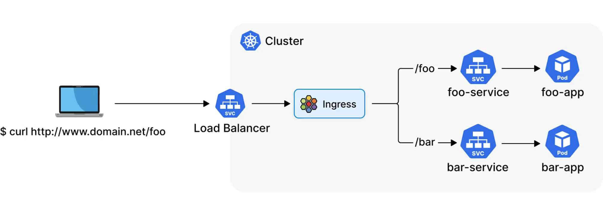

# Ingress and Gateway API: getting HTTP traffic into a cluster

Both APIs answer one question: **a request for `https://shop.example.com/api/orders` arrives at the cluster; which app's Service should handle it?** The Service then says which Pods belong to that app (the three questions are split apart at the end of §1.1). Ingress is the original answer (2015). Gateway API is its replacement. This doc explains both with examples run on minikube, shows where Ingress runs out, and explains why Gateway API is preferred.

---

## 0. Terms

| Term | Meaning |
|---|---|
| **L7 / HTTP routing** | Choosing a backend by looking inside the HTTP request: host name, path, headers, method. A plain Service (L4) only sees IP and port. |
| **reverse proxy** | A server that takes the client's connection and opens its own to the backend (nginx, Envoy, HAProxy, Traefik). Both APIs configure one. |
| **controller / implementation** | The program that reads Ingress or Gateway objects and configures a proxy from them. Without one installed, these objects do nothing. |
| **IngressClass / GatewayClass** | Says *which* controller should handle an object, when several are installed. |
| **TLS termination** | The proxy decrypts HTTPS using a certificate (stored in a Secret) and forwards plain or re-encrypted traffic. |
| **annotation** | Free-form `key: value` metadata on an object. The API server stores it but never checks it. |
| **CRD** | CustomResourceDefinition: adds a new object type to the API server. Gateway API is a set of CRDs, not built into Kubernetes. |

---

## 1. The problem both solve

Without either API, every app that wants outside traffic gets its own `type: LoadBalancer` Service:

```
 shop.example.com  ---> cloud LB #1 ($) ---> Service web ---> Pods
 api.example.com   ---> cloud LB #2 ($) ---> Service api ---> Pods
 admin.example.com ---> cloud LB #3 ($) ---> Service admin --> Pods
```

That means one cloud load balancer per app, each with its own IP, certificates and settings. And it's L4 only, so it can't route `/api` and `/` on the same host to different apps.

Both Ingress and Gateway API put **one shared proxy** at the edge and describe its HTTP routing as Kubernetes objects:

```
                                       +---> Service web   (host shop..., path /)
 *.example.com ---> one cloud LB --->  |
                    proxy (nginx /     +---> Service api   (host shop..., path /api)
                    Envoy / ...)       |
                                       +---> Service admin (host admin...)
        routing rules come from Ingress objects  OR  Gateway + HTTPRoute objects
```

The proxy itself usually sits behind one `LoadBalancer` Service (see `cloud-control-manager.md`).

### 1.1 LoadBalancer Service, Ingress or Gateway: which do you need?

They're layers, not alternatives. A `LoadBalancer` Service gets traffic **to** the cluster; Ingress and Gateway API decide **where it goes** once it's there. In a typical production setup the Gateway itself sits behind one LoadBalancer Service: in §4.1, `envoy-infra-public-...` is `type: LoadBalancer`.

Each layer adds one thing on top of the one before it:

```
 (A) NodePort      client ──────────────────────────► node:30008 ─► app Pod:80
 (B) LoadBalancer  client ─► cloud LB ──────────────► node:30008 ─► app Pod:80
 (C) Ingress       client ─► cloud LB ─► node:3xxxx ─► ingress-nginx Pod ─(Host/path)─► app Pod:80
 (D) Gateway       client ─► cloud LB ─► node:3xxxx ─► Envoy Pod ─(HTTPRoute)───────► app Pod:80
```

In (C) and (D) there are two kinds of Service:

- **The proxy's own Service** is type `LoadBalancer`. It carries all traffic from outside to the proxy Pods.
- **Each app's Service** is type `ClusterIP`. The proxy only reads it to find the app's Pod IPs, then connects to those Pods directly. Other Pods inside the cluster still call the app through its ClusterIP.

So with Ingress or Gateway, **one cloud LB and one node port serve every app**. With plain LoadBalancer Services (B), each app needs its own LB. The NodePort underneath, run on this cluster with the iptables rules, is in [kubernetes-services.md](kubernetes-services.md) §2.2–§2.3.

#### What each one does

| | `type: LoadBalancer` Service | Gateway API / Ingress |
|---|---|---|
| Layer | L4: IP + port (TCP/UDP) | L7: HTTP host, path, headers (Gateway also does TLS SNI, TCP, UDP) |
| One of them gives you | one cloud LB with **one external IP**, for **one Service** | one set of routing rules; many apps share **one** IP |
| Looks inside requests? | no; it forwards bytes | yes: host, path, headers, method |
| TLS | passes it through; the app terminates it (some clouds can terminate at the LB through provider-specific annotations, but that still doesn't route by path: see "Inside step 4" below) | terminated at the Gateway, with certificates managed centrally |
| Canary, redirects, rewrites, header routing | no | yes (§3.4–§3.7) |
| Who implements it | the cloud controller manager + the cloud's LB ([cloud-control-manager.md](cloud-control-manager.md)) | a proxy in the cluster (Envoy, nginx, ...) |
| Cost | **one billed cloud LB per Service** | one cloud LB for the proxy, shared by every route |

```
 LoadBalancer per app:                       One Gateway in front of many apps:

 app.acme.com   -> LB #1 -> Service app      *.acme.com -> LB (one) -> Gateway (Envoy)
 api.acme.com   -> LB #2 -> Service api                                 |- app.acme.com     -> app
 admin.acme.com -> LB #3 -> Service admin                               |- api.acme.com     -> api
 (3 IPs, 3 bills, TLS in every app,                                     |- acme.com/blog    -> blog
  no path routing, no canaries)                                         '- admin.acme.com   -> admin
                                                                     (1 IP, 1 bill, one wildcard cert)
```

**This doesn't mean "`type: LoadBalancer` is bad".** What's discouraged is one LoadBalancer Service **per app**, used *instead of* a proxy. Ingress and Gateway still use exactly one LoadBalancer Service, **for the proxy**, and the apps behind it stay `ClusterIP`:

```
 Ingress:  *.acme.com ─► LB ─► Service ingress-nginx-controller (LoadBalancer) ─► nginx ─► app/api/admin (ClusterIP)
 Gateway:  *.acme.com ─► LB ─► Service envoy-infra-public-…    (LoadBalancer) ─► Envoy ─► app/api/admin (ClusterIP)
```

Both default to it. ingress-nginx's cloud manifest makes its Service `LoadBalancer` (§2.1, "Installing the controller"), and so does Envoy Gateway (§3.3, "Choosing the proxy's Service type"). The difference is what one LB is shared by:

| | Ingress (ingress-nginx) | Gateway (Envoy Gateway) |
|---|---|---|
| One LB per… | controller install | Gateway object |
| Shared by | every Ingress of that class, in every namespace | every route attached to that Gateway |
| A new app adds | an Ingress → no new LB | an HTTPRoute → no new LB |
| A new LB appears when | a second controller is installed | the platform team creates another Gateway (e.g. `internal`, which can also be `ClusterIP`) |

#### A LoadBalancer Service, more closely

A load balancer isn't a separate object like an Ingress. It's a Service with `type: LoadBalancer`:

```yaml
apiVersion: v1
kind: Service
metadata:
  name: api-service
spec:
  type: LoadBalancer
  selector: {app: api-app}
  ports:
  - protocol: TCP
    port: 80          # the cloud LB listens here
    targetPort: 8080  # the container listens here
                      # nodePort: assigned automatically (e.g. 31845)
```

It's the outermost of three nested layers ([kubernetes-services.md](kubernetes-services.md) §2.3):

```
 type: LoadBalancer  ─ "also ask the cloud for an external LB, pointed at the node ports"
  └─ type: NodePort  ─ "also open port 31845 on every node"
      └─ ClusterIP   ─ "a virtual IP + the selector → EndpointSlice"   (always there)
```

Kubernetes itself creates only the inner two layers. The **cloud controller manager** (CCM) sees the Service and creates the real LB with the provider's API ([cloud-control-manager.md](cloud-control-manager.md)). Without a CCM (bare metal, minikube without `minikube tunnel` or MetalLB), `EXTERNAL-IP` stays `<pending>`.

```
 kubectl apply Service (type: LoadBalancer)
      │
      ├─► kube-apiserver: allocates ClusterIP + nodePort 31845
      ├─► kube-proxy (every node): rules for ClusterIP:80 and <node>:31845 → Pod IPs
      └─► CCM service controller: "create LB: listen :80 → nodes:31845"
               │                   (provider API call, outside the cluster)
               ▼
          cloud LB 203.0.113.10 ── writes status.loadBalancer.ingress → EXTERNAL-IP
```

What the big three CCMs create by default:

| Provider | Default LB | Notes |
|---|---|---|
| AWS (`cloud-provider-aws`) | **Classic ELB** | You get an NLB only with `service.beta.kubernetes.io/aws-load-balancer-type: nlb`. The source has `isNLB()` return true only for `"nlb"` (`pkg/providers/v1/aws_loadbalancer.go`). The separate AWS Load Balancer Controller also makes NLBs. |
| GKE | passthrough Network LB (L4) | from Google's docs, not checked in source |
| Azure | Standard Load Balancer (public; internal through an annotation) | from Azure's docs, not checked in source |

Many introductions say AWS creates an NLB. With the AWS CCM it doesn't, unless you ask for one.

**Settings live in YAML, as annotations on the Service.** Introductions sometimes say LB settings are usually managed with the provider's CLI. In Kubernetes the CCM *owns* the LB: it reads annotations on the Service and rewrites the LB to match, so manual changes made in the provider's console or CLI can be overwritten on the next sync. Some examples are covered in this doc and in [cloud-control-manager.md](cloud-control-manager.md):

- TLS termination: Hetzner `load-balancer.hetzner.cloud/protocol: https` plus `http-certificates`; DigitalOcean `do-loadbalancer-protocol` plus `certificate-id`.
- Internal-only LBs: Hetzner `disable-public-network`; Azure `azure-load-balancer-internal`.
- Fields in the Service spec itself: `loadBalancerSourceRanges`, `externalTrafficPolicy`, `loadBalancerClass`.

These annotations are provider-specific, the same portability problem as Ingress annotations (§2.3).

**One LB, one Service.** The LB's targets are the node ports of *this* Service. Adding a second app means adding a second Service, which means a second LB:

```
 api-service (LoadBalancer) ─► cloud LB #1 203.0.113.10 ─► nodes:31845 ─► api Pods
 web-service (LoadBalancer) ─► cloud LB #2 203.0.113.11 ─► nodes:30912 ─► web Pods
                                 2 IPs, 2 bills, no host/path routing between them
```

An Ingress or Gateway routes to many Services, but it **still needs one LB** for its own proxy. The cost difference is "one LB per app" vs "one LB total":

```
 Ingress/Gateway:  cloud LB (one) ─► proxy's nodePort ─► proxy Pods ─┬─► api Pods
                                                                     ├─► web Pods
                                                                     └─► admin Pods
```

The cloud LB lives outside the cluster and is billed by the provider, whether it fronts one app or a proxy for fifty.

#### When a LoadBalancer Service alone is the right choice

1. **Non-HTTP protocols that clients reach directly.**
   - *Example: an IoT platform.* Devices connect to an MQTT broker (EMQX or Mosquitto) on TCP 8883, and the broker does TLS with client certificates. Give the broker's Service `type: LoadBalancer`. An HTTP proxy adds nothing, and terminating TLS anywhere but the broker would break client-certificate authentication.
   - The same applies to SMTP/IMAP mail servers, a public DNS server (UDP 53), SIP or VoIP, and game servers on UDP.
2. **Databases or brokers for consumers outside the cluster, kept private.**
   - *Example:* Postgres in the cluster, used by a BI tool running on VMs in the same private network (VPC). Use an internal LoadBalancer, through a provider annotation. On Hetzner that's `load-balancer.hetzner.cloud/disable-public-network: "true"` (all traffic over the private network), usually together with `use-private-ip: "true"`, so the LB also reaches the nodes privately. On Scaleway it's the private mode ([cloud-control-manager.md](cloud-control-manager.md)). Add `loadBalancerSourceRanges` to limit who can connect.
   - It's one port, one protocol and one consumer group, with nothing to route.
3. **The proxy itself.** The Envoy Gateway or ingress-nginx controller's own Service is a LoadBalancer. This is the one LoadBalancer every HTTP setup needs.
4. **An app that must do its own TLS end to end.** Examples are a service doing mutual TLS with partners, or one that must keep its certificate private for compliance. Forwarding at L4 keeps the encryption unbroken. Gateway API's `TLSRoute` passthrough (§3.8) can also do this behind a shared Gateway.
5. **Very small setups.** One cluster, one public HTTP app, and the cloud LB can terminate TLS through annotations: a LoadBalancer Service is enough. But once there's a second app or a second hostname, you're paying for a second LB and duplicating TLS settings. Those annotations are also provider-specific, which is the same portability problem as Ingress annotations (§2.3).

#### When you need Gateway API (or Ingress)

1. **Several HTTP apps, hostnames or paths on one IP.**
   - *Example: a SaaS product* with `acme.com` (marketing site), `app.acme.com` (frontend), `api.acme.com` (backend, with `/v1` and `/v2` going to different Deployments) and `acme.com/docs` (a docs site).
   - One Gateway, one LB and one wildcard certificate cover it all.
   - Each team owns its own HTTPRoute in its own namespace (§3.1), and the platform team owns the Gateway and decides which namespaces may attach.
2. **Releasing safely.**
   - *Example:* the payments API sends 5% of traffic to `payments-v2`, then 25%, then 100%. That's done by changing `weight` in the HTTPRoute (§3.4), possibly driven by Argo Rollouts.
   - QA can force the new version with a header (`x-canary: always`).
   - A LoadBalancer Service can't split traffic between two Deployments by percentage.
3. **Central TLS and HTTP policy.**
   - *Example:* cert-manager issues `*.acme.com` into a Secret in the `infra` namespace, and the Gateway terminates TLS. All HTTP traffic is redirected to HTTPS by one route (§3.7, and set `sectionName: https` on app routes). Security headers are added once, with a response-header filter.
   - App teams never see the private key.
4. **Moving URLs without breaking clients.**
   - *Example:* `/api/v1/*` moves from the old monolith to a new service. A `URLRewrite` plus a path match moves it without clients changing anything.
   - A deprecated domain gets a `RequestRedirect` with status 301.
5. **gRPC.**
   - *Example:* mobile clients call `orders.OrderService/*` and `users.UserService/*` on one hostname. A `GRPCRoute` splits them by gRPC service name and method, which L4 can't see.
6. **Many TCP or TLS services behind one LB.**
   - *Example:* several tenants' Postgres instances, each needing its own hostname over TLS. A Gateway with `TLSRoute` passthrough routes by SNI to the right database Service through one LB, instead of one LB per tenant.

#### A typical production layout

```
                      public DNS: *.acme.com -> 203.0.113.10
                                        |
                      cloud LB (from the Gateway's LoadBalancer Service)
                                        |
                  Gateway "public" (infra ns)   :443 TLS *.acme.com, :80 -> 301 https
                   |            |              |                 |
             app.acme.com   api.acme.com   acme.com/docs     grpc.acme.com
             HTTPRoute       HTTPRoute      HTTPRoute         GRPCRoute
             (frontend ns)   (payments ns:  (docs ns)         (orders ns)
                              v1 95% / v2 5%)
                   |            |              |                 |
             ClusterIP Services -> Pod IPs (EndpointSlices)  [§4]

   separately, not HTTP:
   mqtt.acme.com:8883 -> LoadBalancer Service -> MQTT broker Pods (broker does mTLS)
   10.0.0.50:5432     -> internal LoadBalancer -> Postgres (VPC-only, sourceRanges)
```

This is the usual pattern:

- One or two Gateways (public and internal), each behind one LoadBalancer Service, carry all the HTTP and gRPC traffic.
- A dedicated LoadBalancer Service is used only where a protocol or security requirement makes an HTTP proxy pointless.
- Everything else is `ClusterIP`.

#### Quick rule

- **HTTP or gRPC, more than one app or hostname, or anything about how requests are routed** → Gateway API (behind one LoadBalancer).
- **Raw TCP or UDP, client-side TLS that must stay end to end, or the proxy itself** → a LoadBalancer Service.
- **Only reached from inside the cluster** → `ClusterIP`, with neither of the above.

#### One request, end to end

The cloud load balancer sits in front of the **proxy**, not your apps. It
exists because the proxy's Service is `type: LoadBalancer`:

```
you create Gateway "public"
   -> Envoy Gateway creates Envoy Pods + Service "envoy-..." (type: LoadBalancer)
        -> the cloud controller manager sees a LoadBalancer Service
             -> asks the provider for a cloud LB, and configures it:
                "listen on 203.0.113.10:80 and :443,
                 forward to every node's IP on that Service's nodePort (e.g. 31845)"
```

One Kubernetes Service of `type: LoadBalancer` causes one cloud LB. The LB
doesn't know about Services; it only knows "these node IPs, this port". Your
apps' Services stay `ClusterIP`, and the cloud LB knows nothing about them.

Now follow one request, `https://shop.example.com/api/orders`:

```
 (1) DNS:  shop.example.com -> 203.0.113.10                    [you set this DNS record]

 ======== CLOUD PROVIDER (outside the cluster) ========
 (2) cloud LB 203.0.113.10:443
       "forward to node IP : 31845"  -- picks a node, say 10.0.0.21

 ======== NODE 10.0.0.21 ========
 (3) kube-proxy rule for nodePort 31845 (Service envoy-..., LoadBalancer)
       -> forwards to an Envoy Pod, say 10.244.1.7:10443

 ======== ENVOY POD = the "Gateway" ========
 (4) Envoy: decrypts TLS (certificate from the Gateway)
            reads   Host: shop.example.com   path: /api/orders
            finds   HTTPRoute rule: /api -> Service "api", port 80
            looks up Service "api"'s EndpointSlice: Pods 10.244.2.9:8080, 10.244.3.4:8080
            picks   10.244.2.9:8080

 ======== APP POD ========
 (5) api Pod 10.244.2.9:8080 handles /orders and answers
       (the answer goes back the same way: Envoy -> node -> cloud LB -> client)
```

| Step | Who does it | Decides |
|---|---|---|
| (2) cloud LB | the provider | **which node** (it only knows nodes and one port) |
| (3) kube-proxy + the proxy's Service | Kubernetes | **which Envoy Pod** |
| (4) Envoy (the Gateway) | your Gateway and HTTPRoutes | **which app**, from host and path, and **which app Pod** |
| (5) app Pod | your code | the actual response |

Ingress or Gateway is **step 4**: the proxy Pods plus their rules, after the
cloud LB and before your apps. The app's Service appears only as a lookup:
Envoy reads its EndpointSlice and sends to the Pod directly (§4).

Without a Gateway, for comparison, make the app's own Service
`type: LoadBalancer` and there's no step 4:

```
client -> cloud LB #1 (203.0.113.10) -> node:nodePort -> kube-proxy -> api Pod
client -> cloud LB #2 (203.0.113.11) -> node:nodePort -> kube-proxy -> web Pod
```

That means one cloud LB per app, nothing reading hostnames or paths, and TLS
handled in each app.

Only traffic from **outside** the cluster takes this path:

- **Pod-to-Pod traffic inside the cluster** (web calling `http://api`) goes
  through the `api` Service's ClusterIP and kube-proxy, and never touches the
  cloud LB or the Gateway ([kubernetes-services.md](kubernetes-services.md)).
- **Without a cloud LB** (bare metal, minikube), something else hands out the
  external IP, such as MetalLB. Or clients use `<node IP>:<nodePort>`, or the
  proxy listens on the nodes' own network. Step 4 stays the same.
- **DigitalOcean's default `REGIONAL_NETWORK` LB** sends to the Service port
  on the node instead of the node port, which changes step 2 slightly
  ([kubernetes-services.md](kubernetes-services.md) §2.3).

#### Inside step 4: which Pods get the request? Three questions, three answerers

Step 4 above says Envoy picks "which app" and "which app Pod", while the `api` Service also seems to say which Pods get the request. "Which Pods should get this request?" sounds like one question. It's really three questions, and the Service answers only the middle one:

| Question | Who answers | How |
|---|---|---|
| 1. Which app is this request for? | **Gateway / Ingress** | It reads the host, path and headers: `shop.example.com` + `/api` → the `api` Service |
| 2. Which Pods make up that app? | **The Service** | Its selector `app=api` produces an EndpointSlice: `10.244.2.9`, `10.244.1.12`, … (ready Pods only, §4.3–4.4) |
| 3. Which one of those Pods gets this request? | **Whoever forwards the packet** | Through the Gateway, Envoy picks a Pod from the EndpointSlice (§4.2). Through the ClusterIP, kube-proxy picks. |

**Why a Service can't answer question 1:** a Service only sees an IP and a port. Every request to `shop.example.com` arrives at the same address, `203.0.113.10:443`:

```
https://shop.example.com/api/orders   ─┐
https://shop.example.com/            ─┼─►  203.0.113.10:443   (same IP, same port)
https://admin.example.com/users      ─┘
```

At that level the three requests look identical. The path and host are inside the HTTP request, and that's inside TLS too. Something has to end TLS, read the HTTP request and choose: "this one goes to `api`, that one to `web`." That's the proxy, and Ingress or Gateway is how you tell it the rules. A Service has no field for "path starts with `/api`", so it can't make that choice. kube-proxy can't either: it rewrites packet addresses (DNAT) and never reads HTTP, so even plain `http://` doesn't help it.

So it's a chain. The Gateway picks the Service. The Service defines the set of Pods. Envoy picks one Pod from that set.

```
request ──► Gateway rules ──► "api" Service ──► EndpointSlice ──► one Pod
            (Q1: which app)   (Q2: which Pods)   (Q3: Envoy picks one)
```

Without a Gateway you skip question 1 by giving each app its own IP: one LoadBalancer Service, and one cloud LB, per app (the "Without a Gateway" diagram above).

**Can't the cloud LB terminate TLS?** Yes, many can, through annotations on the LoadBalancer Service. These names come from the CCM source:

- Hetzner (`internal/annotation/load_balancer.go`): `load-balancer.hetzner.cloud/protocol: https` together with `load-balancer.hetzner.cloud/http-certificates` (or `http-managed-certificate-domains`).
- DigitalOcean (`do/lb_annotations.go`): `service.beta.kubernetes.io/do-loadbalancer-protocol`, `do-loadbalancer-tls-ports` and `do-loadbalancer-certificate-id`. `do-loadbalancer-tls-passthrough` turns termination off.

But **decrypting is not routing**. A LoadBalancer Service maps each of *its own* ports to *its own* nodePort (`destinationPort := int(port.NodePort)` in the Hetzner CCM, see [kubernetes-services.md](kubernetes-services.md) §2.3). After the LB decrypts, every request on 443 still goes to that one Service:

```
                    cloud LB terminates TLS (cert on the LB)
https://shop.../api ─┐        │
https://shop.../    ─┼──► 203.0.113.10:443 ──► nodePort 31845 ──► Service "web" ──► web Pods
https://admin.../   ─┘        decrypted, but the LB has one
                              target for :443, so /api lands on web too
```

So TLS at the LB answers "who holds the certificate". It doesn't answer question 1.

**But if the LB decrypts, it can see the path. Can't it route on it?** Seeing the path isn't the same as routing on it. Routing needs two things, and an L4 cloud LB behind a `LoadBalancer` Service has neither.

1. **The LB needs a rule like "path `/api` → target A".** Hetzner's LB decrypts and parses HTTP: it can set sticky-session cookies and redirect HTTP to HTTPS. Its config has no host or path field, though. Here are the structs from `hcloud-go/hcloud/load_balancer.go`:

   ```go
   type LoadBalancerService struct {
   	Protocol        LoadBalancerServiceProtocol
   	ListenPort      int      // e.g. 443
   	DestinationPort int      // e.g. nodePort 31845: the ONE target for this port
   	Proxyprotocol   bool
   	HTTP            LoadBalancerServiceHTTP
   	HealthCheck     LoadBalancerServiceHealthCheck
   }
   type LoadBalancerServiceHTTP struct {
   	CookieName     string
   	CookieLifetime time.Duration
   	Certificates   []*Certificate
   	RedirectHTTP   bool
   	StickySessions bool
   	TimeoutIdle    time.Duration
   }
   ```

   One listen port goes to one destination port. The LB reads `/api/orders` and still sends it to the same place as `/`. DigitalOcean's Service annotations follow the same pattern (protocol, certificate, TLS ports, no path rules). Its API structs weren't checked the way Hetzner's were.

2. **Even an LB that can route by path has nothing to route to.** A `LoadBalancer` Service describes *one* Service, and the CCM only learns that Service's node ports. Sending `/api` to `api` and `/` to `web` needs one LB with targets in *two* Services, and no single Service object can say that. You need an object that sits above several Services and holds host and path rules: an Ingress or an HTTPRoute.

```
                          sees the path?   has path rules?   knows several Services?
Hetzner / DO LB (https)        yes              no                 no
AWS ALB, Google HTTPS LB       yes              yes                only via an Ingress/Gateway
                                                                   controller that writes the rules
Envoy / nginx in cluster       yes              yes                yes, from Gateway/Ingress objects
```

So "can terminate TLS" gives you "can see the path". "Can route by path" also needs an LB product with path rules *and* a Kubernetes API that names several Services. That API is always Ingress or Gateway, never a `LoadBalancer` Service.

Some cloud LBs are full L7 proxies that *can* route by host and path: AWS ALB, Google Cloud's HTTP(S) load balancer, Azure Application Gateway. You don't reach those features through a LoadBalancer Service, though. They're configured by an Ingress or Gateway controller that runs in the cluster and programs the cloud LB: the AWS Load Balancer Controller, the GKE Gateway controller, Application Gateway for Containers. In that setup the cloud LB itself does step 4, and Ingress or Gateway is still how you write the rules. This paragraph is from the providers' documentation and wasn't tested here.

| TLS ends at | Who answers question 1 | Typical setup |
|---|---|---|
| Cloud L4 LB with a cert annotation (Hetzner, DigitalOcean) | nobody: one Service per LB port | one app per LB; fine for a single site |
| In-cluster proxy (Envoy, nginx) behind an L4 LB | the Gateway or Ingress rules | this doc's lab, and most clusters |
| Cloud L7 LB (ALB, GCLB) | the Gateway or Ingress rules, compiled into the cloud LB's config (GKE example in §2.5) | managed clusters on AWS/GCP/Azure |

**Question 3 in more detail.** Whoever forwards the packet picks the Pod, using its own algorithm:

- **kube-proxy, iptables mode:** random. Each rule carries a `statistic --mode random --probability` match ([kubernetes-services.md](kubernetes-services.md), measured).
- **Envoy:** its own load-balancing policy. For Envoy Gateway the default is least-request, and you change it with a `BackendTrafficPolicy`. That's from the Envoy Gateway docs and wasn't checked in the lab.

This is why Service settings that belong to question 3, such as `sessionAffinity`, have no effect when traffic comes through the Gateway (§4.7). The Service answered question 2, and Envoy, not kube-proxy, answers question 3.

**Weights split question 1, not question 3.** A rule with `backendRefs: web-v1 weight 80, web-v2 weight 20` makes the Gateway choose between two *Services* (two sets of Pods). §4.2 shows Envoy keeping one group per Service with weights 80/20. That's why canary routes name `v1` and `v2` Services even though a Deployment rolls out on its own: a Deployment rollout replaces Pods inside one Service, while a weighted route sends a chosen share of traffic to a separate set of Pods.

**Inside the cluster, the caller answers question 1.** A Pod calling `http://api.shop.svc:80` has already picked the app by choosing the DNS name. CoreDNS returns the ClusterIP and kube-proxy picks a Pod, so only questions 2 and 3 remain and no Gateway is involved.

### 1.2 The lab's backends

Used by every example below: three Deployments in namespace `shop` running `agnhost netexec`, whose `/hostname` endpoint returns the Pod's name.

```yaml
# apps.yaml (abridged): web-v1, web-v2 and api, each 1 replica, each with a Service on port 80
apiVersion: apps/v1
kind: Deployment
metadata: {name: web-v1, namespace: shop}
spec:
  replicas: 1
  selector: {matchLabels: {app: web, version: v1}}
  template:
    metadata: {labels: {app: web, version: v1}}
    spec:
      containers:
      - name: web
        image: registry.k8s.io/e2e-test-images/agnhost:2.53
        args: ["netexec", "--http-port=8080"]
---
apiVersion: v1
kind: Service
metadata: {name: web-v1, namespace: shop}
spec:
  selector: {app: web, version: v1}
  ports: [{port: 80, targetPort: 8080}]
# ... web-v2 and api are the same with their own labels
```

---

## 2. Ingress

**In short.** A Service is private to the cluster by default: `type` defaults to `ClusterIP`, which is reachable only from inside. An Ingress is one way to let outside traffic in. It's usually the **single entry point** for web traffic: one address, and a set of host and path rules that send each request to the right Service's Pods. It's built for HTTP and HTTPS. Other protocols need controller-specific extras.

Most introductions describe Ingress in roughly those words, but three common phrasings are slightly off. The corrections matter for debugging:

| Common phrasing | What actually happens | Where it's shown |
|---|---|---|
| "An Ingress receives a public IP" | The Ingress **object** has no IP. The **controller's own Service** (`type: LoadBalancer` or `NodePort`) gets the address. The controller then copies it into each Ingress's `status.loadBalancer` (the `ADDRESS` column). Every Ingress of the same class shows the **same** address, because they share one proxy. | §2.1 step 5, §1.1 "One request, end to end" |
| "The Ingress forwards to a Service, which sends the request to a Pod" | The Service is only a **lookup**. The proxy reads the Service's EndpointSlice and connects to the Pod IP and target port directly, so the ClusterIP and kube-proxy aren't in the path. The exception is ingress-nginx's `service-upstream: "true"` annotation. | §2.1 (`pod=10.244.120.79:8080` in the log), §4 |
| "Other protocols are possible with extra configuration" | The **Ingress API** can't express them: a rule has only an `http` block (`IngressRuleValue` has one field, `HTTP`). TCP and UDP are configured outside Ingress entirely, through the controller's own ConfigMaps (`--tcp-services-configmap`, `--udp-services-configmap`), so they aren't portable. Gateway API has typed `TCPRoute`, `UDPRoute` and `TLSRoute` for this. | §2.1 flags, §3.8 |
| "The Ingress controller calls the cloud provider's API to provision a load balancer" | For an **in-cluster** controller (ingress-nginx, HAProxy, Traefik), the controller never calls the cloud API. Its install manifest includes a Service with `type: LoadBalancer`, and the **cloud controller manager** sees that Service and creates the LB. The controller only routes. Controllers that really do call the cloud API (GKE's `gce`, the AWS Load Balancer Controller) don't run a proxy at all: the cloud LB *is* the proxy. | §1.1 "A LoadBalancer Service, more closely", §2.5 |
| "When you create an Ingress resource, the cloud provider provisions a load balancer" | With an in-cluster controller, the LB is created **once, when the controller is installed**, because of its Service. Creating Ingresses adds rules to the existing proxy, and every Ingress of the class shows the same ADDRESS. An Ingress alone creates nothing (the no-controller test in §2.1). "One LB per Ingress" is true only for cloud-LB controllers such as GKE's, and even then the AWS controller can share one ALB across Ingresses with `group.name`. | §2.1, §2.5 |

"Single point of entry" is true **per controller or class**. A cluster can run two IngressClasses, for example `public` and `internal`, each with its own proxy and its own LoadBalancer IP. And Ingress isn't the only way to expose a Service. A `NodePort` or `LoadBalancer` Service exposes one Service directly, and Gateway API is Ingress's replacement (§1.1, §6).

```
 outside                      cluster
 client ──► LB IP ──► ingress controller's Service ──► proxy Pod ──rules──► Pod IP of app
            (one IP, shared by          (LoadBalancer/       (nginx)    (looked up via
             every Ingress of the        NodePort)                       the app's Service
             class, shown in ADDRESS)                                    and EndpointSlice)
```

The same path, hop by hop. The LB doesn't point at nginx, and nginx doesn't send to the app's Service:

```
 client
   │
   ▼
 cloud LB 203.0.113.10:443
   │  points at: every node, on the proxy Service's nodePort
   ▼
 node:32053 ── kube-proxy rule (kernel, no process) ── DNAT ──► proxy Pod IP:443
   │                                                    (Service ingress-nginx-controller → its one/few Pods)
   ▼
 nginx / HAProxy process, listening :443 in that Pod
   │  TLS ends, Host + path matched
   │
   │  rule says "Service api:80"  ──► used only as a LOOKUP, done earlier by the controller:
   │                                   Service api → EndpointSlice → [10.244.120.79:8080, 10.244.120.80:8080]
   ▼
 api Pod 10.244.120.79:8080          ← a new connection, straight to the Pod
                                       (the api Service's ClusterIP and kube-proxy aren't used)
```

So the chain is **LB → nodes → kube-proxy → proxy Pod (nginx/HAProxy) → app Pod**. Services appear twice, in different roles:

| Service | Role | In the packet path? |
|---|---|---|
| the proxy's own (`ingress-nginx-controller`, `LoadBalancer`) | kube-proxy rules that get traffic from the node into the proxy Pod | yes, as one NAT rewrite in the kernel |
| each app's (`api`, `ClusterIP`) | a name the controller resolves to Pod IPs | no: only a lookup (except with `service-upstream: "true"`) |

The same path, measured hop by hop with Envoy Gateway, is in §3.4 "Following one request into the proxy Pod". The ingress-nginx code for the lookup is in §2.1 "The Service in the code".

### 2.1 Two parts: the object and the controller

```
 Ingress object (networking.k8s.io/v1)        just a record in the API server
   ingressClassName: nginx
   rules: host + path -> Service
        |
        |  watched by
        v
 ingress controller (e.g. ingress-nginx)      a Deployment in the cluster
   turns every Ingress of class "nginx" into nginx.conf, reloads nginx
        |
        v
 nginx Pods  <--- traffic from the LoadBalancer / NodePort in front of them
```

Kubernetes ships the Ingress **type** but no controller. You install one. In the lab:

```sh
minikube addons enable ingress        # installs ingress-nginx and IngressClass "nginx"
```

#### Installing the controller: where the load balancer comes from

The cloud LB appears **when you install the controller**, not when you create an Ingress. And the controller isn't what creates it:

```
helm install ingress-nginx   (or kubectl apply -f deploy.yaml)
   │
   ├─► Deployment ingress-nginx-controller          the controller + nginx, in one Pod
   ├─► Service ingress-nginx-controller-admission   ClusterIP; the API server calls the webhook here
   ├─► IngressClass nginx
   └─► Service ingress-nginx-controller             type: LoadBalancer
          │
          │  watch event: a LoadBalancer Service appeared
          ▼
       CLOUD CONTROLLER MANAGER  ─── cloud provider API ───►  cloud LB 203.0.113.10
          (not ingress-nginx)                                  listen :80 :443
          writes the IP into the Service's status              forward to every node : nodePort
                                                                         │
                                                                         ▼
                                                     kube-proxy ─► nginx Pods (the controller's Deployment)

 the controller itself:  watches Ingresses, Services, EndpointSlices, Secrets ...
                         configures nginx, writes ADDRESS into each Ingress
                         talks only to the API server, never to the cloud
```

Two kinds of event, two different results:

| Event | What happens | How often |
|---|---|---|
| Install the controller | its `LoadBalancer` Service → the CCM creates **one** cloud LB | once per controller |
| Create an Ingress | the controller adds host and path rules to nginx; ADDRESS = that same LB's IP | every Ingress, no new LB |
| Create an Ingress with no controller | nothing (the test below) | – |

The official manifest confirms both halves. In `deploy/static/provider/cloud/deploy.yaml` (controller `v1.15.1`):

```
Service    ingress-nginx-controller             type: LoadBalancer
Service    ingress-nginx-controller-admission   type: ClusterIP
Deployment ingress-nginx-controller             registry.k8s.io/ingress-nginx/controller:v1.15.1
```

Its `ClusterRole ingress-nginx` shows what the controller is **allowed** to do:

```
list/watch        configmaps, endpoints, nodes, pods, secrets, namespaces, leases, endpointslices
get/list/watch    services, ingresses, ingressclasses
update            ingresses/status          <- the ADDRESS column
create/patch      events
```

There's no `create` on Services and no cloud credentials. The controller **can't** make a load balancer, so it reads Kubernetes objects and configures its own nginx. The CCM holds the cloud credentials and does the provisioning ([cloud-control-manager.md](cloud-control-manager.md)). Without a CCM (bare metal, minikube), the Service's `EXTERNAL-IP` stays `<pending>` until MetalLB or `minikube tunnel` fills it in, or you switch the Service to `NodePort`. ingress-nginx ships separate manifests per provider for this reason: in `provider/baremetal/deploy.yaml` the same `ingress-nginx-controller` Service is `type: NodePort` instead of `LoadBalancer`.

Controllers that *do* call the cloud API (GKE's `gce`, the AWS Load Balancer Controller) are a different design: they have cloud credentials and no in-cluster proxy (§2.5).

##### Who creates the proxy's Service: the install, or the controller?

It depends on the implementation. The RBAC shows which:

| | ingress-nginx | Envoy Gateway |
|---|---|---|
| Who creates the proxy's Service | **the install**: you, with `kubectl apply` or `helm install` | **the controller process**, once for each Gateway |
| Proof | read-only on Services: `get, list, watch` in both ClusterRole and Role `ingress-nginx` (v1.15.1 manifest). It couldn't create one. | Role `eg-gateway-helm-infra-manager` grants `create, get, list, delete, deletecollection, patch, watch` on `services`, `serviceaccounts` and `configmaps` in `envoy-gateway-system` (lab) |
| The Service's owner | none: it's yours, as part of the install | ownerReference `GatewayClass/envoy`, label `app.kubernetes.io/managed-by=envoy-gateway` (lab, `envoy-infra-public-8d55c10f`) |
| When it appears | once, at install, before any Ingress exists | when a Gateway is created; removed with it |

```
 ingress-nginx:   you ─ helm install / kubectl apply ─► Deployment + Service ingress-nginx-controller (+ admission Service)
                                                         the controller runs inside; it only READS Services
                                                         (to resolve your Ingresses' backends)

 Envoy Gateway:   you ─ helm install ─► envoy-gateway Deployment (the controller only, no proxy yet)
                  you ─ kubectl apply Gateway public ─► envoy-gateway CREATES Deployment + Service envoy-infra-public-…
```

So with Ingress, one shared proxy and one LB exist before any rules do. With Gateway API, each Gateway object gets its own proxy and LB (§3.3).

##### Must that Service be `type: LoadBalancer`?

No. LoadBalancer is the cloud default because it gives the proxy one public IP. ingress-nginx ships one manifest per environment (`deploy/static/provider/*/deploy.yaml`, v1.15.1):

```
cloud/                         ingress-nginx-controller   LoadBalancer
aws/nlb-with-tls-termination/  ingress-nginx-controller   LoadBalancer  (+ NLB annotations)
kind/                          ingress-nginx-controller   LoadBalancer
baremetal/                     ingress-nginx-controller   NodePort
(each also has ingress-nginx-controller-admission  ClusterIP: the webhook, not traffic)
```

Envoy Gateway makes it a setting on the `EnvoyProxy` CRD (lab, v1.9.3):

```
$ kubectl explain envoyproxy.spec.provider.kubernetes.envoyService.type
ENUM: ClusterIP, LoadBalancer, NodePort
Type determines how the Service is exposed. Defaults to LoadBalancer.
```

The ways to get outside traffic to the proxy Pods:

| Option | How traffic gets in | Typical use |
|---|---|---|
| `LoadBalancer` (default) | the CCM makes a cloud LB → node ports → proxy Pod | managed clouds |
| `LoadBalancer` + MetalLB / kube-vip | same Service type; MetalLB announces an IP from your own range | bare metal that still wants one stable IP |
| `NodePort` | clients or your own external LB (HAProxy, F5) hit `<node IP>:3xxxx` | bare metal, labs |
| `hostNetwork: true` / `hostPort`, as a DaemonSet | the proxy binds 80/443 on each node's own IP; no Service needed for traffic | bare metal, edge. One proxy per node, since only one can hold port 80. |
| `ClusterIP` + an LB that targets Pod IPs | e.g. the AWS Load Balancer Controller in IP mode, or GKE standalone NEGs, sends straight to the proxy Pods | clouds, to skip the node-port hop |
| `ClusterIP` only | reachable only inside the cluster | internal-only gateways, service-to-service routing |

The Service type only decides how traffic reaches the proxy. The routing rules (Ingress or HTTPRoute) work the same with any of them.

#### From `kubectl apply` to a routed request

At a glance:

```
kubectl apply ─► API server stores Ingress ─► watch event ─► CONTROLLER
                                                             a. class mine?
                                                             b. host + /api → Service api
                                                             c. Service api → EndpointSlice → Pod IPs
                                                             d. render nginx.conf, reload
                                                             e. write ADDRESS into status
                                                                  │
                                                                  ▼
                                                    nginx (REVERSE PROXY) now has the rules

then, per request (the controller isn't involved):

client ─► LB ─► nginx: ends TLS → matches host → matches /api → picks a Pod IP → forwards ─► api Pod
```

The details and the evidence follow.

**Applying an Ingress only creates a record.** The API server validates the object and stores it in etcd. Nothing else in Kubernetes acts on it. Here's a test with ingress-nginx **not** installed: there's no controller, and not even the IngressClass `nginx` exists.

```
$ kubectl get ingressclass
No resources found

$ kubectl apply -f no-controller.yaml       # host shop.example.com, /api -> Service api
ingress.networking.k8s.io/no-controller created

$ kubectl -n shop get ingress no-controller          # 30 s later
NAME            CLASS   HOSTS              ADDRESS   PORTS   AGE
no-controller   nginx   shop.example.com             80      33s

$ kubectl -n shop get ingress no-controller -o jsonpath='{.status}'
{"loadBalancer":{}}

$ kubectl -n shop get events --field-selector involvedObject.name=no-controller
No resources found in shop namespace.
```

The API server accepted it even though the class it names doesn't exist. The object has no address, no status and no events: no proxy anywhere knows about `/api`. The routing comes from the **controller**, which watches these records and turns them into proxy configuration.

How the controller learns the path, step by step:

```
 (1) you: kubectl apply -f shop-ingress.yaml
          │
          ▼
 (2) kube-apiserver ── [ingress-nginx validating webhook: test-render, accept/reject] (§2.3)
          │  stores Ingress "shop" in etcd
          │
          │  watch event: ADDED Ingress shop/shop   (informer, see watching-the-api-server.md)
          ▼
 (3) ingress-nginx CONTROLLER (Go, inside the controller Pod)
          │  a. class = nginx?  yes → mine (otherwise ignored)
          │  b. read the rules:  host shop.example.com
          │                        /api → Service api:80
          │                        /    → Service web-v1:80
          │  c. resolve each Service → its EndpointSlice → Pod IP:targetPort
          │        api    → e.g. 10.244.120.91:8080
          │        web-v1 → 10.244.120.79:8080   (the IP in the §2.4 log)
          │  d. merge with every other Ingress of class nginx
          │  e. render nginx.conf:  server_name shop.example.com { location /api … location / … }
          │     nginx -t, then a graceful reload
          │     (Pod IP lists go to the running nginx without a reload, see "Config changes vs Pod changes")
          │  f. write its own Service's address into status.loadBalancer → ADDRESS column
          ▼
 (4) nginx (the REVERSE PROXY, same Pod) now holds the routing table in memory
```

Then a request goes through the reverse-proxy half. The controller half isn't involved:

```
 client: GET https://shop.example.com/api/orders
   │
   ▼
 cloud LB / NodePort ─► controller's Service ─► nginx :443
   │
   │  nginx: 1. terminate TLS            (Secret from spec.tls)
   │         2. match server_name        shop.example.com
   │         3. match location (Prefix)  /api  → backend "shop-api-80"
   │         4. pick an endpoint         e.g. 10.244.120.91:8080   (from the list in (3c))
   │         5. open a connection and forward the request; log upstream + Pod IP
   ▼
 api Pod 10.244.120.91:8080
```

In short:

- **Does configuring an Ingress create an object?** Yes, and that's all it does. It's a record, like a ConfigMap with a schema.
- **How does the path end up in the proxy?** The controller watches the record, reads the path, and writes it into the proxy's configuration as an nginx `location`.
- **Is the reverse proxy the part doing the routing?** Yes. At request time only nginx is involved. It matches host and path, and it ends TLS.
- **Then it routes to the Service?** To the Service's **Pods**. The Service name in the rule is resolved to Pod IPs in step (3c), and nginx connects to a Pod directly (§4). The access log shows `pod=10.244.120.79:8080`, not a ClusterIP (§2.4).

The test output above is real. Steps (3a)–(3f) describe ingress-nginx's design, and the lab shows its effects (webhook messages, Pod IPs in logs, the ADDRESS column). The exact `nginx.conf` wasn't captured (see the illustrative columns below).

Notes:

- **Every change takes the same path.** Editing or deleting an Ingress sends a `MODIFIED` or `DELETED` watch event, and the controller re-renders. A changed path or host means a new `nginx.conf` and a reload. Changed Pods (scaling, restarts, rollouts) only change the EndpointSlice, and the new IP list is pushed to nginx without a reload ("Config changes vs Pod changes" below).
- **The API server never checks that the controller side exists.** The test shows an Ingress accepted with a class that didn't exist. It also doesn't check that the backend Service exists. A typo in `ingressClassName` or `service.name` is stored without error, and the failure only shows up later as a missing ADDRESS or a 503. (ingress-nginx's webhook catches some of this, but only when ingress-nginx is installed, and only for its own class.)
- **An empty ADDRESS is the first thing to check.** It means no controller has claimed the Ingress: there's no controller, the class is wrong, or the controller can't reach the API server. A filled ADDRESS means a controller has processed it.
- **An Ingress with no `ingressClassName`** is picked up only if an IngressClass is marked as the default (the `ingressclass.kubernetes.io/is-default-class: "true"` annotation), or if the controller runs with `--watch-ingress-without-class=true`. The lab's ingress-nginx had that flag (the `ps` output below).
- **The controller is a client of the API server, like the CCM and Argo CD.** It uses informers to list and watch Ingresses, Services, EndpointSlices, Secrets and its ConfigMap ([watching-the-api-server.md](watching-the-api-server.md)). No component pushes the Ingress to it.
- **Two controllers watching the same class** would both configure their proxies from the same Ingress, and both would try to write ADDRESS. Give each controller its own class. Gateway API makes this explicit with `GatewayClass.spec.controllerName` (§3.3).

#### Reading a typical Ingress diagram

Most introductions draw Ingress like this:



**How many Services are there?** Three Service objects, each with a different job:

| Service | Type | Selects | Job |
|---|---|---|---|
| ① the "Load Balancer" icon (e.g. `ingress-nginx-controller`) | `LoadBalancer` | the **ingress controller's** Pods | carries traffic **to the proxy**; it's why the cloud LB exists |
| ② `foo-service` | `ClusterIP` | foo-app Pods | a **lookup**: "which Pods are foo-app?" |
| ③ `bar-service` | `ClusterIP` | bar-app Pods | a **lookup**: "which Pods are bar-app?" |

The same picture with what's really there:

```
            outside the cluster │ inside the cluster
                                │
 curl ──► cloud LB (provider) ──┼─► ① ingress-nginx-controller Service   type: LoadBalancer
          203.0.113.10          │      selector: the controller Pods (not your apps)
                                │          │  nodePort + kube-proxy
                                │          ▼
                                │   controller Pod (nginx)  ◄── reads the Ingress OBJECT (the rules)
                                │      /foo ─► looks up ② foo-service (ClusterIP) → EndpointSlice → foo Pod IPs
                                │      /bar ─► looks up ③ bar-service (ClusterIP) → EndpointSlice → bar Pod IPs
                                │          │
                                │          └──► connects straight to a foo-app or bar-app Pod IP
```

The picture simplifies three things:

1. **The "Load Balancer" icon is two things merged.** The **cloud LB** is a provider machine outside the cluster. **Service ①** is a Kubernetes object inside it, and the CCM creates the cloud LB *because* Service ① has `type: LoadBalancer` (§1.1 "A LoadBalancer Service, more closely"). Drawing one SVC icon on the cluster boundary fits that well.
2. **The "Ingress" box is the controller Pod**, the nginx reverse proxy. The Ingress **object** is only the `/foo` and `/bar` rules the controller reads. It never touches a packet: without a controller, it just sits there (the test above).
3. **The arrows through foo-service and bar-service are references, not the packet path.** nginx turns each Service into Pod IPs ahead of time and connects to the Pod directly, skipping the ClusterIP and kube-proxy (§4). The picture is right about *which Service names which Pods*, not about *where the bytes go*.

Read it as "who points at whom": correct. Read it as "where the bytes go": the hop through each Service doesn't happen.

**A real install has more Services than the picture.** ingress-nginx's standard manifests also create `ingress-nginx-controller-admission` (ClusterIP, port 443). The **API server** calls it to reach the validating webhook (§2.3). It carries no client traffic. It's in the official manifest (see "Installing the controller" above), though not listed live in this lab. Where to see each piece:

```sh
kubectl -n ingress-nginx get svc                 # ① (and the admission Service)
kubectl -n shop get ingress                      # the rules; ADDRESS = ①'s external IP
kubectl -n shop get svc,endpointslice            # ② ③ and the Pod IPs nginx actually uses
```

**The same picture with Gateway API** has the same shape, with different names:

```
 curl ─► cloud LB ─► ① envoy-infra-public-… (LoadBalancer, created by Envoy Gateway for the Gateway)
                         ─► Envoy Pod ◄── reads Gateway + HTTPRoute objects
                               /foo ─► foo-service ─► EndpointSlice ─► foo Pod IP
                               /bar ─► bar-service ─► EndpointSlice ─► bar Pod IP
```

The one difference is who creates Service ①. With ingress-nginx, it comes from the install manifests. With Envoy Gateway, the controller creates one per Gateway object (§3.3, §4.1). The full Gateway version of this diagram and of the walkthrough is at the end of §3.4.

#### Inside an ingress controller: a reverse proxy plus a config generator

An ingress controller such as ingress-nginx or an HAProxy-based one is two
programs working together:

- a **reverse proxy** (nginx, HAProxy) that handles every request;
- a **controller** that watches the Kubernetes API and keeps rewriting the
  proxy's configuration.

The Ingress object is only input to the controller. The proxy never sees it.

**The reverse is also true: the request never reaches the controller
process.** It reaches nginx, the proxy in the controller's Pod. The Go
controller only wrote nginx's config beforehand. The name "ingress
controller" covers both, which hides this:

```
 BEFORE any request (control path)             DURING a request (data path)
 ─────────────────────────────────             ────────────────────────────
 API server                                    client
    │ watch                                       │ LB → node:nodePort → kube-proxy DNAT
    ▼                                             ▼
 /nginx-ingress-controller (Go)                nginx worker  :80 / :443
    │ writes nginx.conf, reloads                  │ TLS, Host + path match, pick Pod IP
    │ POSTs Pod IPs to nginx's Lua                ▼
    ▼                                          app Pod IP:targetPort
 nginx (same container)
                                               the Go process isn't involved at all
```

- **Losing the API server** doesn't stop traffic. nginx keeps serving with
  the config and Pod IPs it already has. What stops is *updates*: new
  Ingresses, new Pod IPs and certificate changes aren't applied until the
  controller can watch again.
- **In ingress-nginx, the controller can't crash on its own.** It is nginx's
  parent in the same container, so if the controller process dies, the
  container restarts and nginx restarts with it. Not in the request path
  doesn't mean independent.
- **Envoy Gateway splits the two into separate Pods.** If envoy-gateway goes
  down, the Envoy Pods keep serving their last config, and only updates
  stop. Envoy's access log shows a live request going straight to a Pod IP,
  with envoy-gateway nowhere in it (§3.4, "Following one request into the
  proxy Pod").

None of these failure cases were tested on the lab. They follow from the
designs: nginx and Envoy hold their config in memory, and ingress-nginx's
container runs `/nginx-ingress-controller` as the main process, which starts
nginx.

In the lab's ingress-nginx pod, one container runs the controller program,
which starts nginx. Its flags show what it's wired to:

```
$ kubectl -n ingress-nginx exec <controller pod> -- ps -o pid,args
    1 /usr/bin/dumb-init -- /nginx-ingress-controller --election-id=ingress-nginx-leader
        --controller-class=k8s.io/ingress-nginx --watch-ingress-without-class=true
        --configmap=ingress-nginx/ingress-nginx-controller
        --tcp-services-configmap=ingress-nginx/tcp-services --udp-services-configmap=ingress-nginx/udp-services
        --validating-webhook=:8443 ...
```

- `--controller-class` decides which IngressClass it serves.
- `--configmap` holds cluster-wide proxy settings.
- `--tcp-services-configmap` / `--udp-services-configmap` are the
  controller-specific way to do TCP/UDP that Ingress itself can't express
  (§3.8).
- `--validating-webhook` is the admission webhook that test-renders each
  Ingress before the API server stores it.

```
            Kubernetes API
   Ingress, IngressClass, Service, EndpointSlice, Secret (TLS), ConfigMap
                 |  watch (informers, see watching-the-api-server.md)
                 v
 +------------- controller pod (ingress-nginx: one container) ------------+
 |                                                                        |
 |  CONTROLLER (Go)                                                       |
 |   1. keep only Ingresses of its class ("nginx")                        |
 |   2. merge them: host -> paths -> Service -> Pod IPs (EndpointSlices)  |
 |   3. turn annotations into proxy settings                              |
 |   4. write config:                                                     |
 |       - routes / TLS / annotations changed -> render nginx.conf,       |
 |         check it (nginx -t), graceful reload                           |
 |       - only Pod IPs changed -> push the new list into the running     |
 |         proxy, no reload                                               |
 |   5. update each Ingress's status.loadBalancer (the ADDRESS column)    |
 |                                                                        |
 |  REVERSE PROXY (nginx / HAProxy)   <- every client request goes here   |
 |   listens :80 :443, terminates TLS, matches host+path,                 |
 |   picks a Pod IP, forwards, logs                                       |
 +-------------------------------------|----------------------------------+
           ^                            |
           | its own LoadBalancer /     v
           | NodePort Service       Pod IPs : targetPort   (no ClusterIP, §4)
        clients
```

Signs of this in the lab:

- **Upstreams are Pod IPs.** The access log names an upstream per Service and
  a Pod IP, not a ClusterIP: `upstream=shop-web-v1-80 pod=10.244.120.79:8080`
  (§2.4).
- **The webhook test-renders every Ingress.** It logged "successfully
  validated configuration, accepting" for each one (§2.3).

#### Which reverse-proxy features make ingress possible

Each feature, and what drives it. The nginx and HAProxy columns are
**simplified illustrations** of the kind of config each controller generates,
not captured output. I tried to capture ingress-nginx's real `nginx.conf`
for this section, but the lab's API server was failing and the controller
crash-looped.

| Reverse-proxy feature | What it does for ingress | Driven by | nginx (illustrative) | HAProxy (illustrative) |
|---|---|---|---|---|
| **Listening sockets** | one entry point for the whole cluster | the controller's own Service | `listen 80; listen 443 ssl;` | `frontend http` / `bind :80`, `bind :443 ssl crt-list ...` |
| **TLS termination + SNI** | decrypt HTTPS, pick the certificate by hostname | `spec.tls` + the Secret | `ssl_certificate` per `server`, chosen by SNI | `crt-list` with a cert per host |
| **Virtual hosts** | many hostnames on one IP | `rules[].host` | `server { server_name shop.example.com; }` | `acl host_shop hdr(host) -i shop.example.com` |
| **Path routing** | `/api` and `/` to different apps | `paths[]`, `pathType` | `location /api { ... }`, `location / { ... }` | `use_backend shop_api if host_shop { path_beg /api }` |
| **Upstream pools + load balancing** | spread requests over a Service's Pods | the backend Service → EndpointSlices | an upstream whose server list is managed in memory (ingress-nginx uses a Lua balancer) | `backend shop_api` with `server` lines = Pod IPs; round-robin or leastconn |
| **Health / failover** | skip dead Pods, retry elsewhere | readiness from EndpointSlices, plus annotations | `proxy_next_upstream`, retries | `option redispatch`, `retries` |
| **Rewrites and redirects** | strip `/api`, force HTTPS | annotations (`rewrite-target`, `ssl-redirect`) | `rewrite ^/api(/\|$)(.*) /$2 break;`, `return 308 https://...` | `http-request replace-path`, `http-request redirect scheme https` |
| **Header handling** | tell the app the real client and scheme | controller defaults + annotations | `proxy_set_header X-Forwarded-For ...; X-Forwarded-Proto ...; Host ...` | `option forwardfor`, `http-request set-header` |
| **Traffic splitting** | canary | `canary-weight` annotation (§2.3) | done in the Lua balancer: x% of requests go to the canary upstream | weighted `use_backend`, or server weights |
| **Connection management** | client keep-alive, upstream keep-alive pools, buffering, timeouts, WebSocket and gRPC upgrade | annotations / ConfigMap | `keepalive`, `proxy_read_timeout`, `proxy_buffering`, `grpc_pass` | `timeout client/server/tunnel`, `http-reuse` |
| **Access control** | IP allowlists, basic or external auth, rate limits, body size | annotations | `allow/deny`, `auth_request`, `limit_req`, `client_max_body_size` | ACLs, `http-request auth`, stick-tables for rate limits |
| **Observability** | access logs, metrics | controller | `log_format` with the upstream name; Prometheus via the controller | `log-format`; stats or Prometheus exporter |

So from a reverse proxy, ingress uses:

- **accepting and terminating connections**, including TLS with SNI;
- **matching requests** by Host header and path;
- **choosing and connecting to a backend** from a pool, with load balancing,
  retries and timeouts;
- **changing requests and responses** in flight: rewrites, redirects, headers.

Everything after the first two rows was configured through annotations in the
lab, because the Ingress API only describes hosts, paths, backends and TLS
(§2.3).

#### Config changes vs Pod changes

This difference explains a lot of ingress behaviour.

- **Routing change** (new host, path, cert, or most annotations): nginx needs
  a new config file, so the controller re-renders it and does a graceful
  reload. New worker processes start with the new config, and old workers
  finish their open connections and exit. This is cheap but not free:
  frequent reloads in big clusters cost CPU and memory, and long-lived
  connections such as WebSockets get closed when old workers exit.
- **Pod change** (scale, rollout, a Pod becoming ready): this happens
  constantly, so neither controller reloads for it.
  - **ingress-nginx** keeps the upstream server lists in memory inside nginx
    (Lua). The controller sends new endpoint lists to an internal HTTP
    endpoint, and the Lua balancer picks among them per request. No reload.
  - **HAProxy-based controllers** (HAProxy Technologies' `kubernetes-ingress`,
    and the community `haproxy-ingress`) pre-create spare `server` slots in
    each backend. Through HAProxy's **Runtime API** (a control socket), they set
    a slot's address and enable or disable it, without a reload. A reload is
    needed only when the slots run out or the routing changes.

Envoy, used for the Gateway API lab in §3, goes one step further. Envoy
Gateway pushes all of it over **xDS** (gRPC): listeners, routes, clusters and
endpoints. Envoy applies changes live, with no config file and no reload.
That's the `EDS` cluster type seen in §4.2.

#### The Service in the code: from `backend.service` to a Pod IP

This follows one path, `/api → service api:80`, through the code. Sources: `kubernetes/api` and `ingress-nginx`.

**1. The API says a backend is a Service.** `networking/v1/types.go`:

```go
type IngressBackend struct {
	Service  *IngressServiceBackend          `json:"service,omitempty"`   // the normal case
	Resource *v1.TypedLocalObjectReference   `json:"resource,omitempty"`  // rare: e.g. a storage bucket CRD
}

type IngressServiceBackend struct {
	Name string             `json:"name"`   // a Service in the Ingress's own namespace
	Port ServiceBackendPort `json:"port"`
}

type ServiceBackendPort struct {
	Name   string `json:"name,omitempty"`    // the Service's port name...
	Number int32  `json:"number,omitempty"`  // ...or its `port` (not targetPort)
}
```

There's no field for a Pod, an IP or a Deployment. The API server rejects a path without a backend, but it doesn't check that the Service exists (both checked on the lab with `--dry-run=server`):

```
$ kubectl apply --dry-run=server -f no-backend.yaml          # backend: {}
The Ingress "no-backend" is invalid: spec.rules[0].http.paths[0].backend:
  Invalid value: "": resource or service backend is required

$ kubectl apply --dry-run=server -f ghost.yaml               # service: {name: does-not-exist}
ingress.networking.k8s.io/ghost created (server dry run)
```

A missing Service is the controller's problem: it logs a warning, and that path has no endpoints.

**2. The controller turns the Service into ready Pod IPs.** `serviceEndpoints` in `internal/ingress/controller/controller.go`:

```go
svc, err := n.store.GetService(svcKey)              // "shop/api", from the controller's informer cache
...
for i := range svc.Spec.Ports {
	servicePort := svc.Spec.Ports[i]
	// the Ingress's port can match the Service's port number, targetPort, or port name
	if strconv.Itoa(int(servicePort.Port)) == backendPort ||
		servicePort.TargetPort.String() == backendPort ||
		servicePort.Name == backendPort {
		endps := getEndpointsFromSlices(svc, &servicePort, apiv1.ProtocolTCP, zone, n.store.GetServiceEndpointsSlices)
```

Then `getEndpointsFromSlices` in `endpointslices.go`:

```go
for _, ep := range eps.Endpoints {
	if (ep.Conditions.Ready != nil) && !(*ep.Conditions.Ready) {
		continue                                   // not-ready Pods are skipped: readiness probes matter here too
	}
	...
	for _, epAddress := range ep.Addresses {       // Pod IPs
		ups := ingress.Endpoint{
			Address: epAddress,                    // 10.244.120.79
			Port:    fmt.Sprintf("%v", epPort),    // 8080: the Pod's port from the slice, not the Service port
			Target:  ep.TargetRef,                 // the Pod
		}
```

The Service contributes its **selector** (through the EndpointSlices built from it), its **port mapping** and **readiness** (through the slice conditions). Its ClusterIP isn't used.

**3. The Pod IPs go to the nginx process over HTTP, not through a file.** `configureDynamically` in `nginx.go`:

```go
// configureDynamically encodes new Backends in JSON format and POSTs the
// payload to an internal HTTP endpoint handled by Lua.
...
statusCode, _, err := nginx.NewPostStatusRequest("/configuration/backends", "application/json", backends)
```

**4. A reload happens only when something other than Pod IPs changed.** `IsDynamicConfigurationEnough` in `pkg/util/ingress/ingress.go` blanks out backends and certificates on both sides, then compares:

```go
copyOfRunningConfig.Backends = []*ingress.Backend{}
copyOfPcfg.Backends = []*ingress.Backend{}
...
return copyOfRunningConfig.Equal(&copyOfPcfg)   // equal → no reload; the Lua update is enough
```

This is the code behind "Config changes vs Pod changes" above.

**5. Per request, Lua picks the Pod.** The generated nginx.conf has no Pod IPs at all (`rootfs/etc/nginx/template/nginx.tmpl`):

```nginx
upstream upstream_balancer {
    server 0.0.0.1;                                             # placeholder, never used
    balancer_by_lua_file /etc/nginx/lua/nginx/ngx_conf_balancer.lua;
}
...
location /api {
    set $proxy_upstream_name "shop-api-80";                     # upstreamName() in util.go: <namespace>-<service>-<port>
    proxy_pass http://upstream_balancer;
}
```

`rootfs/etc/nginx/lua/balancer.lua`:

```lua
local backend_name = ngx.var.proxy_upstream_name     -- "shop-api-80"
local balancer = balancers[backend_name]             -- filled by the POST in step 3
...
local peer = balancer:balance()                      -- one Pod IP:port (round-robin by default)
```

The whole chain:

```
 Ingress  /api → service {name: api, port: 80}       API server: a Service is required, but not checked to exist
     │
 controller (Go), from its informer cache:
     Service shop/api ── port 80 → targetPort ──┐
     EndpointSlices of shop/api ── Ready only ──┴─► [10.244.120.79:8080, 10.244.120.80:8080]
     │
     ├─ hosts/paths/annotations changed? → rewrite nginx.conf + RELOAD event
     └─ only Pod IPs changed?            → POST /configuration/backends (Lua), no reload
     │
 nginx (same Pod), per request:
     location /api → $proxy_upstream_name = "shop-api-80" → Lua balancer → 10.244.120.79:8080
                                                                          │
                                           straight to the Pod: no ClusterIP, no kube-proxy
```

Two exceptions, in the same code:

- **`nginx.ingress.kubernetes.io/service-upstream: "true"`** uses the Service's ClusterIP as the single endpoint (`// add the service ClusterIP as a single Endpoint instead of individual Endpoints`). kube-proxy then does the balancing, and nginx's per-Pod features, such as sticky sessions, no longer apply.
- **An `ExternalName` Service** becomes a DNS name upstream instead of Pod IPs. The `disable-svc-external-name` setting turns this off.

#### What the generated nginx config looks like: names in the file, Pod IPs in memory

In nginx.conf, the rules don't point at Services, and they don't contain Pod IPs either. Each `location` carries only a **name** (`shop-api-80`), and a Lua table in nginx's memory maps that name to Pod IPs. One Ingress becomes two halves.

**Captured on the lab**, with ingress-nginx v1.15.1 installed from `deploy/static/provider/baremetal/deploy.yaml` (Service type `NodePort`) and the lab's existing `shop` namespace:

```yaml
apiVersion: networking.k8s.io/v1
kind: Ingress
metadata: {name: shop, namespace: shop}
spec:
  ingressClassName: nginx
  rules:
  - host: shop.example.com
    http:
      paths:
      - {path: /api, pathType: Prefix, backend: {service: {name: api, port: {number: 80}}}}
      - {path: /,    pathType: Prefix, backend: {service: {name: web-v1, port: {number: 80}}}}
```

```
$ kubectl -n shop get svc api web-v1                  # both: port 80 → targetPort 8080
$ kubectl -n shop get endpointslice …
SLICE          SVC      PORTS   ENDPOINTS
api-nqg7c      api      8080    10.244.120.121
web-v1-rcntz   web-v1   8080    10.244.120.92,10.244.120.120
```

**The controller Pod: one container, three kinds of process.**

```
$ kubectl -n ingress-nginx exec $POD -- ps -o pid,ppid,args
PID   PPID  COMMAND
    1     0 /usr/bin/dumb-init -- /nginx-ingress-controller --election-id=ingress-nginx-leader …
    7     1 /nginx-ingress-controller --election-id=ingress-nginx-leader --controller-class=k8s.io/ingress-nginx …
   22     7 nginx: master process /usr/bin/nginx -c /etc/nginx/nginx.conf
  635    22 nginx: worker process          (×8, one per CPU)
  643    22 nginx: cache manager process
  644    22 nginx: cache loader process
```

The controller (PID 7) is nginx's parent (PID 22), as described in "Inside an ingress controller" above.

**Half 1: nginx.conf.** It's written to a file, so a change needs a reload. The real file is 734 lines for this one Ingress (`kubectl -n ingress-nginx exec $POD -- cat /etc/nginx/nginx.conf`). The parts that matter:

```nginx
	upstream upstream_balancer {
		### Attention!!!
		#
		# We no longer create "upstream" section for every backend.
		# Backends are handled dynamically using Lua. …
		###

		server 0.0.0.1; # placeholder

		balancer_by_lua_file /etc/nginx/lua/nginx/ngx_conf_balancer.lua;
		…
	}

	## start server shop.example.com
	server {
		server_name "shop.example.com" ;
		listen 80  ;
		listen 443  ssl;
		…
		ssl_certificate_by_lua_file /etc/nginx/lua/nginx/ngx_conf_certificate.lua;

		location "/api/" {
			set $namespace      "shop";
			set $ingress_name   "shop";
			set $service_name   "api";              ← the Service, only as a label (logs, metrics)
			set $service_port   "80";
			set $location_path  "/api";
			…
			set $proxy_upstream_name "shop-api-80";  ← THE link: <namespace>-<service>-<port>
			…                                          (~70 lines of proxy_* settings)
			proxy_pass http://upstream_balancer;     ← always the same placeholder upstream
		}

		location = "/api" {                          ← a SECOND location for the same path (see below)
			…
			set $proxy_upstream_name "shop-api-80";
			proxy_pass http://upstream_balancer;
		}

		location "/" {
			set $service_name   "web-v1";
			…
			set $proxy_upstream_name "shop-web-v1-80";
			proxy_pass http://upstream_balancer;
		}
	}
```

Things the capture shows that are easy to get wrong when reading the template:

- **One `pathType: Prefix` path becomes two locations.** `location "/api/"` matches `/api/...`, and the exact-match `location = "/api"` matches `/api` itself. That's how ingress-nginx gets Prefix semantics: `/api` and `/api/x` match, `/apix` doesn't.
- **There are no Pod IPs and no app ClusterIPs anywhere in the file.** `grep 10.244` finds nothing, and neither does the api ClusterIP `10.102.111.187`. The only cluster IP in the file is CoreDNS, `resolver 10.96.0.10 valid=30s;` (twice: `http` and `stream`). nginx uses it to resolve names such as ExternalName Services.
- **Each location is about 95 lines**, mostly `proxy_*` timeouts, buffers and headers from defaults and annotations.
- **The certificate is loaded per connection by Lua** (`ssl_certificate_by_lua_file`), which is why certificate changes also need no reload.

Where the lines come from in the `ingress-nginx` source:
- `set $namespace … $service_port` is `nginx.tmpl` lines 1152–1155.
- `set $proxy_upstream_name {{ buildUpstreamName $location }}` is line 1188. It returns `location.Backend`, which `upstreamName()` in `util.go` builds as `<namespace>-<service>-<port number>`, or with the port name if the Ingress uses a name.
- `{{ buildProxyPass … }}` is line 1421. It always uses `upstream_balancer` and only changes the protocol prefix: `http://`, `https://`, `grpc://` or `grpcs://`.

**Half 2: the Lua backends.** These are in nginx's memory and change without a reload. Read them with `/dbg`, which ships in the controller image:

```
$ kubectl -n ingress-nginx exec $POD -- /dbg backends list
shop-api-80
shop-web-v1-80
upstream-default-backend

$ kubectl -n ingress-nginx exec $POD -- /dbg backends get shop-api-80      (trimmed)
{
  "name": "shop-api-80",
  "port": 80,
  "endpoints": [ { "address": "10.244.120.121", "port": "8080" } ],
  "service": { … the full api Service object, including spec.clusterIP 10.102.111.187 … },
  …   (also: noServer, sslPassthrough, sessionAffinityConfig, trafficShapingPolicy, upstreamHashByConfig)
}

$ kubectl -n ingress-nginx exec $POD -- /dbg backends get shop-web-v1-80   (endpoints only)
[{'address': '10.244.120.92', 'port': '8080'}, {'address': '10.244.120.120', 'port': '8080'}]
```

The endpoints are exactly the EndpointSlice addresses on the **target port** 8080. The Service object is carried along, ClusterIP included, but the balancer only uses `endpoints`.

**Per request, the two halves meet.** Sent through the controller's node port (`31704`), with access-log lines in ingress-nginx's default format:

```
$ minikube ssh -- "curl -s -H 'Host: shop.example.com' http://192.168.49.2:31704/hostname"
web-v1-5fdb5559d6-h4xrg

… "GET /api/hostname HTTP/1.1" 200 … [shop-api-80]    [] 10.244.120.121:8080 …
… "GET /hostname HTTP/1.1"     200 … [shop-web-v1-80] [] 10.244.120.120:8080 …
                                      └ $proxy_upstream_name    └ the Pod nginx connected to
```

```
 GET http://shop.example.com/api/orders
   │ server_name "shop.example.com" → location "/api/"
   │ $proxy_upstream_name = "shop-api-80"
   │ proxy_pass http://upstream_balancer
   ▼
 balancer_by_lua → balancers["shop-api-80"]          (Half 2)
   │ round-robin → 10.244.120.121:8080
   ▼
 nginx connects to 10.244.120.121:8080              (the Pod; the api ClusterIP 10.102.111.187 isn't used)
```

(The `/api/hostname` request reached the api Pod. That Pod answers unknown paths with the time, because the path isn't rewritten. Routing is all this shows.)

**Which half changes, tested.** Reload count is from the controller log (`Backend successfully reloaded`), and the file fingerprint is `md5sum /etc/nginx/nginx.conf`:

```
before:                         reloads=2  nginx.conf=1fcbde4fa6b5
scale deploy/api 1 → 2:         reloads=2  nginx.conf=1fcbde4fa6b5    ← no reload, file unchanged
  /dbg backends get shop-api-80 → endpoints ['10.244.120.121', '10.244.120.73']   ← Half 2 updated
add path /v2 → web-v2:          reloads=3  nginx.conf=cbceacd54c64    ← reload, new file
  "Configuration changes detected, backend reload required"
  "Backend successfully reloaded"
  event RELOAD: "NGINX reload triggered due to a change in configuration"
```

(The first two reloads were at startup and when the `shop` Ingress was created.)

So:
- **"Points to a Service"** means the location holds the string `shop-api-80`.
- **The Service object** is read by the controller to build the endpoint list.
- **Scaling or a Pod restart** only changes Half 2. A new host or path changes Half 1 and causes a reload ("Config changes vs Pod changes" above).

##### When is nginx.conf actually read?

Only at startup and on a reload. No request reads the file:

```
 CONTROLLER (Go)                      nginx MASTER (PID 22)                 nginx WORKERS (×8)
 ───────────────                      ─────────────────────                 ──────────────────
 Ingress/host/path changed
   │ render template
   │ testTemplate (nginx -t on a temp file)
   │ os.WriteFile(/etc/nginx/nginx.conf)
   │ nginx -s reload  ───────────────► reads + parses nginx.conf  ─────────► starts NEW workers with the
   │                                   (the ONLY time it's read)             parsed config IN MEMORY;
   │                                                                         old workers finish & exit
   │
 Pod IPs changed (scale, restart)
   │ POST /configuration/backends ───────────────────────────────────────►  Lua handler writes JSON into
   │   (no file, no reload)                                                  shared memory: configuration_data
   │                                                                           │
   │                                                                         every 1 s, each worker's timer
   │                                                                         (sync_backends) copies it into
   │                                                                         its own Lua balancer table
   ▼
                                       ─── a request arrives ───
                                                                            1. server_name / location match
                                                                               → from the parsed config (memory)
                                                                            2. $proxy_upstream_name "shop-api-80"
                                                                            3. balancer_by_lua → that worker's
                                                                               balancers["shop-api-80"] → Pod IP
                                                                            (no file read, no API call)
```

**The file is read once per reload, by the master.** `OnUpdate` in `internal/ingress/controller/nginx.go`:

```go
err = n.testTemplate(content)                                      // validate first (nginx -t on a temp file)
...
err = os.WriteFile(cfgPath, content, file.ReadWriteByUser)         // write /etc/nginx/nginx.conf
...
o, err := n.command.ExecCommand("-s", "reload").CombinedOutput()   // tell the master to re-read it
```

The master parses the file into an in-memory tree of servers and locations, and the workers inherit it. On the lab, no worker even has the file open: for each `nginx: worker`, `ls /proc/<pid>/fd | grep -c nginx.conf` gives `0`.

**Pod IPs arrive through shared memory and a 1-second timer.** `rootfs/etc/nginx/lua/balancer.lua`:

```lua
-- for an Nginx worker to pick up the new list of upstream peers
-- it will take <the delay until controller POSTed the backend object to the
-- Nginx endpoint> + BACKENDS_SYNC_INTERVAL
local BACKENDS_SYNC_INTERVAL = 1
...
ok, err = ngx.timer.every(BACKENDS_SYNC_INTERVAL, sync_backends)
```

The POST handler (`configuration.lua`) stores the JSON in `lua_shared_dict configuration_data 20M`, which is line 31 of the live nginx.conf and shared by all workers. It also stores a `raw_backends_last_synced_at` timestamp. Each worker's `sync_backends` compares that timestamp with its own copy and rebuilds its balancers only when it has changed.

| What changed | File rewritten? | Read by | Picked up |
|---|---|---|---|
| host, path, most annotations | yes | the master, on `nginx -s reload` | new workers start with it |
| Pod IPs (scale, rollout, readiness) | no | each worker's 1 s Lua timer, from shared memory | about 1 s after the controller's POST, which itself waits for the EndpointSlice watch event |
| TLS certificates | no | Lua, at each TLS handshake (`ssl_certificate_by_lua_file`) | the next handshake |

**What `balancer_by_lua_file` is.** It isn't a name. It's an **nginx directive**: a hook that says "when this upstream needs a server, run this Lua file to choose one". It comes from lua-nginx-module (OpenResty), which is compiled into the ingress-nginx image:

```nginx
upstream upstream_balancer {                                           ← the NAME, used by proxy_pass
    server 0.0.0.1;                                                    ← placeholder so nginx accepts the block
    balancer_by_lua_file /etc/nginx/lua/nginx/ngx_conf_balancer.lua;   ← the HOOK: run this to pick the peer
}
```

Plain nginx would pick one of the `server` lines. This directive replaces that choice with Lua code. Its sibling `balancer_by_lua_block { … }` takes inline code instead of a file. The file it runs is two lines:

```lua
-- rootfs/etc/nginx/lua/nginx/ngx_conf_balancer.lua
local balancer = require("balancer")
balancer.balance()
```

`balance()` in `balancer.lua` ends by telling nginx where to connect:

```lua
local ngx_balancer = require("ngx.balancer")          -- OpenResty's API for this phase
...
local peer = balancer:balance()                       -- e.g. "10.244.120.121:8080"
...
local ok, err = ngx_balancer.set_current_peer(peer)   -- "connect THERE" (instead of 0.0.0.1)
```

The word "balancer" appears at three levels:

```
 balancer_by_lua_file   nginx directive (the hook)          — from lua-nginx-module
        │ runs
        ▼
 balancer.lua           ingress-nginx's Lua module          — balancer.balance()
        │ looks up balancers["shop-api-80"]
        ▼
 balancer/round_robin.lua, ewma.lua, chash.lua, sticky_*.lua — the ALGORITHM object for that backend
        │ returns one Pod IP:port
        ▼
 ngx.balancer.set_current_peer("10.244.120.121:8080")      — nginx opens the connection
```

The algorithm is chosen per backend:

```lua
local DEFAULT_LB_ALG = "round_robin"
local IMPLEMENTATIONS = {
  round_robin = round_robin,
  chash = chash,                       -- upstream-hash-by annotation
  chashsubset = chashsubset,
  sticky_balanced = sticky_balanced,   -- affinity: cookie
  sticky_persistent = sticky_persistent,
  ewma = ewma,                         -- load-balance: ewma
}
```

So `balancers["shop-api-80"]` is a round-robin object holding that backend's Pod IPs, rebuilt by `sync_backends` whenever the POSTed data changes. The `load-balance` setting or annotation swaps it for `ewma`. Affinity annotations swap it for a sticky one.

What was verified:
- **From source:** the write-then-reload code, the 1-second interval, the shared dict, and the balancer hook and algorithm table (v1.15.1, the version installed on the lab).
- **On the lab:** the `lua_shared_dict` line, no worker having the file open, and the scale test above (new endpoint in `/dbg`, no reload).
- **Not measured:** the exact delay.

Also noticed: the Ingress's ADDRESS was empty for its first seconds, then became `192.168.49.2`, the node's IP. With the bare-metal `NodePort` Service there's no external IP, so the controller reports the node's address instead. That's the same thing Envoy Gateway does for a `NodePort` Gateway (§3.3).

#### How an annotation becomes proxy behaviour

Take the canary from §2.3:

```
Ingress shop-canary
  annotations: canary: "true", canary-weight: "20"
  backend: web-v2
        |
        |  controller: "this is a canary for host shop.example.com, path /"
        v
 no separate server/location for it; instead the main backend (web-v1) gets
 an "alternative backend" = web-v2 with weight 20
        |
        v
 per request, the in-nginx balancer rolls a number:
   < 20  -> pick a web-v2 Pod IP
   else  -> pick a web-v1 Pod IP
```

The annotation is an instruction to *that controller's* config generator.
HAProxy-based controllers implement canaries with their own annotations and
their own mechanism. That's why Ingress manifests don't move between
controllers, and why the misspelled `canary-wieght` in §2.3 did nothing: the
generator never looked for that key.

#### Why "config snippet" annotations were dangerous

Because the controller turns annotations into raw config text, some
annotations used to let users inject raw nginx directives
(`configuration-snippet`, `server-snippet`). Anyone allowed to create an
Ingress could then write arbitrary proxy config, running in a pod that can read
every TLS Secret the controller watches.

In March 2025, a set of vulnerabilities nicknamed "IngressNightmare" (for
example CVE-2025-1974) went further: crafted Ingress objects sent to the
admission webhook's config check could lead to code execution in the controller
pod. After that, ingress-nginx disabled snippet annotations by default, and
these controllers' weak points became widely known. Gateway API avoids this
whole class of problem by having typed fields instead of free-text config
(§3.4, "Typos are rejected").

### 2.2 A working example: host and path routing

```yaml
apiVersion: networking.k8s.io/v1
kind: Ingress
metadata:
  name: shop
  namespace: shop
spec:
  ingressClassName: nginx
  rules:
  - host: shop.example.com
    http:
      paths:
      - path: /api
        pathType: Prefix
        backend:
          service:
            name: api
            port: {number: 80}
      - path: /
        pathType: Prefix
        backend:
          service:
            name: web-v1
            port: {number: 80}
```

Requests through `kubectl -n ingress-nginx port-forward svc/ingress-nginx-controller 8081:80`, with the `Host` header set by hand:

```
$ curl -H 'Host: shop.example.com' localhost:8081/hostname
web-v1-5fdb5559d6-kjwrq                                   <- path "/" -> web-v1

$ curl -H 'Host: shop.example.com' localhost:8081/api/hostname
NOW: 2026-11-01 03:45:29.857896634 +0000 UTC ...  [200]   <- reached api, but see below

$ curl -o /dev/null -w '%{http_code}' -H 'Host: other.example.com' localhost:8081/
404                                                       <- no rule for that host
```

Notes:

- **`pathType`** is `Exact`, `Prefix` or `ImplementationSpecific` (`types.go`). `Prefix` matches whole path segments: `/api` matches `/api` and `/api/x`, but not `/apiary` (that went to the `/` rule).
- **The `/api` request reached the `api` Pod with its path unchanged.** netexec has no `/api/hostname` endpoint, so it printed the time instead. Ingress has **no field** to strip a prefix. That leads straight to annotations (§2.3).
- **The backend Service must be in the same namespace** as the Ingress. `IngressServiceBackend` has only `name` and `port`:

  ```
  $ kubectl explain ingress.spec.rules.http.paths.backend.service
    name  <string> -required-
      name is the referenced service. The service must exist in the same namespace
      as the Ingress object.
  ```

- **TLS** goes in `spec.tls` (`hosts` + `secretName`), and the Secret must also be in the Ingress's namespace.

That is the whole Ingress API: host, path, backend Service, TLS Secret, and a default backend. Everything else has to come from somewhere outside the spec.

### 2.3 Where Ingress runs out: annotations

Anything beyond host and path is up to the controller, and every controller does it through **its own annotations**. All of these are real results from the lab.

**Stripping a path prefix** needs two nginx annotations and a regex path:

```yaml
metadata:
  name: shop-api
  annotations:
    nginx.ingress.kubernetes.io/use-regex: "true"
    nginx.ingress.kubernetes.io/rewrite-target: /$2
spec:
  rules:
  - host: shop.example.com
    http:
      paths:
      - path: /api(/|$)(.*)
        pathType: ImplementationSpecific
        backend: {service: {name: api, port: {number: 80}}}
```

```
$ curl -H 'Host: shop.example.com' localhost:8081/api/hostname
api-895759795-b4t6t                                        <- now rewritten to /hostname
```

**A canary (send 20% to v2)** needs a *second* Ingress for the same host and path, marked with nginx annotations:

```yaml
metadata:
  name: shop-canary
  annotations:
    nginx.ingress.kubernetes.io/canary: "true"
    nginx.ingress.kubernetes.io/canary-weight: "20"
spec:
  rules:
  - host: shop.example.com
    http:
      paths:
      - path: /
        pathType: Prefix
        backend: {service: {name: web-v2, port: {number: 80}}}
```

```
200 requests:
 159 web-v1
  39 web-v2          <- about 20% (2 requests timed out on the slow cluster)
```

Header-based canary is yet another annotation, `nginx.ingress.kubernetes.io/canary-by-header: x-canary`, after which `x-canary: always` sent 20 of 20 requests to v2.

Read the canary object's **spec** without the annotations, as any tool other than ingress-nginx would:

```
$ kubectl -n shop get ingress shop-canary -o jsonpath='{.spec}'
{"ingressClassName":"nginx","rules":[{"host":"shop.example.com","http":{"paths":[{"backend":{"service":{"name":"web-v2",...}},"path":"/","pathType":"Prefix"}]}}]}
```

It says "send `/` on shop.example.com to web-v2", which flatly conflicts with the first Ingress. The real meaning, "20% canary", lives only in strings the API server doesn't understand.

**Nobody checks annotations.** Misspell one:

```
$ kubectl -n shop annotate ingress shop-canary \
    nginx.ingress.kubernetes.io/canary-wieght=100 nginx.ingress.kubernetes.io/canary-weight-
ingress.networking.k8s.io/shop-canary annotated
exit=0

100 requests:
 100 web-v1                      <- the canary silently stopped

controller log:  "successfully validated configuration, accepting" ingress="shop/shop-canary"
```

There was no error from the API server, and no warning from the controller. The only symptom is that traffic quietly went somewhere else.

**Annotations aren't portable.** The same intent is spelled differently on every controller. For example, a path rewrite is `nginx.ingress.kubernetes.io/rewrite-target` on ingress-nginx, `haproxy.org/path-rewrite` on the HAProxy controller, and a separate `Middleware` CRD on Traefik. Moving controllers means rewriting every Ingress, and the YAML stops being a description of routing you can read on its own.

### 2.4 Where Ingress runs out: one object, no ownership

One Ingress mixes things that belong to different people: the hostname and TLS certificate (owned by the platform or security team) and the paths and backends (owned by the app team). Kubernetes RBAC works per object type and namespace, so "may create Ingresses" means "may claim any hostname".

Lab: a different team, in its own namespace, takes over `/login` on someone else's host:

```yaml
apiVersion: networking.k8s.io/v1
kind: Ingress
metadata:
  name: grab
  namespace: other-team
spec:
  ingressClassName: nginx
  rules:
  - host: shop.example.com          # not their hostname
    http:
      paths:
      - path: /login
        pathType: Prefix
        backend: {service: {name: intruder, port: {number: 80}}}
```

The controller's access log names the upstream that served each request:

```
GET /login    -> 200 upstream=other-team-intruder-80 pod=10.244.120.89:8080
GET /hostname -> 200 upstream=shop-web-v1-80         pod=10.244.120.79:8080
```

ingress-nginx merged both teams' rules for `shop.example.com`. `shop` was never asked. Preventing this needs an admission policy or a controller-specific setting; the API itself has no way to say who may use a hostname.

### 2.5 When the cloud LB is the proxy: GKE Ingress

Everything above used an **in-cluster** proxy (nginx Pods behind one LoadBalancer Service). On GKE the default Ingress controller works differently. There's **no proxy Pod**: the controller turns each Ingress into Google Cloud resources, and Google's own L7 load balancer does the routing. Nothing in this section was tested (there's no GKE in the lab). It's from Google's GKE Ingress documentation.

**Same API, different controller.** The Ingress object looks the same. What changes is who reads it:

```
 Ingress (class "gce")                                Ingress (class "nginx", or any other)
        │ watched by                                          │ watched by
        ▼                                                     ▼
 GKE Ingress controller (ingress-gce)                 your own controller (ingress-nginx, ...)
   runs in Google's managed control plane               runs as Pods in your cluster
   calls Google Cloud APIs                              configures its in-cluster proxy
        │                                                     │
        ▼                                                     ▼
 external Application Load Balancer                   nginx Pods behind a LoadBalancer Service
 (Google's proxies, outside the cluster)              (the setup in §2.1–2.4)
```

The paste's line "by including annotations … you can create a custom Ingress controller" means this. Give the Ingress a class for another controller, through the `kubernetes.io/ingress.class` annotation or `ingressClassName`, and GKE's controller leaves it alone. Then your own controller handles it.

**What one Ingress becomes.** These are Google Cloud resources, created and owned by the controller:

```
 Ingress "shop"                                    Google Cloud (outside the cluster)
 ─────────────                                     ─────────────────────────────────
                                                   forwarding rule     34.120.0.10:443   ← the IP in ADDRESS
                                                        │
 spec.tls (Secret) ─────────────────────────────►  target HTTPS proxy  (holds the certificate)
                                                        │
 rules:                                                 ▼
   host shop.example.com ───────────────────────►  URL map
     /api → Service api:80 ───────────────────────►   host rule  shop.example.com
     /    → Service web:80                              path matcher  /api/* → backend service A
                                                                      /*     → backend service B
                                                        │
 Service api (port 80) ─────────────────────────►  backend service A ── health check A (from api's readinessProbe)
 Service web (port 80) ─────────────────────────►  backend service B ── health check B (from web's readinessProbe)
                                                        │
                                                        ▼
                                                   backends: instance groups (nodes)  OR  NEGs (Pod IPs)
```

Here's how it maps:
- one forwarding rule per Ingress, with one IP
- one URL map holding the Ingress's host and path rules
- **one backend service per Kubernetes Service and port** that the Ingress references
- one health check per backend service

**The two backend modes** are where traffic ends up, and they change the packet path:

```
 Instance groups (the older mode; the Service must be NodePort or LoadBalancer)

 client ─► Google LB ─► any node : nodePort ─► kube-proxy ─► Pod (maybe on ANOTHER node)
                        (group = the cluster's VMs)          a second hop; the LB can't see Pods,
                                                             so the health check probes nodes

 NEGs: container-native load balancing (the Service can be ClusterIP)

 client ─► Google LB ─────────────────────────────────────► Pod IP : targetPort
                        (the NEG = a list of Pod IPs,       no node port, no kube-proxy, one hop;
                         kept in sync by the NEG controller  the health check probes each Pod
                         from the EndpointSlices)
```

NEG mode is the same idea as §4. The proxy (here, Google's LB) uses the Service only to find Pods, and sends to Pod IPs directly. With instance groups, the Service's node port is in the packet path, as with a `LoadBalancer` Service ([kubernetes-services.md](kubernetes-services.md) §2.3). Google's docs say NEGs are used by default on VPC-native clusters under conditions they list; the Service annotation `cloud.google.com/neg: '{"ingress": true}'` turns it on explicitly.

**Health checks come from readiness probes.** If the backend Pods have an HTTP `readinessProbe`, GKE copies its path and port into the Google Cloud health check. Otherwise the default is `GET /`, which must return 200. A common surprise follows from this. An app that answers `/` with a redirect or a 404, and has no HTTP readiness probe, shows as unhealthy at the LB. The Pods are Ready in Kubernetes, yet the LB returns 502. A `BackendConfig` CRD sets the health check explicitly.

**Compared with ingress-nginx:**

| | ingress-nginx (§2.1) | GKE Ingress (`gce` class) |
|---|---|---|
| Where the proxy runs | Pods in your cluster | Google's L7 LB, outside the cluster |
| Service in front of the proxy | one `LoadBalancer` Service → an L4 cloud LB | none: the L7 LB *is* the entry point |
| Who answers "which app?" (§1.1) | nginx | the URL map |
| Who answers "which Pod?" | nginx, from EndpointSlices | the LB: per Pod with NEGs, per node and then kube-proxy with instance groups |
| Config changes | re-render and reload nginx | Google Cloud API calls, which often take minutes, not seconds |
| Cost | one L4 LB for every Ingress together | an L7 LB (forwarding rule + proxy + URL map) **per Ingress** |
| Extra settings | nginx annotations (§2.3) | GKE annotations plus `BackendConfig` / `FrontendConfig` CRDs |

So the three questions from §1.1 still hold: the URL map picks the app, the Service defines the Pods, and the LB picks one. Only the place the proxy runs has moved. GKE's Gateway controller does the same for Gateway API: a GatewayClass such as `gke-l7-global-external-managed` turns Gateway and HTTPRoute objects into the same Google Cloud resources. The AWS Load Balancer Controller does the equivalent with ALBs.

### 2.6 Status: frozen API, retired controller

- **The Ingress API is frozen.** It stays in Kubernetes and is supported, but it won't get new features. New work goes into Gateway API.
- **ingress-nginx, the most widely used controller (the one used above), was retired in March 2026.** It gets no more releases or security fixes. Existing installations keep working, which is exactly why the Kubernetes Steering and Security Response Committees urged users to check whether they run it and migrate.
  - Sources: [Ingress NGINX Retirement: What You Need to Know](https://kubernetes.io/blog/2025/11/11/ingress-nginx-retirement/) (Nov 2025), and [Statement from the Steering and Security Response Committees](https://www.kubernetes.io/blog/2026/01/29/ingress-nginx-statement/) (Jan 2026).
  - The posts recommend moving to Gateway API, or to another Ingress controller.

---

## 3. Gateway API

### 3.1 Split by role

Gateway API splits Ingress's one object into several, each owned by the person responsible for it:

```
 infrastructure provider     GatewayClass "envoy"                (cluster-scoped)
 (installs the controller)     controllerName: gateway.envoyproxy.io/gatewayclass-controller
                                   |
 platform / cluster team     Gateway "public"  (namespace infra)
 (owns ports, IPs, TLS,        listeners: http :80, hostname *.example.com
  who may attach)              allowedRoutes: namespaces with label gateway-access=public
                                   ^
                                   |  parentRefs (the route asks to attach;
                                   |              the Gateway decides whether to allow it)
 app team                    HTTPRoute "shop"  (namespace shop)
 (owns paths, splits,          hostnames: shop.example.com
  rewrites, backends)          rules: matches -> filters -> backendRefs (Services, weights)
                                   |
                             Services / Pods in shop
                                   (a backend in ANOTHER namespace needs a
                                    ReferenceGrant written by that namespace)
```

| Resource | Scope | Replaces in Ingress | Owner |
|---|---|---|---|
| `GatewayClass` | cluster | `IngressClass` | whoever installs the implementation |
| `Gateway` | namespace | the hostname/TLS half of an Ingress, plus the controller's LB settings | platform team |
| `HTTPRoute` (also `GRPCRoute`, `TLSRoute`, `TCPRoute`, `UDPRoute`) | namespace | the paths/backends half, *and* the annotations | app team |
| `ReferenceGrant` | namespace | nothing (Ingress can't cross namespaces at all) | the namespace being referenced |

Each team edits only its own objects, so RBAC can map directly onto the roles. An app team gets `httproutes` and never `gateways`.

#### The three roles in two implementations: Envoy Gateway and HUG

The Gateway API docs name three roles, each with a persona:

| Persona | Role | Cares about |
|---|---|---|
| **Ian** (he/him) | infrastructure provider | infrastructure shared by many clusters and tenants, often at a cloud or PaaS provider |
| **Chihiro** (they/them) | cluster operator | policies, network access and permissions, for all the users of a cluster |
| **Ana** (she/her) | application developer | her app: timeouts, request matching, routing to backends |

These roles are the same in every implementation, but what a `Gateway` object does isn't. In Envoy Gateway it creates a new proxy. In HAProxy Unified Gateway (HUG) it adds configuration to a proxy that's already running. That moves work between Ian and Chihiro.

```
                       Envoy Gateway                      HUG

Ian       install      controller only                    controller + HAProxy Deployment,
(provider)             + GatewayClass                     Service + GatewayClass
             |
Chihiro   Gateway      NEW Deployment + Service           NO new Pod
(operator)             one proxy per Gateway              same proxy, new listener
             |
Ana       HTTPRoute    routes pushed to that Envoy        routes written into shared HAProxy
(app dev)
```

HUG is a separate project from `haproxytech/kubernetes-ingress`, which has no Gateway API code. HUG serves Gateway API and Ingress.

**Ian: the install and the `GatewayClass`.** The docs describe his job more widely than this, but in these repos his part is the install plus the class.

| | Envoy Gateway | HUG |
|---|---|---|
| Installs | a controller with no proxy yet | one Deployment and one Service; HAProxy runs in that same container |
| `GatewayClass` names | `gateway.envoyproxy.io/gatewayclass-controller` | `gate.haproxy.org/hug` |
| Class settings | `EnvoyProxy`: can shape the proxy Deployment and Service | `HugGate`: its only field is `mworkerMaxReload` |
| Proxy-wide settings | `EnvoyProxy` defaults | `HugConf`, which points to `Global` and `Defaults` |
| Controller rights on Deployments | `create`, `delete`, `patch` and others | `get`, `list` only |

The last row is the clearest proof: HUG's controller can't create a proxy Deployment, while Envoy Gateway's can. So with HUG, proxy size is set at install time (`replicas: 1` in the example).

**Chihiro: the `Gateway`.** They own ports, TLS and who may attach. The `allowedRoutes` check works the same in both. The difference is what happens after `kubectl apply`:

| | Envoy Gateway | HUG |
|---|---|---|
| Creates | ServiceAccount, ConfigMap, Deployment or DaemonSet, Service, and optional HPA/PDB | a listener for each port in `haproxy.cfg`; the port is added to the existing Service |
| Address | each Gateway has its own Service, so its own address | every Gateway reports the same controller address |
| Per-Gateway tuning | `EnvoyProxy` through `spec.infrastructure.parametersRef` | only the `HugGate` field above |
| Isolation | separate proxies by default (`mergeGateways` makes one per class) | shared by default |
| Client-side and gateway-wide rules | `ClientTrafficPolicy` (Gateway or ListenerSet only); `BackendTrafficPolicy` and `SecurityPolicy` | `Global` and `Defaults` affect the whole proxy |

HUG's main limitation: two Gateways on the same port share one socket, yet both report as valid. The comment in `k8s/gate/tree/gateway_listener_conflict.go` calls this a recorded gap. The workaround is one HUG install per Gateway with `--gateway-ns-name`, which the comment says narrows the problem without closing it. HUG's conformance setup does the same thing, with one controller and Service per Gateway.

**Ana: the `HTTPRoute`.** Her route is basically the same in both: `parentRefs`, matches and `backendRefs`. The spec also leaves the final decision to expose an app with her: Chihiro can limit which routes attach, but can't force hers on. Crossing namespaces needs `allowedRoutes` or a `ReferenceGrant` in both.

The projects differ when she needs more than the standard fields:

| | Envoy Gateway | HUG |
|---|---|---|
| Extra tuning | a separate policy object that targets her route | a `Backend` CR, referenced from the route's `backendRef` |
| Alternative | label selectors (`targetSelectors`) | annotation on the Service, which also covers TLSRoute and TCPRoute |
| Who wins a clash | route-level beats Gateway-level | Service-level beats route-level |

So in Envoy Gateway, Ana can override a Gateway-level `BackendTrafficPolicy` value. Chihiro's setting there is a default, not a guarantee, unless RBAC stops her from writing that policy.

**How this works in practice:**

- **You write the human RBAC.** The install manifests read here only grant the controllers. The security doc gives the model:

  | Writes | `GatewayClass` | `Gateway` | Route |
  |---|---|---|---|
  | Infrastructure provider | yes | yes | yes |
  | Cluster operator | no | yes | yes |
  | Application developer | no | no | yes |

- **One person can hold several roles.** In this lab, one person is all three.
- **The optional fourth role fits HUG less well.** The docs also describe an Application Admin, who can write Gateways in their own namespaces. In Envoy Gateway that gets them their own proxy, but in HUG they'd be changing the shared one. This is an inference from the code, not something either project states.
- **Ingress on HUG skips Chihiro's gate.** HUG turns Ingresses into a synthetic Gateway that allows routes from all namespaces. That's the missing ownership split from §2.4.

Choose Envoy Gateway if teams need separate proxies, and accept one proxy and possibly one load balancer per Gateway. HUG suits one central team running one shared proxy, as long as teams don't rely on separate Gateways for isolation.

### 3.2 Install: CRDs plus an implementation

Gateway API isn't built into Kubernetes. It's a set of CRDs from `kubernetes-sigs/gateway-api`, in two channels:

- **standard**: stable fields only.
- **experimental**: standard plus features still being tried out. In v1.7.0, for example, the `ExternalAuth` filter and `sessionPersistence` are experimental only.

You then install an implementation: Envoy Gateway, Istio, Cilium, NGINX Gateway Fabric, Traefik, Kong, a cloud provider's own, and others. In the lab:

```sh
helm install eg oci://docker.io/envoyproxy/gateway-helm --version v1.9.3 \
  -n envoy-gateway-system --create-namespace
```

```
$ kubectl get crd -o name | grep gateway.networking.k8s.io
backendtlspolicies  gatewayclasses  gateways  grpcroutes  httproutes
listenersets  referencegrants  tcproutes  tlsroutes  udproutes
$ kubectl get crd httproutes.gateway.networking.k8s.io -o jsonpath='{...bundle-version} {...channel}'
v1.6.1 experimental
```

In Gateway API v1.7.0's standard channel, all of these are served at `v1`: `TCPRoute`, `UDPRoute`, `TLSRoute`, `ListenerSet` and `BackendTLSPolicy`, alongside `Gateway`, `GatewayClass`, `HTTPRoute` and `GRPCRoute`. `ReferenceGrant` is served at both `v1` and `v1beta1`. Which features work depends on the implementation and the bundle version it installs. Check the implementation's conformance report.

### 3.3 GatewayClass and Gateway: the platform team's part

```yaml
apiVersion: gateway.networking.k8s.io/v1
kind: GatewayClass
metadata:
  name: envoy
spec:
  controllerName: gateway.envoyproxy.io/gatewayclass-controller
---
apiVersion: gateway.networking.k8s.io/v1
kind: Gateway
metadata:
  name: public
  namespace: infra
spec:
  gatewayClassName: envoy
  listeners:
  - name: http
    protocol: HTTP
    port: 80
    hostname: "*.example.com"          # routes may only use hostnames under this
    allowedRoutes:
      namespaces:
        from: Selector                 # Same (default) | All | Selector
        selector:
          matchLabels:
            gateway-access: public     # only namespaces with this label may attach
```

Real output. Every object reports in `status` what the implementation did with it:

```
$ kubectl get gatewayclass envoy
NAME    CONTROLLER                                      ACCEPTED
envoy   gateway.envoyproxy.io/gatewayclass-controller   True

$ kubectl -n infra get gateway public -o jsonpath='{range .status.conditions[*]}{.type}={.status} {.reason}: {.message}{"\n"}{end}'
Accepted=True Accepted: The Gateway has been scheduled by Envoy Gateway
Programmed=False AddressNotAssigned: No addresses have been assigned to the Gateway
-- listener http: attachedRoutes=0  Programmed=True  Accepted=True  ResolvedRefs=True
```

`Programmed=False AddressNotAssigned` is accurate: minikube has no cloud load balancer, so the Gateway's `LoadBalancer` Service has no external IP. An Ingress has no equivalent field; its `status` only carries an address.

Starting `minikube tunnel`, which plays the role of the CCM here, flips it:

```
before:  service/envoy-infra-public-8d55c10f  LoadBalancer  10.99.63.149  <pending>   80:31845/TCP,443:32053/TCP
         gateway public   ADDRESS: (empty)    PROGRAMMED: False   (AddressNotAssigned)

after:   service/envoy-infra-public-8d55c10f  LoadBalancer  10.99.63.149  127.0.0.1   80:31845/TCP,443:32053/TCP
         gateway public   ADDRESS: 127.0.0.1  PROGRAMMED: True    (Programmed)
```

The Gateway's address **is** its Service's external IP. Envoy Gateway copies it from the Service status into the Gateway status.

Envoy Gateway runs **one Envoy deployment per Gateway**:

```
$ kubectl -n envoy-gateway-system get deploy,svc -l gateway.envoyproxy.io/owning-gateway-name=public
deployment.apps/envoy-infra-public-8d55c10f   1/1
service/envoy-infra-public-8d55c10f           LoadBalancer   10.110.73.29   <pending>   80:32027/TCP
```

So a second Gateway, say `internal`, gets its own proxy and its own IP, separate from `public`. Some implementations share one proxy across Gateways instead; the API leaves that open.

#### Choosing the proxy's Service type: LoadBalancer, NodePort or ClusterIP

The Service that Envoy Gateway creates for each Gateway defaults to `LoadBalancer`, but it's configurable. The routing doesn't change. Only **how traffic reaches the Envoy Pods** does, and with it **what the Gateway reports as its ADDRESS**.

The setting lives in Envoy Gateway's own `EnvoyProxy` resource, not in Gateway API. A Gateway points at it through the standard `spec.infrastructure.parametersRef`. A GatewayClass can point at one too, through `spec.parametersRef`, to set a default for every Gateway of that class.

```yaml
apiVersion: gateway.envoyproxy.io/v1alpha1
kind: EnvoyProxy
metadata: {name: as-nodeport, namespace: gw-types}
spec:
  provider:
    type: Kubernetes
    kubernetes:
      envoyService: {type: NodePort}          # ClusterIP | LoadBalancer (default) | NodePort
---
apiVersion: gateway.networking.k8s.io/v1
kind: Gateway
metadata: {name: gw-nodeport, namespace: gw-types}
spec:
  gatewayClassName: envoy
  infrastructure:
    parametersRef: {group: gateway.envoyproxy.io, kind: EnvoyProxy, name: as-nodeport}
  listeners:
  - {name: http, protocol: HTTP, port: 80, hostname: nodeport.example.com}
```

**Tried on the lab** (Envoy Gateway v1.9.3). There were three Gateways, one per type, each with an HTTPRoute to the same `echo` Service (agnhost netexec). Namespace `gw-types`, deleted afterwards.

```
$ kubectl -n gw-types get gateway
NAME              CLASS   ADDRESS          PROGRAMMED
gw-clusterip      envoy   10.109.142.218   True        ← the Service's ClusterIP
gw-loadbalancer   envoy                    False       ← AddressNotAssigned: no LB yet (tunnel not running)
gw-nodeport       envoy   192.168.49.2     True        ← the node's IP

$ kubectl -n envoy-gateway-system get svc -l gateway.envoyproxy.io/owning-gateway-namespace=gw-types
SVC                                       TYPE           CLUSTER-IP       PORT   TARGET   NODEPORT   EXTERNAL
envoy-gw-types-gw-clusterip-30621265      ClusterIP      10.109.142.218   80     10080    <none>     <none>
envoy-gw-types-gw-loadbalancer-a0a86ec7   LoadBalancer   10.101.179.97    80     10080    30785      <none>
envoy-gw-types-gw-nodeport-d8671a84       NodePort       10.98.52.204     80     10080    32418      <none>
```

All three have a ClusterIP, and the Gateway's listener port 80 maps to Envoy's `10080` in every case. What differs is what's added on top of the ClusterIP, the same nesting as ordinary Services ([kubernetes-services.md](kubernetes-services.md) §2.3).

##### `type: LoadBalancer` (the default)

```
 client (internet)
   │  DNS → 203.0.113.10
   ▼
 cloud LB 203.0.113.10:80          ← made by the CCM (or MetalLB / minikube tunnel)
   │  forwards to every node
   ▼
 <node IP>:30785                    ← nodePort, kube-proxy DNAT
   ▼
 Envoy Pod :10080 ─(HTTPRoute)─► echo Pod IP :8080

 Gateway ADDRESS = the LB's IP  ·  PROGRAMMED = False until an LB exists
```

- **Reachable from:** anywhere that can reach the LB's IP.
- **On the lab:** no ADDRESS and `Programmed=False AddressNotAssigned`, because no tunnel was running. The node port behind it already worked: `curl -H 'Host: loadbalancer.example.com' 192.168.49.2:30785/hostname` → `echo-5cdf8cbf9b-b42qv`. With `minikube tunnel` running, the ADDRESS becomes `127.0.0.1` and `Programmed=True` (shown for Gateway `public` above).
- **Use:** public entry points on a cloud. One billed LB per Gateway.

##### `type: NodePort`

```
 client (must be able to reach a node)
   │
   ▼
 <any node IP>:32418                ← port 30000-32767, the same on every node
   │  kube-proxy DNAT
   ▼
 Envoy Pod :10080 ─(HTTPRoute)─► echo Pod IP :8080

 your own LB in front (optional):  HAProxy / F5 / DNS round-robin ─► node1:32418, node2:32418, …

 Gateway ADDRESS = the node IP(s)  ·  PROGRAMMED = True right away
```

- **Reachable from:** anything that can reach a node IP, on the high port. Clients see `:32418`, not `:80`, unless an external LB or firewall NAT maps it.
- **On the lab:** ADDRESS `192.168.49.2` and `Programmed=True` immediately. `curl -H 'Host: nodeport.example.com' 192.168.49.2:32418/hostname` → `echo-5cdf8cbf9b-b42qv`. Envoy Gateway filled the address from the node, since there is no external IP.
- **Use:** bare metal with an existing external LB, or labs. No cloud LB, no cost, but no stable single IP either.

##### `type: ClusterIP`

```
 ┌──────────────────────────── cluster ────────────────────────────┐
 │  any Pod                                                        │
 │    │  envoy-gw-types-gw-clusterip-30621265.envoy-gateway-system │
 │    ▼  = 10.109.142.218:80                                       │
 │  kube-proxy DNAT                                                │
 │    ▼                                                            │
 │  Envoy Pod :10080 ─(HTTPRoute)─► echo Pod IP :8080              │
 └─────────────────────────────────────────────────────────────────┘
        ✗ client outside the cluster: 10.109.142.218 isn't routable

 Gateway ADDRESS = the ClusterIP  ·  PROGRAMMED = True right away
```

- **Reachable from:** inside the cluster only. Pods, and the node itself, since kube-proxy's rules are on the node.
- **On the lab:**
  - from a Pod, `curl -H 'Host: clusterip.example.com' http://envoy-gw-types-gw-clusterip-30621265.envoy-gateway-system/hostname` → `echo-5cdf8cbf9b-b42qv`
  - from the node, the ClusterIP worked too
  - from the Mac, it timed out (`curl` exit 28)
- **Use:**
  - **an internal gateway:** routing, retries and header matching between services, with no external exposure
  - **behind something that targets Pod IPs directly**, such as the AWS Load Balancer Controller in IP mode, or GKE standalone NEGs (from docs; not tried here)

##### Side by side

```
                           ClusterIP          NodePort                LoadBalancer
 ClusterIP                    ✓                  ✓                         ✓
 nodePort on every node       ✗                  ✓                         ✓
 external LB (CCM)            ✗                  ✗ (bring your own)        ✓
 Gateway ADDRESS          the ClusterIP      node IP(s)            the LB's IP (empty until it exists)
 Programmed right away?       yes                yes                  only once the LB has an IP
 reachable from           inside only        anything → node:3xxxx anything → LB:80/443
```

The HTTPRoute, the listener and Envoy's config are identical in all three. Envoy matched `Host:` and sent to the same `echo` Pod each time. The type only decides the path *into* the Envoy Pod, which is why `Programmed` is about addresses and `Accepted` is about configuration.

Not tried: a GatewayClass-level `parametersRef` (the default for all Gateways of a class) and how it merges with a Gateway-level one. The Gateway API spec leaves that merging to the implementation. Also not tried: other `envoyService` fields such as `externalTrafficPolicy` and annotations.

### 3.4 HTTPRoute: the app team's part

Everything section 2.3 needed annotations for is a typed field here:

```yaml
apiVersion: gateway.networking.k8s.io/v1
kind: HTTPRoute
metadata:
  name: shop
  namespace: shop
spec:
  parentRefs:                              # which Gateway to attach to
  - name: public
    namespace: infra
  hostnames: ["shop.example.com"]
  rules:
  - matches:                               # 1. /api/... -> api, with /api stripped
    - path: {type: PathPrefix, value: /api}
    filters:
    - type: URLRewrite
      urlRewrite:
        path: {type: ReplacePrefixMatch, replacePrefixMatch: /}
    backendRefs:
    - name: api
      port: 80
  - matches:                               # 2. header x-canary: always -> v2
    - headers:
      - name: x-canary
        value: always
    backendRefs:
    - name: web-v2
      port: 80
  - matches:                               # 3. everything else: 80/20 split
    - path: {type: PathPrefix, value: /}
    filters:
    - type: ResponseHeaderModifier
      responseHeaderModifier:
        add:
        - name: x-served-via
          value: gateway-api
    backendRefs:
    - name: web-v1
      port: 80
      weight: 80
    - name: web-v2
      port: 80
      weight: 20
```

#### Attaching needs both sides to agree

Applied before the `shop` namespace had the label the Gateway requires (real output):

```
$ kubectl -n shop get httproute shop -o jsonpath='{range .status.parents[*]}...'
parent=infra/public
  Accepted=False NotAllowedByListeners: No listeners included by this parent ref allowed this attachment.
  ResolvedRefs=True ResolvedRefs: Resolved all the Object references for the Route
```

The platform team labels the namespace:

```
$ kubectl label ns shop gateway-access=public
parent=infra/public
  Accepted=True Accepted: Route is accepted
$ kubectl -n infra get gateway public -o jsonpath='{.status.listeners[0].attachedRoutes}'
1
```

Compare §2.4. A route can *ask* to attach to a Gateway, but the Gateway's `allowedRoutes` decides. When it refuses, the route's status says so in plain words.

The same takeover as §2.4, tried with Gateway API. `other-team` (no label) creates a route for `/login` on `shop.example.com`:

```yaml
apiVersion: gateway.networking.k8s.io/v1
kind: HTTPRoute
metadata: {name: grab, namespace: other-team}
spec:
  parentRefs: [{name: public, namespace: infra}]
  hostnames: ["shop.example.com"]
  rules:
  - matches: [{path: {type: PathPrefix, value: /login}}]
    backendRefs: [{name: intruder, port: 80}]
```

```
grab: Accepted=False NotAllowedByListeners: No listeners included by this parent ref allowed this attachment.
```

`/login` still goes to `shop`'s own route. Envoy's access log names the route and the upstream Pod:

```
{'x-envoy-origin-path': '/login', 'response_code': 200,
 'route_name': 'httproute/shop/shop/rule/2/match/0/shop_example_com',
 'upstream_host': '10.244.120.118:8080'}            <- web-v1's Pod IP
```

A route also can't claim a hostname outside the listener's `hostname`. With `hostnames: ["shop.other.org"]` on the `*.example.com` listener:

```
elsewhere: Accepted=False NoMatchingListenerHostname: There were no hostname intersections between the HTTPRoute and this parent ref's Listener(s).
```

#### Traffic

Sent through `kubectl -n envoy-gateway-system port-forward svc/envoy-infra-public-8d55c10f 8082:80`. This cluster's disk is slow (most of etcd's disk syncs took 32–128 ms), so each request took 1–3 s. The tests used a 60 s client timeout and 4 requests at a time, and every request completed.

```
$ curl -H 'Host: shop.example.com' localhost:8082/api/hostname
api-895759795-q5ncm  [200]                <- rule 1: reached api, /api stripped to /hostname by URLRewrite

x-canary: always, 20 requests:            <- rule 2: header match
  20 web-v2

x-canary: no (wrong value), 20 requests:  <- no header match, falls to rule 3
  16 web-v1
   4 web-v2

no header, 200 requests:                  <- rule 3: weights 80/20
 159 web-v1
  41 web-v2

$ curl -D - -o /dev/null -H 'Host: shop.example.com' localhost:8082/hostname
HTTP/1.1 200 OK
x-served-via: gateway-api                 <- rule 3's ResponseHeaderModifier

$ curl -o /dev/null -w '%{http_code}' -H 'Host: other.example.com' localhost:8082/
404                                       <- no route for that host
```

Compare §2.2: the same `/api/hostname` request through Ingress reached `api` with the path unchanged, and needed two nginx annotations and a regex to fix (§2.3).

The counting command, which prints each response as one line even with 4 requests in flight:

```sh
seq 1 200 | xargs -P 4 -I{} sh -c 'echo "$(curl -s -m 60 -H "Host: shop.example.com" localhost:8082/hostname)"' \
  | sed 's/-[a-z0-9]*-[a-z0-9]*$//' | sort | uniq -c
```

#### Typos are rejected

The §2.3 typo, made in an HTTPRoute, and two other mistakes. Each was refused at apply time (`kubectl apply --dry-run=server`):

```
backendRefs: [{name: web-v2, port: 80, wieght: 20}]
Error from server (BadRequest): ... strict decoding error: unknown field "spec.rules[0].backendRefs[0].wieght"

backendRefs: [{name: web-v2, port: 80, weight: -5}]
The HTTPRoute "typo" is invalid: spec.rules[0].backendRefs[0].weight: Invalid value: -5: ... should be greater than or equal to 0

filters: [{type: URLRewritee}]
The HTTPRoute "typo" is invalid: spec.rules[0].filters[0].type: Unsupported value: "URLRewritee": supported values: "RequestHeaderModifier", "ResponseHeaderModifier", "RequestMirror", "RequestRedirect", "URLRewrite", "ExtensionRef", "CORS", "ExternalAuth"
```

With Ingress, `canary-wieght` was accepted and silently turned the canary off.

#### Which rule wins

The spec fixes the order (`apis/v1/httproute_types.go`, on `HTTPRouteRule.Matches`), across all routes attached to the same listener and host:

1. an `Exact` path match
2. the `PathPrefix` match with the most characters
3. a method match
4. the most header matches
5. the most query-param matches
6. still tied: the oldest route, then `{namespace}/{name}` alphabetically, then the first rule in list order

In the example, rule 2 has no `path`, so it gets the default `PathPrefix /`. That ties with rule 3 on path, but rule 2 has one header match against rule 3's zero, so requests with `x-canary: always` go to rule 2, and everything else falls to rule 3. The traffic test above shows exactly that: 20 of 20 to v2 with the header, and the 80/20 split without it or with a wrong value. With Ingress annotations, ordering like this is whatever each controller happens to do.

Hostname comes before all of this: a route with an exact hostname beats one inherited from a wildcard listener, before any path is compared. §3.7 shows how that can break a catch-all redirect.

#### From `kubectl apply` to a routed request (Gateway API)

This is the Gateway counterpart of §2.1's walkthrough. It works the same way: the objects are records, and a controller turns them into proxy configuration. Two things differ. The controller also **creates the proxy** and its Service. And it **pushes config over gRPC (xDS)** instead of writing a file and reloading.

At a glance:

```
kubectl apply Gateway "public" ─► API server stores it ─► watch ─► ENVOY GATEWAY (controller, Deployment envoy-gateway)
                                                                   a. class "envoy" → controllerName mine?
                                                                   b. create Deployment + Service ① envoy-infra-public-8d55c10f
                                                                      (type: LoadBalancer → CCM / minikube tunnel → external IP)
                                                                   c. copy that IP into Gateway status; Programmed=True

kubectl apply HTTPRoute "shop" ─► API server stores it ─► watch ─► ENVOY GATEWAY
                                                                   d. parentRef → Gateway public, listener allows ns shop?
                                                                   e. backendRef → Service api → EndpointSlice → Pod IPs
                                                                   f. translate to Envoy listeners / routes / clusters
                                                                   g. push over xDS (gRPC) to the Envoy Pods, no reload
                                                                   h. write HTTPRoute status: Accepted, ResolvedRefs
                                                                        │
                                                                        ▼
                                                          Envoy Pods (the REVERSE PROXY) now have the rules

then, per request (the controller isn't involved):

client ─► LB ─► Service ① nodePort ─► Envoy: ends TLS → matches listener + host → matches /api → picks a Pod IP ─► api Pod
```

What the lab shows for each step:

| Step | Evidence |
|---|---|
| a | `kubectl get gatewayclass envoy` → `CONTROLLER gateway.envoyproxy.io/gatewayclass-controller`, `ACCEPTED True` (§3.3) |
| b | Service ① carries the labels `gateway.envoyproxy.io/owning-gateway-name: public` and `owning-gateway-namespace: infra`. Its `ownerReferences` point at the **GatewayClass** `envoy`, not the Gateway. The Envoy Pod has two containers, `envoy` and `shutdown-manager`. |
| c | the before/after `minikube tunnel` output in §3.3 |
| d | wrong namespace → `NotAllowedByListeners`; wrong host → `NoMatchingListenerHostname` (§3.4) |
| e, f | Envoy's `/clusters` lists Pod IPs per rule, `httproute/shop/shop/rule/N`, and no ClusterIPs (§4.2) |
| g | cluster type `EDS`; scaling changes Envoy's endpoints with no change to the route (§4.2, §4.3) |
| h | `RefNotPermitted`, `BackendNotFound`, `PortNotFound` show up in route status (§3.6, §4.5) |

The xDS port isn't something the lab showed in use. The `envoy-gateway` Service exposes `18000-18002/TCP`, `19001/TCP` and `9443/TCP`, and Envoy Gateway's docs describe 18000 as the xDS server. That's from the docs.

Notes:

- **No reload, ever.** ingress-nginx re-renders `nginx.conf` and reloads for route changes (§2.1). Envoy receives new routes and endpoints as xDS updates on a gRPC stream that's already open.
- **Status says why, not only whether.** An Ingress with an empty ADDRESS just looks unclaimed (§2.1). A Gateway says `AddressNotAssigned`, and a route says `NotAllowedByListeners` or `RefNotPermitted`. Debugging starts with `kubectl get gateway,httproute -o yaml`.
- **The controller owns the proxy's lifecycle.** Delete the Gateway and Envoy Gateway is expected to remove its Deployment and Service ①, and with it the cloud LB. Because the `ownerReferences` point at the GatewayClass, it's the controller that does this cleanup, not Kubernetes garbage collection. This wasn't tested, to keep the lab's Gateway. With ingress-nginx, the proxy and its Service come from the install manifests and outlive every Ingress.
- **One Gateway, one proxy, one IP** (with Envoy Gateway). A second Gateway (`internal`) gets its own Service ① and its own LB (§3.3).

#### Reading a typical Gateway diagram

Draw the Ingress picture from §2.1 for Gateway API, and the single "Ingress" box splits into three objects owned by different people, plus the proxy they configure:

```
                                   │ cluster
                                   │
 curl ─► cloud LB (provider) ──────┼─► ① envoy-infra-public-8d55c10f   (LoadBalancer, created by Envoy Gateway)
         ADDRESS of the Gateway    │       selector: owning-gateway-name=public → Envoy Pods
                                   │          │  nodePort 32053 + kube-proxy
                                   │          ▼
                                   │   Envoy Pod  ◄── xDS ── envoy-gateway (controller)
                                   │      │                     reads: GatewayClass envoy     (infra provider)
                                   │      │                            Gateway public         (platform team: ports, TLS, who may attach)
                                   │      │                            HTTPRoute shop         (app team: hosts, paths, weights)
                                   │      │
                                   │      ├─ /foo ─► looks up ② foo-service (ClusterIP) → EndpointSlice → foo Pod IPs
                                   │      └─ /bar ─► looks up ③ bar-service (ClusterIP) → EndpointSlice → bar Pod IPs
                                   │      │
                                   │      └──► connects straight to a foo-app or bar-app Pod IP
```

**How many Services?** The same three as the Ingress picture, plus one for the control plane:

| Service | Type | Selects | Job |
|---|---|---|---|
| ① `envoy-infra-public-8d55c10f` | `LoadBalancer` | the Envoy Pods of Gateway `public` | carries client traffic to the proxy; one per Gateway |
| ② `foo-service` | `ClusterIP` | foo-app Pods | lookup for Pod IPs |
| ③ `bar-service` | `ClusterIP` | bar-app Pods | lookup for Pod IPs |
| `envoy-gateway` | `ClusterIP` | the controller | control plane only (xDS, webhook, metrics); **no client traffic**. This is the Gateway counterpart of ingress-nginx's admission Service. |

What the Gateway picture makes clearer than the Ingress picture:

1. **Rules and listeners are separate objects.** The `Gateway` holds ports, TLS and which namespaces may attach, and the platform team owns it. The `HTTPRoute` holds `/foo` and `/bar`, and the app team owns it (§3.1). In the Ingress picture they're one object in one namespace.
2. **Who creates Service ① is explicit.** The controller creates it from the Gateway object, so the Gateway and its LB share a lifecycle.
3. **Service arrows are still references.** Envoy sends to Pod IPs (§4.2), and Service settings that only kube-proxy applies, such as `sessionAffinity`, are ignored (§4.7).

Where to see each piece:

```sh
kubectl get gatewayclass                                             # who implements it
kubectl -n infra get gateway public                                  # ADDRESS = ①'s external IP, PROGRAMMED
kubectl -n envoy-gateway-system get svc,deploy \
  -l gateway.envoyproxy.io/owning-gateway-name=public                # ① and the Envoy Deployment
kubectl get httproute -A                                             # the rules, per namespace
kubectl -n shop get svc,endpointslice                                # ② ③ and the Pod IPs Envoy uses
```

#### Following one request into the proxy Pod (live)

The usual question about the diagram above: does the request "hit the Service" and then "reach the controller"? Partly. It hits the **proxy's** Service ①, which is only kube-proxy rules. Then it reaches the **proxy** process (envoy). It never reaches the controller (envoy-gateway). Checked on the lab, with the `deploy/lab` apps running.

**Service ①, and the one Pod behind it:**

```
$ kubectl -n envoy-gateway-system get svc envoy-infra-public-8d55c10f -o 'jsonpath=…'
type=LoadBalancer clusterIP=10.99.63.149 ports=80->10080 nodePort 31845; 443->10443 nodePort 32053;

$ kubectl -n envoy-gateway-system get endpointslice -l kubernetes.io/service-name=envoy-infra-public-8d55c10f -o 'jsonpath=…'
["10.244.120.112"] ports=10443 10080
```

**What "hitting the Service" is: kube-proxy's NAT rules for it** (`minikube ssh -- sudo iptables -t nat -S | grep envoy-infra-public-8d55c10f:https`, trimmed):

```
KUBE-NODEPORTS  -p tcp  "…:https-443"                                         -j KUBE-EXT-HJ7CM7GBTVLE7IA4   ← nodePort 32053
KUBE-SERVICES   -d 10.99.63.149/32  "…:https-443 cluster IP"                  -j KUBE-SVC-HJ7CM7GBTVLE7IA4
KUBE-SERVICES   -d 127.0.0.1/32     "…:https-443 loadbalancer IP"             -j KUBE-EXT-HJ7CM7GBTVLE7IA4   ← from minikube tunnel
KUBE-EXT-HJ7C…                                                                -j KUBE-SVC-HJ7CM7GBTVLE7IA4
KUBE-SVC-HJ7C…  "…:https-443 -> 10.244.120.112:10443"                         -j KUBE-SEP-JUW6FGZW3PZ4OVEI
KUBE-SEP-JUW6…  -j DNAT --to-destination 10.244.120.112:10443
```

All three ways in (node port, ClusterIP, LB IP) end at the same `KUBE-SVC` chain, which has a single entry because there's one Envoy Pod.

**Who listens at the end of the DNAT** (`ss -tlnp` inside the Envoy Pod's network namespace, via `nsenter`; duplicates collapsed, since Envoy opens one listening socket per worker thread):

```
0.0.0.0:10443   envoy           ← HTTPS from Service port 443
0.0.0.0:10080   envoy           ← HTTP from Service port 80
0.0.0.0:19001   envoy           ← listener envoy-gateway-proxy-stats (Prometheus stats)
0.0.0.0:19003   envoy           ← listener envoy-gateway-proxy-ready (the Pod's readiness probe)
127.0.0.1:19000 envoy           ← admin, localhost only
*:19002         envoy-gateway   ← the shutdown-manager sidecar, not traffic
```

**One request through the node port** (from the node, so it goes through `KUBE-NODEPORTS`):

```
$ minikube ssh -- "curl -sk --resolve money.example.com:32053:192.168.49.2 https://money.example.com:32053/hostname"
moneystack-5f7cc868f8-jg8tp
```

conntrack on the node shows the kube-proxy rewrite for that connection:

```
tcp 6 9 CLOSE src=192.168.49.2   dst=192.168.49.2   sport=55454 dport=32053    ← what curl sent
              src=10.244.120.112 dst=10.244.120.64  sport=10443 dport=14751    ← reply direction after NAT
              [ASSURED]
```

The destination was rewritten to the Envoy Pod `10.244.120.112:10443` (DNAT). The source was rewritten to `10.244.120.64`, the node's Calico `tunl0` address (masquerade, because `externalTrafficPolicy: Cluster`).

Envoy's access log for the same request (fields trimmed):

```
"requested_server_name": "money.example.com",                       ← SNI: TLS ended here
"downstream_local_address":  "10.244.120.112:10443",                ← arrived on the DNAT target
"downstream_remote_address": "10.244.120.64:14751",                 ← the masqueraded source, not the client
"route_name":    "httproute/moneystack/moneystack/rule/1/match/0/money_example_com",
"upstream_host": "10.244.120.108:8080",                             ← a moneystack Pod IP, chosen by Envoy
"upstream_local_address": "10.244.120.112:45982",                   ← a NEW connection from the Envoy Pod
"response_code": 200
```

`10.244.120.108` is `moneystack-5f7cc868f8-jg8tp`, the Pod that answered. Service `moneystack` (ClusterIP) never saw the request. Envoy had already turned it into Pod IPs.

The whole path, with who touches each hop:

```
 curl ─► 192.168.49.2:32053                                 (on a cloud: LB IP:443 → node:32053 first)
   │  kernel, kube-proxy's rules for Service ①  — no process involved
   │  DNAT → 10.244.120.112:10443, SNAT → 10.244.120.64
   ▼
 envoy process, Pod 10.244.120.112, listening :10443
   │  TLS ends (SNI money.example.com) → route httproute/moneystack/moneystack/rule/1
   │  picks an endpoint from the EDS list envoy-gateway pushed earlier
   ▼  new TCP connection 10.244.120.112:45982 → 10.244.120.108:8080
 moneystack Pod jg8tp                                       Service moneystack: not in the path
```

| Process | Sees the request? | Its job |
|---|---|---|
| kube-proxy | no: it wrote the rules earlier | turns Service ① into the NAT rules above |
| envoy (the proxy) | **yes** | ends TLS, matches host/path, opens the connection to the app Pod |
| envoy-gateway (the controller) | no | watched the Gateway and HTTPRoute and pushed config over xDS beforehand |
| kube-apiserver | no | not in the traffic path |

With ingress-nginx, only the names change. Service ① is `ingress-nginx-controller` (ports `80→http`, `443→https`), nginx workers listen on 80/443 inside the Pod, and the `/nginx-ingress-controller` process in the same container stays out of the path, just like envoy-gateway ("The Service in the code", §2.1).

#### What the generated Envoy config looks like: names in routes, Pod IPs in EDS

This is the Gateway counterpart of "What the generated nginx config looks like" in §2.1. The idea is the same: routes carry only a **name**, and a separate, constantly updated list maps that name to Pod IPs. The mechanism differs. Envoy has **no config file to reload**. envoy-gateway streams every piece over gRPC (xDS), and Envoy swaps each piece in memory.

Captured on the lab (Envoy Gateway v1.9.3, Envoy 1.39.5) from the admin API of the `public` Gateway's Envoy Pod. The admin port listens only on `127.0.0.1:19000` inside the Pod, so you reach it with a port-forward:

```sh
POD=$(kubectl -n envoy-gateway-system get pod -l gateway.envoyproxy.io/owning-gateway-name=public -o name | head -1)
kubectl -n envoy-gateway-system port-forward $POD 19000:19000 &
curl -s 'localhost:19000/config_dump?include_eds' > config_dump.json   # everything Envoy holds, as JSON
curl -s  localhost:19000/clusters                                      # endpoints + health, plain text
curl -s  localhost:19000/stats                                         # counters, incl. xDS updates
```

**The route, from the lab's `shop` HTTPRoute** (namespace `shop`; the same `api` and `web-v1` Services as the Ingress in §2.1):

```
hostnames: [shop.example.com]
rule 0: PathPrefix /api, filter URLRewrite                      → api:80
rule 1: PathPrefix /, header x-canary: always                   → web-v2:80
rule 2: PathPrefix /, filter ResponseHeaderModifier             → web-v1:80 weight 80, web-v2:80 weight 20
```

**Where Envoy gets its config.** The only static part is the bootstrap. It says "get everything else over one gRPC stream from `xds_cluster`":

```
dynamic_resources:
  ads_config:  api_type DELTA_GRPC, grpc_services → envoy_grpc cluster_name: xds_cluster
  lds_config:  ads        ← listeners  come over that stream
  cds_config:  ads        ← clusters   come over that stream
xds_cluster  → envoy-gateway.envoy-gateway-system.svc.cluster.local.:18000
```

So the xDS connection seen in watching-the-api-server.md §8.2 (`10.109.166.162:18000`) is the only way config gets in. Envoy dials envoy-gateway, just as the controllers dial the API server.

**The chain inside Envoy, from the config dump** (trimmed):

```
 LISTENER  infra/public/https   0.0.0.0:10443                    ← Gateway listener "https" (port 443 → 10443)
   filter chain  infra/public/https   SNI ['*.example.com']       ← TLS ends here, cert from SDS
     http_connection_manager → rds route_config_name: infra/public/https  (via ads)
        │
 ROUTE CONFIG  infra/public/https
   virtual_host infra/public/https/shop_example_com   domains ['shop.example.com']    ← one per hostname
     route httproute/shop/shop/rule/0/match/0/shop_example_com
           match {path_separated_prefix: /api}
           regex_rewrite ^/api\/* → /                                ← the URLRewrite filter
           cluster: httproute/shop/shop/rule/0                         ← THE link (a name)
     route httproute/shop/shop/rule/1/match/0/shop_example_com
           match {prefix: /, headers: x-canary exact "always"}
           cluster: httproute/shop/shop/rule/1
     route httproute/shop/shop/rule/2/match/0/shop_example_com
           match {prefix: /}
           cluster: httproute/shop/shop/rule/2
        │
 CLUSTER  httproute/shop/shop/rule/2      type: EDS                  ← "endpoints arrive separately"
   eds_cluster_config.service_name: httproute/shop/shop/rule/2 (via ads)
   load_balancing_policy: envoy.load_balancing_policies.least_request
                          + locality_weighted_lb_config
        │
 ENDPOINTS (EDS)  httproute/shop/shop/rule/2
   locality …/rule/2/backend/0   weight 80   10.244.120.92:8080, 10.244.120.120:8080   ← web-v1 Pods
   locality …/rule/2/backend/1   weight 20   10.244.120.122:8080                       ← web-v2 Pod
```

Side by side with ingress-nginx:

| | ingress-nginx | Envoy Gateway |
|---|---|---|
| Unit of matching | `server` per host, `location` per path | listener → `virtual_host` per hostname → `route` per rule/match |
| The link from rule to backends | `$proxy_upstream_name "shop-api-80"` (namespace-service-port) | `cluster: httproute/shop/shop/rule/0` (namespace/route/**rule**) |
| One backend set per… | **Service port**: the same Service in two Ingresses shares one | **HTTPRoute rule**: a rule with two backendRefs is one cluster |
| Pod IPs live in | a Lua table in shared memory (POST `/configuration/backends`) | EDS `ClusterLoadAssignment` per cluster (pushed over xDS) |
| Weights (80/20) | canary annotations, a separate backend | **localities** inside one cluster, `load_balancing_weight` 80 and 20 |
| Default algorithm | round-robin (`balancer/round_robin.lua`) | **least request** (`envoy.load_balancing_policies.least_request`) |
| Rewrites | `rewrite-target` annotation → nginx `rewrite` | `regex_rewrite` on the route, from the typed `URLRewrite` filter |
| Inspect it | `cat nginx.conf`, `/dbg backends get …` | `/config_dump`, `/clusters` on the admin port |

The rule-level naming is why the earlier access logs show `httproute/moneystack/moneystack/rule/1` and not a Service name. **The Service names don't appear anywhere in Envoy's config:** `grep -c web-v1 config_dump.json` gives `0`. The cluster's metadata names only the HTTPRoute (`{"kind": "HTTPRoute", "namespace": "shop", "name": "shop"}`), and the localities are just `backend/0` and `backend/1`, the rule's first and second `backendRef`. envoy-gateway resolved `web-v1` and `web-v2` to Pod IPs before sending anything. nginx at least keeps `$service_name` as a label.

**Per request**, one connection to `shop.example.com/` with no `x-canary` header:

```
 TLS on :10443 → filter chain (SNI *.example.com) → HCM → route config infra/public/https
   │ virtual_host shop_example_com → first matching route: rule/2 (rule/0 needs /api, rule/1 needs the header)
   │ cluster httproute/shop/shop/rule/2
   ▼
 load balancer of that cluster (least_request + locality weights)
   1. pick a locality by weight: backend/0 (web-v1) 80%, backend/1 (web-v2) 20%
   2. inside it, pick the host with fewer active requests (of two sampled)
   ▼
 connection to 10.244.120.92:8080 (a web-v1 Pod)        no ClusterIP, no kube-proxy
```

The order of the two steps (locality first, then hosts) is from Envoy's docs on locality-weighted load balancing. The lab showed the configuration but didn't measure the split.

**When the config changes: a live update, never a reload.** Envoy's own counters, before and after two changes (`/stats`; `server.uptime` and `server.hot_restart_epoch` show it never restarted):

```
                                   lds   cds   rds(https)   EDS rule/2      members of rule/2
 before                             1     1       1         update 1          3
 scale web-v1 2 → 3                 1     1       1         update 2   ←      4   ← only the endpoints changed
 add HTTPRoute tmp-route            1     2 ←     2 ←        —                 —   ← new cluster + routes, live
 server.uptime 7242 → 7267 s,  hot_restart_epoch 0,  control_plane.connected_state 1
```

And `/clusters` after the scale showed the new Pod, with each endpoint's health:

```
httproute/shop/shop/rule/2::10.244.120.92:8080::health_flags::healthy
httproute/shop/shop/rule/2::10.244.120.120:8080::health_flags::healthy
httproute/shop/shop/rule/2::10.244.120.91:8080::health_flags::healthy      ← the new web-v1 Pod
httproute/shop/shop/rule/2::10.244.120.122:8080::health_flags::healthy
```

| What changed | ingress-nginx | Envoy Gateway |
|---|---|---|
| Pod IPs (scale, rollout, readiness) | Lua POST, picked up by each worker's 1 s timer; no reload | **EDS** update for the affected cluster only; listeners, routes and clusters untouched |
| New host / path / route | rewrite nginx.conf + `nginx -s reload` (new workers) | **RDS + CDS** update applied in place; no restart, no new process |
| Certificate | Lua per handshake | **SDS** update (secrets over the same stream) |
| What would need a restart | — | changes to the bootstrap itself (e.g. the EnvoyProxy resource's Deployment settings), which roll the Envoy Pods |

The last row comes from Envoy Gateway's design (the bootstrap is set when the Envoy Pod starts). It wasn't tested here.

What was verified:
- **On the lab:** the bootstrap's xDS source; the listeners, including the 19001 stats and 19003 readiness listeners; the routes, clusters, EDS localities and weights; the `least_request` policy; and the update counters for both changes.
- **Restored afterwards:** `web-v1` back to 2 replicas, and `tmp-route` deleted.

### 3.5 Filters available as typed fields

The HTTPRoute filter types in v1.7.0 (`HTTPRouteFilterType` in `httproute_types.go`, checked against the standard CRD):

| Filter | Does | Ingress equivalent |
|---|---|---|
| `RequestHeaderModifier` | add/set/remove request headers | controller annotation or config snippet |
| `ResponseHeaderModifier` | add/set/remove response headers | same |
| `RequestRedirect` | redirect (scheme, host, path, port, status code), e.g. HTTP → HTTPS | `nginx.ingress.kubernetes.io/ssl-redirect`, ... |
| `URLRewrite` | rewrite host and/or path (`ReplaceFullPath`, `ReplacePrefixMatch`) | `rewrite-target` + regex |
| `RequestMirror` | copy traffic to another backend | `nginx.ingress.kubernetes.io/mirror-target` |
| `CORS` | CORS headers | `nginx.ingress.kubernetes.io/enable-cors`, ... |
| `ExtensionRef` | the implementation's own filter CRD, referenced by a typed link | — |
| `ExternalAuth` | external auth service (**experimental channel only** in v1.7.0) | `nginx.ingress.kubernetes.io/auth-url` |

Rules also have typed `timeouts` and `retry` fields, and `backendRefs` have `weight`. Matches can use `path`, `headers`, `queryParams` and `method`.

### 3.6 Crossing namespaces safely: ReferenceGrant

Ingress can't send traffic to a Service in another namespace at all. Gateway API can, but only if the **target** namespace allows it. That's the right side to decide, because it's their Service. The `search` namespace runs its own `search-api` Deployment and Service (same agnhost image as the others).

```yaml
# HTTPRoute in shop, sending /search to a Service owned by namespace search
apiVersion: gateway.networking.k8s.io/v1
kind: HTTPRoute
metadata: {name: search, namespace: shop}
spec:
  parentRefs: [{name: public, namespace: infra}]
  hostnames: ["shop.example.com"]
  rules:
  - matches: [{path: {type: PathPrefix, value: /search}}]
    filters:
    - type: URLRewrite
      urlRewrite:
        path: {type: ReplacePrefixMatch, replacePrefixMatch: /}
    backendRefs:
    - name: search-api
      namespace: search            # cross-namespace backend
      port: 80
---
# written by the search team, in THEIR namespace: "routes from shop may use our Services"
apiVersion: gateway.networking.k8s.io/v1
kind: ReferenceGrant
metadata: {name: allow-shop-routes, namespace: search}
spec:
  from:
  - group: gateway.networking.k8s.io
    kind: HTTPRoute
    namespace: shop
  to:
  - group: ""
    kind: Service
```

The route first, with no grant yet:

```
$ kubectl -n shop get httproute search -o jsonpath='{range .status.parents[0].conditions[*]}...'
Accepted=True Accepted: Route is accepted
ResolvedRefs=False RefNotPermitted: Failed to process route rule 0 backendRef 0: Backend ref to Service search/search-api not permitted by any ReferenceGrant.

$ curl -H 'Host: shop.example.com' localhost:8082/search/hostname
  [500]
```

The `search` team applies the ReferenceGrant:

```
ResolvedRefs=True ResolvedRefs
$ curl -H 'Host: shop.example.com' localhost:8082/search/hostname
search-api-65cf568c4c-glgv8  [200]
```

And deletes it again:

```
$ kubectl -n search delete referencegrant allow-shop-routes
ResolvedRefs=False RefNotPermitted
$ curl -H 'Host: shop.example.com' localhost:8082/search/hostname
  [500]
```

So the referenced namespace grants access and can take it back at any time. The spec (`referencegrant_types.go`) requires this: implementations "MUST NOT permit cross-namespace references which have no grant", and must revoke access when a grant is deleted. The same mechanism lets a Gateway in `infra` use a TLS Secret kept in another namespace.

### 3.7 TLS and HTTP → HTTPS redirect

The certificate belongs to the Gateway (platform team), not to each app. In the lab, a self-signed wildcard certificate goes in a Secret in `infra`:

```sh
openssl req -x509 -newkey rsa:2048 -nodes -days 30 -keyout tls.key -out tls.crt \
  -subj '/CN=*.example.com' -addext 'subjectAltName=DNS:*.example.com'
kubectl -n infra create secret tls wildcard-example-com --cert=tls.crt --key=tls.key
kubectl label ns infra gateway-access=public     # the redirect route below lives in infra
```

The Gateway gets a second listener:

```yaml
apiVersion: gateway.networking.k8s.io/v1
kind: Gateway
metadata: {name: public, namespace: infra}
spec:
  gatewayClassName: envoy
  listeners:
  - name: http
    protocol: HTTP
    port: 80
    hostname: "*.example.com"
    allowedRoutes:
      namespaces:
        from: Selector
        selector:
          matchLabels: {gateway-access: public}
  - name: https
    protocol: HTTPS
    port: 443
    hostname: "*.example.com"
    tls:
      mode: Terminate
      certificateRefs:
      - kind: Secret
        name: wildcard-example-com    # lives in infra; app teams never see the key
    allowedRoutes:
      namespaces:
        from: Selector
        selector:
          matchLabels: {gateway-access: public}
---
# redirect everything on :80 to https; attaches only to the "http" listener
apiVersion: gateway.networking.k8s.io/v1
kind: HTTPRoute
metadata: {name: to-https, namespace: infra}
spec:
  parentRefs:
  - {name: public, sectionName: http}
  rules:
  - filters:
    - type: RequestRedirect
      requestRedirect: {scheme: https, statusCode: 301}
```

App routes attach to the HTTPS listener only, by naming it in `sectionName`:

```sh
kubectl -n shop patch httproute shop --type=json \
  -p '[{"op":"replace","path":"/spec/parentRefs/0","value":{"name":"public","namespace":"infra","sectionName":"https"}}]'
```

Status after applying (the `search` route from §3.6 still had no `sectionName` at this point, so it was attached to both listeners):

```
http:  attachedRoutes=2 Programmed=True Accepted=True ResolvedRefs=True
https: attachedRoutes=2 Programmed=True Accepted=True ResolvedRefs=True
to-https: Accepted=True ResolvedRefs=True
```

The Envoy Service gained a port, `https-443` (target port 10443). Through a second port-forward, `8443:443`:

```
$ curl -k --resolve shop.example.com:8443:127.0.0.1 https://shop.example.com:8443/hostname
web-v1-5fdb5559d6-stjkf  [200]
$ curl -k -v --resolve shop.example.com:8443:127.0.0.1 https://shop.example.com:8443/hostname 2>&1 | grep ...
SSL connection using TLSv1.3 / AEAD-CHACHA20-POLY1305-SHA256
subject: CN=*.example.com                       <- the Gateway's certificate
$ curl -k --resolve shop.example.com:8443:127.0.0.1 https://shop.example.com:8443/api/hostname
api-895759795-q5ncm                             <- same rules (URLRewrite) over HTTPS

$ curl -D - -o /dev/null -H 'Host: www.example.com' localhost:8082/hostname
HTTP/1.1 301 Moved Permanently
location: https://www.example.com/hostname      <- plain HTTP redirected
```

(`--resolve` makes curl send `shop.example.com` as the TLS server name (SNI), so the Gateway picks the right certificate; `-k` because it's self-signed.)

**A trap the lab ran into: the most specific hostname wins first.** While the `search` route was still attached to `http` too, plain HTTP for `shop.example.com` did *not* redirect:

```
$ curl -D - -o /dev/null -H 'Host: shop.example.com' localhost:8082/hostname
HTTP/1.1 404 Not Found
```

Gateway API matches the hostname before the path. On the `http` listener, `shop.example.com` (exact, from the `search` route) beat `*.example.com` (inherited by `to-https`, which has no `hostnames`). So requests for that host were matched only against `search`'s one rule, `/search`, and `/hostname` got a 404. Attaching `search` to `https` only fixed it:

```
$ kubectl -n shop patch httproute search ... sectionName: https
$ curl -D - -o /dev/null -H 'Host: shop.example.com' localhost:8082/hostname
HTTP/1.1 301 Moved Permanently
location: https://shop.example.com/hostname
```

The rule to take away: when a Gateway redirects HTTP to HTTPS, **every app route should set `sectionName: https`**. A route attached to the `http` listener with an exact hostname takes that hostname away from the redirect.

With Ingress, every app's Ingress names a TLS Secret, which has to sit in that app's namespace.

### 3.8 Beyond HTTP

| Route | For |
|---|---|
| `GRPCRoute` | gRPC: match on service and method, not URL paths |
| `TLSRoute` | route encrypted TLS by SNI without terminating it (passthrough) |
| `TCPRoute`, `UDPRoute` | plain L4 forwarding on a listener port (databases, DNS, game servers) |
| `BackendTLSPolicy` | how the proxy should verify TLS *to* the backend |
| `ListenerSet` | lets other namespaces add listeners (e.g. their own hostname + cert) to a shared Gateway |

Ingress is HTTP(S) only. TCP/UDP with Ingress means a controller-specific ConfigMap.

---

## 4. The link to Services

Both APIs point at **Services**, never at Pods or Deployments. An Ingress path has `backend.service.name` and `port`; an HTTPRoute rule has `backendRefs` with `name` and `port`. But the proxy doesn't send traffic to the Service. It uses the Service to *find* Pods, then sends to the Pods directly.

### 4.1 Two Services, two different jobs

```
                         Service #1: exposes the PROXY (type LoadBalancer / NodePort)
 client                  envoy-infra-public-8d55c10f   (created by Envoy Gateway)
   |                     ingress-nginx-controller      (created by the ingress-nginx install)
   |  shop.example.com      |
   v                        v
 cloud LB / NodePort ---> kube-proxy ---> proxy Pod (Envoy / nginx)
                                             |
                                             |  rule matched: backendRef web-v1, port 80
                                             |
              Service #2: a LOOKUP for the backend (usually ClusterIP)
              web-v1  selector app=web,version=v1  port 80 -> targetPort 8080
                                             |
                    EndpointSlice web-v1-xxxxx: 10.244.120.118:8080 ready
                                             |
                                             v
                     proxy connects straight to 10.244.120.118:8080 (the Pod)
                     NOT to the ClusterIP 10.101.255.66, so kube-proxy isn't involved
```

- **Service #1** carries real traffic. It's an ordinary `LoadBalancer` Service in front of the proxy Pods: the cloud controller manager gives it an IP (see [cloud-control-manager.md](cloud-control-manager.md)), and kube-proxy forwards from it to a proxy Pod.
- **Service #2** (one per backend) is mostly a **name** for a set of Pods and a port mapping. The controller (Envoy Gateway, ingress-nginx) watches the Service and its **EndpointSlices** (see [watching-the-api-server.md](watching-the-api-server.md)) and programs the proxy with the Pod IPs and target ports.

The same path as a list, with what each hop does:

```
Client
  → cloud LB → proxy's Service (LoadBalancer: nodePort + kube-proxy)   [carries the traffic]
  → Gateway/Ingress proxy Pod                                          [routes by host/path]
  → backend Pod                                                        [chosen from the
                                                                        backend Service's
                                                                        EndpointSlices]
```

**Traffic flows Client → LB → proxy → Pod. The backend Service is how the
proxy *finds* the Pods, not something the traffic passes through.**

So the common picture "Client → Gateway/Ingress → Service → Pods" is right as
a chain of *references*: the route names a Service, and the Service's selector
picks the Pods. It isn't the packet path, for two reasons:

- **There's a Service in front of the proxy as well.** The proxy's own
  LoadBalancer Service carries the traffic in.
- **The backend Service's ClusterIP is skipped.** The proxy sends to Pod IPs
  directly.

The exception is ingress-nginx with `nginx.ingress.kubernetes.io/service-upstream: "true"`,
which sends to the ClusterIP and puts the backend Service back in the path
(§4.7).

### 4.2 Seeing it: the proxy holds Pod IPs, not the ClusterIP

The backend Services and their EndpointSlices:

```
$ kubectl -n shop get svc,endpointslice
NAME             TYPE        CLUSTER-IP       PORT(S)   SELECTOR
service/api      ClusterIP   10.102.111.187   80/TCP    app=api
service/web-v1   ClusterIP   10.101.255.66    80/TCP    app=web,version=v1
service/web-v2   ClusterIP   10.108.38.153    80/TCP    app=web,version=v2

NAME                                          ADDRESSTYPE   PORTS   ENDPOINTS
endpointslice.discovery.k8s.io/api-nqg7c      IPv4          8080    10.244.120.91
endpointslice.discovery.k8s.io/web-v1-rcntz   IPv4          8080    10.244.120.118
endpointslice.discovery.k8s.io/web-v2-hrvc6   IPv4          8080    10.244.120.126
```

What Envoy was actually given, read from its admin endpoint (`kubectl port-forward <envoy pod> 19000:19000`, then `curl localhost:19000/clusters`). Each HTTPRoute rule becomes an Envoy "cluster":

```
httproute/shop/shop/rule/0::10.244.120.91:8080::health_flags::healthy     <- rule 1 (/api)  -> api Pod
httproute/shop/shop/rule/1::10.244.120.126:8080::health_flags::healthy    <- rule 2 (header) -> web-v2 Pod
httproute/shop/shop/rule/2::10.244.120.118:8080::health_flags::healthy    <- rule 3: web-v1 Pod
httproute/shop/shop/rule/2::10.244.120.126:8080::health_flags::healthy    <- rule 3: web-v2 Pod
```

There are no `10.10x.x.x` ClusterIPs anywhere: every address is a Pod IP on the **target port** 8080, not the Service port 80. The access log tells the same story (§3.4): `upstream_host: 10.244.120.118:8080`. ingress-nginx does the same: its log in §2.4 showed `pod=10.244.120.79:8080`.

**Where the weights live.** In Envoy's config dump (`/config_dump?include_eds`), rule 3 has one group per `backendRef`. The `weight` is set on the group, and the group holds that Service's Pods:

```
locality: httproute/shop/shop/rule/2/backend/0  load_balancing_weight: 80  hosts: ['10.244.120.118:8080']
locality: httproute/shop/shop/rule/2/backend/1  load_balancing_weight: 20  hosts: ['10.244.120.126:8080']
```

So `weight: 80` means "80% to web-v1's Pods, however many there are", not "80% per Pod".

The cluster type is `EDS` (Endpoint Discovery Service): Envoy Gateway pushes endpoint lists to Envoy as they change, without reloading routes.

### 4.3 Scaling changes the proxy, not the route

Scale web-v1 from 1 to 3. Nothing about the HTTPRoute or the Service changes:

```
$ kubectl -n shop scale deploy web-v1 --replicas=3
$ kubectl -n shop get endpointslice -l kubernetes.io/service-name=web-v1 -o jsonpath=...
10.244.120.118 ready=true
10.244.120.95 ready=true
10.244.120.98 ready=true

envoy rule/2 hosts, a few seconds later:
httproute/shop/shop/rule/2::10.244.120.118:8080 healthy
httproute/shop/shop/rule/2::10.244.120.95:8080 healthy      <- new
httproute/shop/shop/rule/2::10.244.120.98:8080 healthy      <- new
httproute/shop/shop/rule/2::10.244.120.126:8080 healthy     <- web-v2
```

The chain is: Deployment → ReplicaSet → Pods ([deployments-and-replicasets.md](deployments-and-replicasets.md)) → the EndpointSlice controller adds the ready Pods → Envoy Gateway sees the EndpointSlice change and updates Envoy.

**Only ready Pods get traffic.** While a Pod is shutting down, its endpoint stays in the slice marked `ready: false, terminating: true`, and the proxy stops using it:

```
web-v2 endpoints: [{"addresses":["10.244.120.126"],"conditions":{"ready":false,"serving":true,"terminating":true}, ...}]
```

Readiness probes (§1.2 of the Deployments doc) therefore control Gateway and Ingress traffic as well as Service traffic.

### 4.4 A Service with no ready Pods

Scale web-v2 to 0. The Service still exists, so the route stays valid, but there's nothing to send to:

```
web-v2 endpoints: null
route status: Accepted=True, ResolvedRefs=True      <- the reference is fine; the Service just has no Pods

$ curl ... -H 'x-canary: always' https://shop.example.com:8443/hostname    (rule 2: only web-v2)
  [503]
  [503]

100 requests to rule 3 (web-v1 weight 80, empty web-v2 weight 20):
  80 200
  20 503
```

**The empty backend keeps its share.** Traffic isn't moved to web-v1; the 20% meant for web-v2 fails with 503. That's on purpose: the weights describe a split you chose, and the proxy doesn't quietly send everything to the old version. If you want "fall back when v2 is down", scale v2 or change the weights.

### 4.5 The `port` is the Service's port, not the container's

Route rules referencing a test host `probe.example.com`:

```yaml
rules:
- matches: [{path: {type: PathPrefix, value: /targetport}}]
  backendRefs: [{name: api, port: 8080}]            # WRONG: 8080 is the targetPort; the Service port is 80
- matches: [{path: {type: PathPrefix, value: /missing}}]
  backendRefs: [{name: does-not-exist, port: 80}]   # no such Service
```

```
ResolvedRefs=False BackendNotFound,PortNotFound:
  Failed to process route rule 0 backendRef 0: TCP Port 8080 not found on Service shop/api.
  Failed to process route rule 1 backendRef 0: service shop/does-not-exist not found.

/targetport/hostname   [500]
/missing/hostname      [500]
```

So:

1. `backendRefs.port` (and `backend.service.port` in an Ingress) names a port **on the Service**.
2. The controller looks up that port's `targetPort` and sends to that port on each Pod (8080 here).

This is the same mapping a ClusterIP does; the proxy just applies it itself.

Gateway API separates the two failures:

| Problem | Route status | Request gets |
|---|---|---|
| Service or port doesn't exist | `ResolvedRefs=False` (`BackendNotFound`, `PortNotFound`) | **500** |
| no grant for a cross-namespace Service (§3.6) | `ResolvedRefs=False` (`RefNotPermitted`) | **500** |
| Service exists but has no ready Pods (§4.4) | `ResolvedRefs=True` | **503** |

An Ingress pointing at a missing Service shows nothing in its status; you find out from the controller's logs or a failing request.

### 4.6 What kind of Service works as a backend

Because the proxy only needs "Pod IPs and a port", the backend Service doesn't have to be a normal ClusterIP Service:

```yaml
# headless: no ClusterIP at all
apiVersion: v1
kind: Service
metadata: {name: api-headless, namespace: shop}
spec:
  clusterIP: None
  selector: {app: api}
  ports: [{port: 80, targetPort: 8080}]
---
# no selector: Kubernetes creates no endpoints; the EndpointSlice is written by hand
apiVersion: v1
kind: Service
metadata: {name: manual, namespace: shop}
spec:
  ports: [{name: http, port: 80, targetPort: 8080}]
---
apiVersion: discovery.k8s.io/v1
kind: EndpointSlice
metadata:
  name: manual-1
  namespace: shop
  labels:
    kubernetes.io/service-name: manual      # this label ties the slice to the Service
addressType: IPv4
ports: [{name: http, port: 8080, protocol: TCP}]
endpoints:
- addresses: ["10.244.120.91"]              # the api Pod's IP, typed in by hand
  conditions: {ready: true}
```

Both work as `backendRefs`:

```
/headless/hostname     api-895759795-q5ncm  [200]
/manual/hostname       api-895759795-q5ncm  [200]
```

The selector-less one is how you put something outside the cluster behind a Gateway: a VM, a database, a legacy server. You give its IP in an EndpointSlice, and route to the Service by name.

| Backend Service | Works? | Why |
|---|---|---|
| `ClusterIP` (the normal case) | yes | proxy reads its EndpointSlices; the ClusterIP itself isn't used |
| headless (`clusterIP: None`) | yes (tested) | same EndpointSlices, no ClusterIP needed |
| no selector + hand-written EndpointSlice | yes (tested) | the proxy only cares about the slice |
| `NodePort` / `LoadBalancer` | yes, but pointless | the extra node/cloud exposure isn't used by the proxy |
| `ExternalName` (a DNS name) | depends on the implementation (not tested here) | there are no EndpointSlices to read; some controllers resolve the name, others reject it |

### 4.7 Service settings that the proxy bypasses

Anything kube-proxy implements on the ClusterIP doesn't apply, because the proxy doesn't go through the ClusterIP. Tested with `sessionAffinity: ClientIP` on web-v1 (3 Pods):

```
30 requests through the Gateway:
   7 web-v1-5fdb5559d6-4xftc
   9 web-v1-5fdb5559d6-r87tg
   8 web-v1-5fdb5559d6-stjkf
   6 (web-v2's 20% share; its new Pod was still starting)    <- spread over all 3: affinity ignored

10 requests to http://web-v1 (the ClusterIP) from a Pod inside the cluster:
  10 web-v1-5fdb5559d6-4xftc                                   <- kube-proxy pinned them to one Pod
```

The same goes for `internalTrafficPolicy` and kube-proxy's load balancing in general. With Ingress or Gateway API, those decisions are made by the proxy:

- **Load balancing:** the proxy's own algorithm.
- **Stickiness:** an implementation policy. In Gateway API it's `sessionPersistence`, experimental in v1.7.0 (§3.2).
- **Health:** readiness from the EndpointSlice, plus any health checks the proxy runs.

ingress-nginx has an annotation, `nginx.ingress.kubernetes.io/service-upstream: "true"`, that makes it send to the ClusterIP instead. Then kube-proxy does the balancing, and settings like these apply again.

### 4.8 Summary

| Question | Answer |
|---|---|
| What do Ingress paths and HTTPRoute `backendRefs` point at? | A Service, by name and **Service** port, in the same namespace (or another one with a ReferenceGrant, §3.6). |
| Does traffic go through the Service's ClusterIP? | No. The proxy sends to the Pod IPs from the Service's EndpointSlices, on the `targetPort`. |
| Then what is the Service for? | Finding the Pods (selector → EndpointSlices), the port mapping, and readiness. |
| What does traffic go through? | The *proxy's own* Service, usually `type: LoadBalancer`, which kube-proxy and the cloud LB handle. |
| Scaling a Deployment? | Updates the EndpointSlice, and the proxy picks it up. No route change needed. |
| Service with no ready Pods? | 503 for that backend's share; the route stays valid. |
| Wrong Service name or port? | Route `ResolvedRefs=False` with the reason; requests get 500. |

---

## 5. The same features side by side

| Want | Ingress | Gateway API |
|---|---|---|
| host + path routing | spec | spec |
| strip a path prefix | controller annotation + regex (§2.3) | `URLRewrite` filter |
| 80/20 canary | second Ingress + annotations | `weight` on `backendRefs` |
| route by header | annotation | `matches.headers` |
| HTTP → HTTPS redirect | annotation | `RequestRedirect` filter |
| add/remove headers | annotation or raw config snippet | header modifier filters |
| timeouts, retries | annotations | `timeouts`, `retry` fields |
| backend in another namespace | impossible | `backendRefs.namespace` + `ReferenceGrant` |
| who may use a hostname | anyone who can create an Ingress (§2.4) | the Gateway's `hostname` + `allowedRoutes` |
| TLS certificate | Secret in every app namespace | Secret on the Gateway, owned by the platform |
| gRPC, TLS passthrough, TCP, UDP | controller-specific | `GRPCRoute`, `TLSRoute`, `TCPRoute`, `UDPRoute` |
| typo in a setting | silently ignored (§2.3) | rejected at apply time: unknown field, out-of-range value, unsupported filter type (§3.4) |
| "did it work?" | look at the controller's logs | `status.conditions` on Gateway and each route (§3.3, §3.4) |
| switch controller | rewrite every annotation | change `gatewayClassName` |
| API status | frozen; most-used controller retired | active, v1.7.0 (Oct 2026) |

---

## 6. Why Gateway API is preferred

1. **Features are fields, not strings.** Rewrites, splits, header matches, redirects, mirrors, timeouts and retries have schemas. They're checked on `kubectl apply`: a misspelled field is rejected by kubectl's default strict field validation, and an out-of-range or wrong-type value by the CRD schema. In the lab, Ingress accepted `canary-wieght` and silently dropped the canary.
2. **It's portable.** The same HTTPRoute means the same thing on Envoy Gateway, Istio, Cilium, NGINX Gateway Fabric and others, and conformance tests check that. Ingress manifests are tied to one controller by their annotations, and that's what made the ingress-nginx retirement painful for so many users.
3. **Ownership matches how teams work.**
   - The platform team owns Gateways: ports, IPs, certificates, and which namespaces may attach.
   - App teams own Routes.
   - Other namespaces' resources need their explicit consent (`ReferenceGrant`).

   With Ingress, any namespace could take over `/login` on someone else's hostname (§2.4). With Gateway API, the same route got `NotAllowedByListeners` until the platform team allowed the namespace (§3.4).
4. **Status tells you what happened.** `Accepted`, `Programmed`, `ResolvedRefs`, `attachedRoutes`, each with a reason like `NotAllowedByListeners`, `AddressNotAssigned` or `RefNotPermitted`. With Ingress, "did my annotation work?" is answered by reading proxy logs or sending traffic.
5. **It covers more than HTTP**: gRPC, TLS passthrough, TCP and UDP, plus backend TLS, in one model.
6. **It's where development happens.** The Ingress API is frozen, ingress-nginx is retired, and new networking features, such as the `ExternalAuth` filter now in the experimental channel, land only in Gateway API.

When Ingress is still fine: a small cluster, one team, plain host/path routing, and a maintained controller that you don't plan to change. Even then, new setups are better off starting with Gateway API. Most implementations are also Ingress controllers, so there's no need to run two proxies.

### Migrating

- `kubernetes-sigs/ingress2gateway` converts Ingress objects, including some controllers' annotations, into Gateway API objects.
- Many implementations accept both APIs, so you can move one app at a time.
- The rough mapping is:
  - IngressClass → GatewayClass
  - each distinct host/TLS combination → a listener on a shared Gateway
  - each Ingress's paths, plus its annotations → an HTTPRoute

---

## 7. Lab cleanup

```sh
kubectl delete ns shop infra search other-team
kubectl delete gatewayclass envoy
helm -n envoy-gateway-system uninstall eg
kubectl delete ns envoy-gateway-system
# the Gateway API CRDs installed by the chart stay; remove them only if nothing else uses them:
# kubectl get crd -o name | grep 'gateway.networking.k8s.io$' | xargs kubectl delete
```
